# AcFun 小视频 · PC 站竖刷页（油猴脚本）

在 **www.acfun.cn（PC 网页端）** 加入「小视频」入口，打开全屏抖音式竖滑信息流。
支持**双内容源**（竖刷页顶栏切换）：**小视频**（meow 接口，竖版短视频）与 **推荐**
（APP 单列精选流 singleColumn，普通视频投稿，带弹幕/清晰度切换/收藏/投蕉），浏览与播放均**无需登录**。

> **项目宣传页 / UI 设计文档站**（2026-11-23 起）：在线地址 <https://name-xxl.github.io/acfun-svfeed/>。
> 仓库根 [`index.html`](index.html) 是宣传首页；[`docs/preview/`](docs/preview/) 是 36 份界面确认稿的文档站
> （分组导航、状态徽章、取值标出处）。

## 安装

1. 浏览器安装 [Tampermonkey](https://www.tampermonkey.net/) 扩展；
2. 任选其一：
   - **直接安装**：打开 [最新版 acfun-svfeed.user.js](https://github.com/name-xxl/acfun-svfeed/releases/latest/download/acfun-svfeed.user.js)，
     Tampermonkey 会自动弹出安装页；
   - **手动**：新建脚本，把 `acfun-svfeed.user.js` 的内容整个粘贴进去保存（或把文件拖入浏览器安装）；
3. 打开 **A 站首页**（`www.acfun.cn/`），顶部导航会出现「小视频」项；
   若站点改版导致首页导航没注入成功，首页右下角会出现红色「▶ AcFun 小视频」悬浮按钮作为兜底入口。
   **入口只出现在首页**（0.9.47 起）：播放页、文章页等其他页面不注入、不弹胶囊——
   **个人中心例外**（0.9.128 起）：`/member/*` 页会注入「动态广场」入口（在原页就地展开，
   不跳竖刷壳，见「使用」表）；分享链接 `#svfeed`（含带 meowId 的回跳链接）在**任意页面**打开仍可进入竖刷页。

> **更新检查授权提示（0.9.60 起）**：脚本会拉 GitHub 官方 `releases.atom` 做更新提示，
> 首次触发时 Tampermonkey 可能弹 **`github.com` 跨域授权确认，请点允许**——拒绝/漏点只影响
> 自动更新提示（debug 版可用 `acsv-stats` 的 `upd.check`/`upd.err` 计数自诊），其余功能不受影响。

## 使用

**播放与翻页**

| 操作 | 效果 |
|---|---|
| 滚轮 / ↑↓ / PgUp PgDn / J K / 右下角箭头 | 上一个 / 下一个视频（滚动吸附） |
| ← / → 短按 | 快退 / 快进 5 秒；**→ 长按** 2 倍速快进，松手恢复 |
| 点击画面 / 空格 | 首次点击开启声音，之后播放/暂停 |
| M / F | 静音；三级全屏（常态 → 网页全屏 → 窗口全屏，控制栏另有两颗全屏键） |
| 悬停画面底部 | 浮出控制栏（静止 2.5s 淡出）：进度拖动（时间气泡+缩略图）/弹幕开关·输入·设置/清晰度/编码/缓冲/连播/倍速/音量/画中画/全屏 |
| 连播 / 倍速 / 音量 / 编码 / 缓冲 | 跨会话记忆；倍速 0.5x–3.0x（长按 2x 是临时态不记忆）；编码默认 H.264（滤 HEVC 防卡帧）；缓冲默认加大 20s |
| 弹幕设置（控制栏齿轮） | 两 tab：显示（区域/透明度/字号/速度/防挡/合并）｜屏蔽（按类型+关键词），改即生效 |
| 标题下简介 | 默认折叠 3 行，点「展开/收起」就地展开 |
| Esc / 右上角 ✕ | Esc 逐层出栈（大图 → 抽屉 → 播放层级别 → 视图 → 退出）；**✕ 永远=退出脚本回首页**；深界面顶栏左缘另有「向左返回」 |

**互动与抽屉**（点赞/关注/投蕉/收藏/发评论/发弹幕/私信需登录 A 站；浏览无需登录）

| 操作 | 效果 |
|---|---|
| 右侧红心 / 头像 +/✓ | 真实点赞（未登录回退本地态并提示）；关注/分组弹层（可新建组、已关注可取关） |
| 投蕉 / 收藏（推荐模式） | 蕉：悬停第 N 根点亮 1~N、点第 N 根投 N，投过锁定（不可取消）；藏：选夹弹层（多选+行内新建） |
| 评论按钮 / C | 评论抽屉：嵌套回复/自动续页/划选复制；推荐模式可发评论/回复/表情/配图、可点赞，小视频纯浏览；配图点击看大图；展开时画面等比避让（窄窗退化为覆盖） |
| 分享 | 私信分享面板：最近联系人（可搜索），点分享发「标题+链接」，成功后转「捎句话」直达聊天；失败自动降级复制链接 |
| 顶栏信封 / I 键 | 私信抽屉：列表 ↔ 聊天（作品卡/引用/表情/图片收发、失败重试、已读上报）；与评论抽屉互斥，开一方自动收另一方 |
| 顶栏搜索框 | 搜视频/UP主/文章：结果网格/UP 卡（最近投稿+一键关注）/文章行（阅读浮层）；自动续页；点空框出历史面板（与站方共享同一份历史） |
| 顶栏更新 | 自动检查新版本，弹更新说明（可忽略此版本）；拉取失败静默 |
| 打开 message.acfun.cn | 原生私信页自动增强：不支持的消息占位替换为作品卡、分享卡/引用消息渲染 |

**左栏视图**（榜单/分区/关注/广场/我的/搜索，同一套顶栏与抽屉避让；点卡片进播放层就地播放，Esc/向左返回回列表）

| 视图 | 内容 |
|---|---|
| 榜单 / 分区 | 渠道/子频道/榜期 chips + 榜单行（视频卡+UP 卡）；分区页=自适应网格+首卡大卡 |
| 关注 | 全站关注动态流（行内评论/赞蕉/分享）；顶栏可切「视频」侧竖刷流 |
| 广场 | 全站最新动态流（24h 窗口、发现态提示条） |
| 我的 | 资料头 + 五档：动态/观看历史（删除/清空）/稍后再看/收藏夹（建夹/改名/移动/移除）/关注列表（编辑分组/特别关注） |
| 个人中心「动态广场」（`/member/*` 原生页导航） | 就地展开全站动态流（浅色原生皮肤，再点=刷新）；**点行/点图一律落站方原址新标签**，不开脚本浮层 |

地址栏即分享链接：切视频自动变 `#svfeed/v/<meowId>`（小视频）或 `#svfeed/a/<acId>`（推荐），
刷新/粘贴打开回到同一条并自动切到所属源；视图地址（如 `#svfeed/my`）可收藏。

### 推荐模式（顶栏「小视频 | 推荐」切换，选择记忆）

数据来自 APP 单列精选流（免登录），内容为普通视频投稿，交互对齐 APP：弹幕（含高级弹幕）/
清晰度 360P–1080P60（切换保留进度）/投蕉/收藏/评论点赞。发弹幕走控制栏常驻输入框（Enter 发送，
需登录）。小视频源只有单一档位、无弹幕，互动仅点赞/关注/分享。

界面设计借鉴快手网页版（new-reco）：封面模糊延伸的氛围背景、扁平白色图标操作栏、右下角切换箭头、悬停播放控制栏。

## UP 主空间页的小视频标签

在 `www.acfun.cn/u/<uid>` 空间页内容标签栏末尾自动加「小视频」标签（PC 端空间本来不展示）：
后台自动加载（左上角显示「已加载 N / 总数」，上限默认 20 页）+ 底部页码条 + 最新/最热筛选
（最热=客户端统计点赞重排，接口不支持排序）；点封面以竖刷模式打开，后续按主页列表顺序播放，
Esc 退回空间页。数据抓自 m 站 pagelet 接口，依赖 GM_xmlhttpRequest 跨域（须 Tampermonkey）。

## 说明与限制

- 接口：`POST https://m.acfun.cn/rest/mobile-direct/meow/feedList`（信息流）、
  `POST .../meow/info?meowId=<id>`（单视频详情，用于直链过期后刷新）、
  `GET https://www.acfun.cn/rest/pc-direct/comment/list?sourceId=<meowId>&sourceType=5`（评论列表，
  小视频在通用评论系统里的 sourceType 是 5，免登录；评论头像 headUrl 是 `[{cdn,url}]` 数组）。
  优先走 `GM_xmlhttpRequest`，未授权时回退 XHR（站点会重写 window.fetch，A 站包装器对部分 URL 会抛错）。
- 更新检查（0.9.60）：每次打开竖刷页查一次官方 `releases.atom`（与 @downloadURL 同域，
  60s 最小间隔防频繁进出刷请求），正文直接用 GitHub 官方渲染 HTML（不自研 markdown 渲染）；
  状态存 `localStorage['acsv-upd-v1']`（{seen,notified,ignored,lastCheck}）。拉取失败/未授权
  一律静默——GitHub 不可达意味着发布通道本身不可达，弹窗无意义。
- 非个性化推荐（0.9.278）：设置 → 隐私 → 「非个性化推荐」。开启后推荐流、小视频流、相关推荐、
  分区/榜单、视频/文章搜索、播放直链、弹幕列表与进度缩略图改用游客身份拉取；视频详情（含赞/藏/蕉
  状态）、UP 主搜索、评论、动态、我的页、关注、IP、签到仍走登录态，写链与观看上报不变。需
  Tampermonkey；只控制脚本请求，页面自身请求仍带 Cookie，`udid`/IP 仍可能被服务端识别；下次
  加载/翻页生效。小视频游客态 `isLike` 为 false（红心初始未赞），本轮不做登录态回填。
- 官方页面增强（0.9.341；0.9.343/0.9.346 两次修订）：设置 → 通用 → 「官方页面增强」（总开关 + 「管理」钮进二级）。
  管理脚本在**非脚本页**（官方界面）上添加的功能：个人中心动态广场、空间页动态/小视频标签、
  原生页评论 IP 与设备、官方主页动态表情显示（0.9.346 增——官方动态区渲染器漏映射
  `[emot=…]` 表情码，脚本以文本节点手术式替换补位，官方已有元素一律不碰，查无此码原样
  保留；取证 `api-research §22`）、私信页卡片显示。关闭＝不注入不加载、重新加载页面后官方界面与未装脚本
  一致（无当前页即时摘除承诺——生效时机是承诺不是缺陷）；总闸关掉时二级置灰但不回写各项值。
  竖刷世界（`#svfeed`）是脚本自有界面、不寄生官方页，不在本开关射程。**豁免（0.9.343 复审）**：
  首页顶导航入口与兜底胶囊是进脚本页、进而进本面板的唯一进门键——不入清单、不受总闸管辖
  （「可关入口」＝开关吞掉自己的入口，用户实报自锁悖论后撤除）。
  背景：官方网页端动态广场上架后与本脚本原生面功能重合，处置由用户经开关自选（2026-11-17 裁决）。
- 操作栏图标：推荐模式的赞/藏/蕉用视频页原生图标做 CSS mask（借形状换色：未激活白色 →
  激活 A 站红 `--acsv-accent`，投过蕉锁定蕉黄）；小视频模式的赞用小视频站原生 PNG。
  评论/分享取自 AcFun 小视频页面自带资源（ali-imgs CDN 的 PNG）。内置 SVG 仅为
  CDN 资源加载失败时的回退。
- 弹幕（0.9.204–0.9.205 实况）：经典弹幕走 `new-danmaku/list` 全量拉取；**高级弹幕只能走**
  `new-danmaku/pollByPosition`（真机实证：list 链路即便带 `enableAdvanced=true` 也一条高级弹幕都不返回），
  故按原生做法**跟播放头增量拉 20s 窗口**（不预扫全片）。两条**尚未做**的：① `contentType=1` 的
  **Base64 图片弹幕明确不画**（宁缺勿错，不静默画成文本）；② 「过滤弹幕」目前只按**关键词**，
  原生还有「按用户 id」（需本地列表 UI，另批）。
- feedList 是随机推荐池（无翻页 cursor，m 站"下一条"也是同一接口、每批 5 条），脚本内按 `meowId`
  去重后拼接成无限流；刷新页面时若地址带深链（`#svfeed/v/<meowId>` 或 `#svfeed/a/<acId>`）则先加载
  该条并切到它所属的源，否则按源记忆重新随机。**深链解析失败会出错误盒，不会静默回落随机流**——
  0.9.72 前的老链接是裸数字 `#svfeed/<id>`（两种 id 空间语法同形），解析层会先按 meow 再按 ac 探测。
- 视频直链带签名（约 7 天有效），播放失败时自动换备用 CDN → 刷新详情 → 手动重试。
- **作者信息只有一个出口 `item.up{id,name,img,isFollowing}|null`（0.9.82）**：各来源只在自己
  的解析器里声明自家字段名（端点形状差异是事实，只压缩成一行映射），下游渲染/回填一律只读
  `up`；未知作者就是 `null`，渲染层**不挂作者行**、不编造占位名字（占位文案已由 eslint 禁令
  与 `test/unit/contract.test.js` 双重挡住）。各入口的作者来源：

  | 入口 | 作者来源 | 名字 | uid | 头像 |
  |---|---|---|---|---|
  | 推荐流（singleColumn） / 小视频流 | 卡片自带 `user`（`normalize`/`normalizeHome` 直读） | ✓ | ✓ | ✓ |
  | 站内搜索 | `search/video` 条目自带 `userName/userId/userImg`（0.9.151 换 JSON；0.9.72–150 为 SSR 片段解析） | ✓ | ✓ | ✓ |
  | 我的·收藏 | `dougaList` 条目自带 `userName/userId/userImg`（docs §4.2 实测） | ✓ | ✓ | ✓ |
  | 分区榜单 | `rankList` 条目自带 `userName/userId/userImg` | ✓ | ✓ | ✓ |
  | 深链 → 小视频 | `meow/info` 回包 `user` | ✓ | ✓ | ✓ |
  | 深链 → ac 号 | `douga/info` 回包 `user`（`user.headUrl`，§3 实测） | ✓ | ✓ | ✓ |
  | 我的·观看历史 | `histories[].user`（与 APP 家族 user 同形状，§4.1 实测） | ✓ | ✓ | ✓ |

  即：**七条入口在面板层就带齐作者**，卡片首帧与播放层首帧都完整，且全程**零额外请求**——
  头像就在各来源自己的回包里（历史在 `histories[].user.headUrl`、深链在 `douga/info` 的
  `user.headUrl`），不必另调 `getUserCardList`。只有深链是"连卡片都没有"的入口，首帧要等
  那一发 `douga/info` 回来（这是它的固有形态，不是缺数据）。卡片脚行右槽与播放层日期槽的
  时间口径（0.9.85）：
  - **站方页面口径**（原生 UP 空间页/v 页）= 发布时刻 = `douga/info` 的 `createTimeMillis`。
    播放层左下日期槽（与竖刷推荐流每张卡）显示它，且**本地时区**格式化成 `YYYY-MM-DD`
    （顶层 `createTime` 只是展示串——旧稿 `2023-10-2`、近期 `24小时前`，不能当日期用）。
  - 历史卡右槽 = **观看时间**（`browseTime`）：三天内相对文案，更早带年份日期。
  - 收藏卡右槽 = **稿件上传时刻**（`dougaList.contentCreateTime`，与 `videoList[0].uploadTime`
    互证差 9 秒）。它与上面的"发布时刻"**可能差数天**（本稿差 5.16 天）——收藏列表接口不提供
    发布时刻，故按上传时刻显示，差异来源记在 `docs §4.2`。
- 每个小视频只有**单一档位**的直链（播放接口不提供清晰度切换）：清晰度取决于该视频上传时平台转出的源文件，
  新一些的视频多为 720p（横屏 1280×720 / 竖屏 720×1280），2018 年前后的老投稿常见 720×480。
  已实测 `meow/info` 与 `feedList` 对同一 ID 返回完全一致的 playInfo，无隐藏的高清参数；
  App 端 `api-new.app.acfun.cn/rest/app/meow/info` 需登录 api_st（未登录返回 result 105001）。
- 真实互动接口（需登录 www.acfun.cn）：
  点赞 = `POST id.app.acfun.cn/rest/web/token/get`（sid=acfun.midground.api，带 cookie）换 api_st →
  `POST api.kuaishouzt.com/rest/zt/interact/add|delete`（objectId=<meowId>&objectType=2&interactType=1&subBiz=mainApp&kpn=ACFUN_APP，成功返回 result=1）；
  关注 = `POST www.acfun.cn/rest/pc-direct/relation/follow`（toUserId&action=1 关注 / 2 取关 / **3 改分组**；groupId 空=未分组、"0"=移回未分组，成功 result=0）；分组 CRUD 在 `relation/group`（action=4/5/6）与 `relation/getGroups`，收口 `src/relationapi.js`（0.9.142，docs §2.2/§2.6）。
  两接口 CORS 均放行 www.acfun.cn，页内 fetch 带 cookie 即可。
- 私信分享（需登录）：网页端私信**没有 REST 发送端点**，官方自己走快手 ImSdk
  （klink WebSocket + protobuf，CDN 地址取页面 `globalConfig.imsdkcdn`）。脚本加载 SDK 后
  `new ImSdk({dev:false})`——构造是单例，与站点顶栏未读红点实例共用同一条 WS 连接；
  鉴权 `POST id.app.acfun.cn/rest/web/token/get`（sid=acfun.midground.api，同点赞令牌），
  最近联系人 = `kernel.getSessions()`（按最近消息排序）+ `getUserCardList` 补头像昵称，
  发送 = `sendMessage(targetId, text)`（纯文本 ≤1000 字，成功有回调、失败无回调需超时兜底）。
  全链路任一步失败自动降级为复制链接。

### 推荐模式接口（api-new.app.acfun.cn，与 acfunchina.com 同后端互通）

- 推荐流（0.9.189 换源为单列精选）：`POST /rest/app/selection/feed/singleColumn?product=ACFUN_APP&app_version=6.31.1.1026&appMode=0`，
  body `mkey=<固定token>&pcursor=<游标>&count=10`；**必须带 APP 请求头**
  （acPlatform=ANDROID_PHONE、appVersion、productId=2000、udid、requestTime 等，UA 用
  `acvideo core/...` 设备格式），缺了报 result 21；本接口必须带 appVersion 头，
  douga/playInfo 不带。mkey 是客户端硬编码 token，免登录免签名。回包 `body[{schema,bodyContents[]}]`
  聚合块（`carousels` 轮播块丢弃、取 `resourceType=2` 视频卡），item 与旧 `selection/feed` **同构**
  ⇒ 解析层零改动；`pcursor` 逐块数字自增。
- 详情：`GET /rest/app/douga/info?dougaId=<ac号>&mkey=` → `videoList[].id` 即 videoId，
  附 channel（发弹幕的 subChannelId/Name 取 channel.parentId/parentName）、全套计数、
  isLike/isFavorite 初始状态。
- 播放：`GET /rest/app/play/playInfo/cast?videoId=&resourceId=<ac号>&resourceType=2&mkey=` →
  streams[] 按清晰度降序（1080P60…360P，各 2 个 CDN），playUrls 为 http m3u8，
  前缀直接换 https 可用（实测 200）；Chromium 需 hls.js——0.9.14 起构建期内嵌进产物、
  0.9.164 起以字符串字面量内嵌（首个 m3u8 挂载前才编译执行——非竖刷页不再支付这份
  编译；无 CDN 依赖、不吃页面 CSP）；0.9.242 起串改 **deflateRaw+base64 压缩存储**
  （300KB→120KB，产物 -23%；首调解包 fflate 纯 JS），内嵌缺失/解包失败时才逐源拉
  CDN 文本 + Function 兜底（npmmirror 优先）；两者全灭即落 error 态（**0.9.180 封原生回落**
  ——冻结专项定案 Chromium 系原生 HLS 管线不可靠，不再「赌一把原生解码」）；Safari 走原生 HLS。streams[] 不带编码字段，且每档是单变体 media playlist
  （无 #EXT-X-STREAM-INF 变体），编码维度只体现在 m3u8 文件名标记里（如 `h264_60`/`h264_6m`），
  脚本据此嗅探并支持按偏好过滤档位（`cfg.codec`）。
- 弹幕：全量 `POST www.acfun.cn/rest/pc-direct/new-danmaku/list`
  （resourceId=<videoId>&resourceType=9&pcursor=1&count=200，网页 Cookie，pcursor 翻页）；
  发送 `POST www.acfun.cn/rest/pc-direct/new-danmaku/add`
  （body/color/mode=1/position=<ms>/id=<ac号>/videoId/subChannelId/subChannelName/type=douga）。
- 收藏/投蕉/评论点赞：全部走 **PC 端点 + 网页 Cookie**（0.9.30 前后逐一实测改定，APP 端点已弃）——
  收藏 `POST www.acfun.cn/rest/pc-direct/favorite/resource/add|remove`（**resourceType=9**（收藏体系
  专用枚举，2→9 由 acfunsdk 显式映射）且必须带 `addFolderIds/delFolderIds` 落进收藏夹；此前调
  APP 端 `/rest/app/favorite` 服务端回 result:0 但实际不入库）；夹 CRUD（`folder/list` 带 resourceId
  得 `inFolder` 勾选态 / `folder/add`（响应 data.folderId）/ `folder/update`（改名）/ `folder/delete`
  （**连带移除仅存于该夹的收藏记录**，实测）/ `resource/updateFolder`（移动））收口 `src/favapi.js`
  （0.9.143，docs §4.2）、投蕉
  `POST www.acfun.cn/rest/pc-direct/banana/throwBanana`（resourceType=2&count 1~5）、评论点赞
  `POST www.acfun.cn/rest/pc-direct/comment/like|unlike`（无需 token）。
- 弹幕 mode：1=滚动、4=底部、5=顶部；颜色为十进制 int（16777215=白色），position 为毫秒。

## 冻结归因实验（0.9.7+，仅 debug 构建）

「最小化回来画面冻结、音频正常」的归因用控制变量法：**同一浏览器同一视频，每轮只改一个条件**，
跑 7 轮最小化往返（等 30 秒再回来），记录冻/不冻。实验开关写入 `localStorage['acsv-exp']` 后
重开信息流生效（清除：`localStorage.removeItem('acsv-exp')`）：

| 轮次 | 操作 | 验证什么 |
|---|---|---|
| 0 对照 | A 站主站播放页打开同一视频，同样最小化往返 | 坐实差异在脚本栈 |
| 1 基线 | debug 版默认设置 | 复现冻结 |
| 2 锁档 | 清晰度菜单手动锁 720P（`_qManual` 置位） | 顶配/60fps 解码负载因素 |
| 3 `{"q30":1}` | 滤掉 60fps 档 | 同上（不动 `_qManual`） |
| 4 `{"noMonitor":1}` | 跳过看门狗 | 顶针/rME/降档动作本身致冻 |
| 5 `{"noWorker":1}` | 关 hls.js 转封装 worker | worker 后台往返问题 |
| 6 `{"smallBuf":1}` | 缓冲缩到 std 档 | 大缓冲内存压力因素 |
| 7 `{"native":1}` | 强制走原生 HLS（MSE 可用时默认一律 hls.js） | 0.9.12 定因轮：Edge 原生 HLS 管线缺陷（已定案，开关保留备查） |

读数（控制台，TM 下请用第二种）：
```js
__ACSV_TEST__.getStats()                          // 页内/harness 环境可用
JSON.parse(localStorage.getItem('acsv-stats'))    // TM 环境兜底（debug 版每秒镜像，取 .stats 字段）
```
- `vis.framesBackMs`：回前台到首个真实帧的耗时。**反复 >2000ms = 真楔死**（看门狗该出手）；
  **反复 <1000ms 却仍判冻 = 监视器误判（脚本锅实锤）**；
- `hls.levelCodec`：实际播放编码（avc/hevc + fps）——确认有无 HEVC 泄漏；
- `attach.hls`/`attach.native`/`attach.cdnFail`：挂载管线归属——Chromium 系无 `exp.native` 时
  出现 `attach.native` 即异常；`attach.cdnFail` 增长且落 error 态 = hls.js 不可得（0.9.180 起
  不回落原生，坏情况表现为「视频加载失败」而非冻结）；
- `hls.lazyEval`/`hls.evalMs`/`hls.evalErr`/`hls.unpackMs`/`hls.unpackLen`/`hls.unpackErr`：
  内嵌串解包与编译是否发生/耗时/异常摘要（0.9.181 起；解包六件 0.9.242 起——`unpackLen` 计数 = 长度校验拦下）——
  `evalMs` 有耗却 `attach.hls` 不涨 = 编译了但取不回类；近零（秒拒）= 构造期即抛（TM 沙箱
  Function 语义），两者 0.9.181/182 已分别以「返回式取数」「Blob 脚本层（页面 world）」兜住；
- `hls.evalOk`/`evalNoClass`/`evalNoMse`/`blobOk`/`blobErr`/`blobTimeout`：装载分层落点计数
  （0.9.182 起）——定位哪层成功/哪层没接住；镜像里的 `ver` = 当前所装构建版本号；
- `im.sdkLoad`/`im.loadMs`：IM SDK 拉取（fetch+补丁+注入 → 构造器）的计数与耗时（0.9.244 起）——
  进竖刷后是在~15s（badgeDelay）被拉起、还是被别的路径提前，看它；
- `stall.tailReattach`/`session.dispose` 增长 = 看门狗在自救。

判定：`q30`/锁档有效 → 顶配解码负载（后续改默认档策略）；`noMonitor` 有效 → 看门狗动作致冻；
`noWorker` 有效 → worker 问题；`smallBuf` 有效 → 内存压力；全无效且 `framesBackMs` 大 →
环境级（GPU/驱动/Chromium 版本），脚本无责收尾。

## 项目理念

五条硬规矩（改动/新增功能前先读；AI 助手另见根目录 [AGENTS.md](AGENTS.md)）：

1. **UI 先出静态预览，再落地**（2026-10-04 用户裁决）。**所有涉及界面/版式的任务，动手改
   `src/` 之前，必须先在 [`docs/preview/`](docs/preview/) 产出一份单文件静态网页预览**
   （用 `docs/preview/_template.html` 起步；暗色皮肤、真实文案、1600×900 桌面视口自检、
   关键状态全摆出来），**经用户确认形态后**才进脚本实现；确认稿留在仓库当设计存档，改版先改它。
   分工口径：预览管"长什么样"（版式/尺寸/层级/文案），代码管"怎么活"（数据/交互/边界）；
   **边界（0.9.147 审计定标）**：纯交互/行为修正（外点收起、上报时机等视觉形态零变化者）不算预览范畴；
   **只要新增/改动控件与面板形态（哪怕是很小的按钮/弹层样式），仍须先出预览**。
   理由：0.9.134–0.9.138 的评论观感与版式连返工四轮，全部是"先落地再改"折腾出来的——
   静态预览一次对齐，比落地后反复改便宜得多。
   **稿与实现之间配闸（0.9.314 用户裁决 A 案）**：确认稿承诺的**取值**必须与实现逐字一致，由
   [`test/check-preview.mjs`](test/check-preview.mjs) 钉住（注册表登记「稿文件 + 取值字面 + src 文件 +
   实现侧出现次数」；摘实现任一条即红，实现侧多添一份同值也红）。来历是两起**静默出入**：条卡
   `cursor:pointer` 稿里有实现里没有、宫格放大稿写 1.03 实现取 1.05（方向相反）——稿与实现此前
   **没有任何机械闸**，出入只能靠人偶然发现。形态/行为类承诺（"原生页不得再弹脚本查看器"、"hover
   环不得回潮"）不在此闸，由 harness 断言承载（各管各的腿，同一事实不两处钉）。
2. **真机先行，宁可空白不可编造**。接口与站点行为先用内置浏览器（带登录态）抓包/实测，
   结论入档 `docs/api-research.md`（本地留档，不入公开仓）；拿不准的标"未实测"，不写猜测性实现。
3. **单源收口**。跨源条目契约规整在契约件 `src/playitem.js`（播放）/`src/panelitem.js`（面板，
   0.9.162 data.js 终解）、域回包规整随各自 `*api.js`（momentapi/relationapi/favapi…，0.9.159
   域归域）、跨面 UI 件抽模块（rowkit/commentkit/pickpop…）。同一条规则只允许一个出口，
   禁止第二份"看着一样"的实现（历史教训：同形副本必漂移）。
4. **测试钉行为，不钉实现**。harness 断言钉"结果不变式"（同一 DOM 节点/请求 body/逐行几何），
   改共享件前 grep 全消费点；新钉要能通过**摘修复反跑**（临时还原病灶，断言必须转红）证明有效。
5. **验证通过即提交**。build/lint/check/单测/全场景全绿后直接提交 `main`（版本号 + CHANGELOG
   同批）；提交信息写清 病灶 → 修法 → 测试证据，别写成"update"。

### 五维质量尺（2026-10-17 用户裁决）

判断一个改动/一个模块是否"好代码"，按五维自检——每维都落到本仓的**可验证物**，不是口号：

| 维度 | 本仓含义 | 已有抓手 |
|---|---|---|
| 便于维护 | 改一处不牵一片；依赖方向与职责边界可机器证明 | `check-deps` 0 环、`check-direction` 三口径棘轮、`check-listeners`、契约件/单源件 |
| 可复用 | 同一件事只有一个出口；跨面件抽模块 | `playitem`/`panelitem`、`cards`/`rowkit`/`commentkit`、`imgload`/`imgurl`、`pack`/`pageloader`/`listtail` |
| 可扩展 | 新增源/视图/设置是"加一行/加一件"，不是改 if 链 | `viewreg` 注册表、`PANEL_PARSERS`、`SCHEMA`、`IMG_POLICY`、工厂与 30+ 注入缝 |
| 强灵活性 | 目标域内多环境可跑；范围外不冒充通用 | GM→XHR、TM/页面 world、Safari/Chromium HLS、PC/APP 双通道、双构建 |
| 健壮性 | 失败有降级、坏数据不崩、生命周期可撤、失败可观测 | 恢复链/看门狗、`contract` 形状计数、`swallow`/`no-empty`、`lifecycle` 作用域、约 3000 条断言 |

**使用纪律**：新增/改动先问五问——① 这条逻辑是否已有唯一出口？② 新增的是表项/注册项还是
分支？③ 失败时降级到什么、留下什么可观测信号？④ 监听器/定时器/单例由谁负责撤？⑤ 目标域外
的兼容是否在承诺范围内？回答不了就不算"好代码"。

### 病灶上溯结构（bug 三问，2026-10-26）

修 bug 的完成态不是"这一个不出了"，而是"**这一类出不来了**"。任何病灶落地前先过三问：
① 这是孤例还是同类病灶？② 什么结构放它进来？③ 修法灭的是这一例还是这一类？判据很朴素：
**同一道缝反复出血，就是结构裁决**——三起"各自不同"的 bug 如果都能画到同一张因果图上，
修第三起时就不该再用修第一起的姿势（再打一个补丁），而应该把缝本身收掉，并配机械守卫
（棘轮/门禁/lint 禁令）让回潮在 CI 就红，不靠 review 抓。

沉淀纪律随之分层：**意识进本契约**（AGENTS.md 规矩 7，只写方法论）；**个案与修法细节进
CHANGELOG**（日志的本职就是记个案）；**结构落工具与代码**（单出口、注册表、订阅捆绑、
check 门禁）。最新的教科书样本是底栏偏好记忆：0.9.282/283/284 三连病灶（双写漏同步/预渲染
快照漂移/字典双写）表面各不相干，合看即同一结构因——"一个偏好改动后必须发生什么"没有单一
出口；0.9.285 收口为「偏好记忆单链」（写入只 setSetting、后果挂 onChange 订阅捆绑、注册即
恢复、`test/check-pref.mjs` 棘轮），详见该版 CHANGELOG 与各模块头注。

**卫生审计判定口径**（2026-10-30 六域全量审计 0.9.301–306 收口后沉淀——审"魔法值散落/同形
副本/改动放大"三类债时的判据，日常改动自查同款）：

1. **字面量出现次数即病灶计数**：同一外部事实（协议号、枚举、阈值、几何、文案串、存储键、
   判据正则）字面出现 ≥2 处就是副本，不论当下是否一致——**一致只是漂移的前态**。合格的收口
   判据只有一条：值写在一处，其余处引用它，或有闸证明它们必同改。
2. **改动放大按"改一个事实"推演**：动手数同改面——散在多文件且无机械联动即结构缺位；修法是
   建表项/派生/订阅（规矩 6），不是逐处改字面顺手把下一处漂留作哑雷。
3. **注释即事实源者必须可核**：注释写「同值/同源/逐字一致/单测钉/档位表」即做了事实断言，
   要么有机械闸核到实体，要么降级为「摘要，以实体为准」。**假注释比没有注释更坏**——它主动
   骗过单源检查（本域实证：codec「controls 同表」实为四份、白名单「两张网不共用」实为逐字节
   相同、pagekind「单测钉一致」实钉不到消费点）。
4. **豁免要划界到"层"**：登记「双端/各宿主各自消费」类豁免时必须写明豁免的是哪一层——
   渲染外壳、皮肤、时机可以不同；**文案口径、协议号、成功码、判据值不可以不同**。边界含糊
   即放行副本（imnative 预览、slide errbox 皆此判）。
5. **收口必配闸，闸必能反跑**：每处收口落地时回答「哪条闸防它回潮」；没有现成闸就按规矩 7
   补一条（本仓闸全清单与覆盖面见「开发」章的病灶×守卫对照表），新闸用摘修复反跑证明有效。

## 免责声明与使用规范

- 本项目为**非官方第三方用户脚本**，与 AcFun、快手及其关联方无任何关系，不代表官方立场。
- 本项目涉及的接口知识，全部来源于**公开客户端可观察的行为**（浏览器开发者工具、公开安装包），
  仅为实现功能所必需的最小限度使用，仅供学习交流与个人浏览体验增强。
- 使用本脚本即表示你将**自行遵守 AcFun 用户协议及适用法律法规**。禁止将本项目或其中涉及的
  接口知识用于**批量抓取、刷量、绕过风控、任何商业或灰黑产用途**——此类滥用与本项目无关，
  亦不被允许；由此产生的一切责任由使用者自行承担。
- 代码按 [MIT](LICENSE) 许可提供，**不附带任何明示或默示的担保**；官方接口、风控策略随时可能
  变更，脚本不承诺持续可用，因使用产生的任何后果（包括但不限于账号受限）由使用者自行承担。
- 如本项目侵犯你的合法权益，请通过 [Issues](https://github.com/name-xxl/acfun-svfeed/issues)
  联系，核实后将第一时间处理。

### 设备型号数据许可（与代码的 MIT **分声明**）

内置设备型号表（`src/devicetab.js`，由 `tools/gen-device-data.js` 生成；0.9.255 数据优化专项起为
全品牌手机+平板 4,031 条、deflateRaw+base64 压缩内嵌）的数据来自：

- [KHwang9883/MobileModels](https://github.com/KHwang9883/MobileModels) — 各品牌型号文件
  （手机+平板章节；**CC BY-NC-SA 4.0**：署名 + 非商业性使用 + 相同方式共享）
- [adamawolf/Apple_mobile_device_types](https://gist.github.com/adamawolf/3048717) +
  MobileModels `apple_all.md`（Apple 识别符对照，两者取并集）

即：**脚本代码是 MIT，设备型号数据不是**。再分发时须保留上述署名与许可声明，不得将数据段当作
MIT 内容一并分发，不得用于商业用途（数据许可的约束不因代码许可是 MIT 而豁免）。

## 更新日志

完整更新日志见 [CHANGELOG.md](CHANGELOG.md)——每个版本一节（病灶 / 修法 / 测试证据），
最新在前；改版本时同步自己的小节（`test/check-release.mjs` 会校版本号与小节一致）。

## 开发

源码按模块拆在 `src/`（ES 模块），构建打包成单文件油猴脚本：

```
npm install          # 安装开发依赖（esbuild/eslint/playwright）与 hls.js / fflate（运行时依赖：前者构建期内嵌、后者打包进产物负责懒解包）
npm run build        # 产出 acfun-svfeed.user.js + acfun-svfeed.debug.user.js
npm run watch        # 监听 src/ 变更自动重建
npm test             # 静态一致性校验 + 单测 + 无头 harness 全场景（需先 npx playwright install chromium，
                     #   没装时本机自动回退系统 Edge）
npm run check        # 仅静态校验（CI 在 build 后跑）：场景登记双向对齐 / 版本号-产物-CHANGELOG
                     #   三者一致 / 依赖图不缺边且无未知节点（含整图环检测；0.9.297 起未知节点即红）/
                     #   接口侦察文档不入公开仓 / 方向卫生棘轮（未登记反向边即红，0.9.187 起；
                     #   0.9.297 起每个 src 必须显式分类）/ 全局监听器卫生
                     #   （window/document 监听未撤且未标 singleton-listener 即红，0.9.264 起）/
                     #   偏好写点棘轮（pb 记忆字段唯 playback.js 可写，0.9.285 起）/
                     #   文档机械事实（模块表覆盖/竖线/空行，0.9.297 起）/
                     #   浮层键盘监听白名单（新浮层只许 overlayOpen，0.9.298 起）/
                     #   空态/列表文案单源（liststate.setEmpty / pageloader 常数〔失败两态+「加载中…」+
                     #   动态到底，0.9.300 起、0.9.305 批⑤扩〕）/
                     #   z 档实体↔注释一致性 + gridMin/gridGap→SEAMS 消费闸（check-zlayers，0.9.303 起）/
                     #   协议方言字面单源（no_more/令牌串/裸 resourceType，check-dialect，0.9.304 起）/
                     #   通用重复扫描（跨文件字面+同文件≥3写+代码克隆，check-hygiene 棘轮+基线，0.9.307/308 起；
                     #     图标 <svg> 串跨文件重复＝pass⑥，0.9.320 起）/
                     #   结构面棘轮（孤儿件/死导出/单消费抽象/尺寸建档+扇出榜仅报告，check-structure，0.9.310 起）/
                     #   生灭配对与吞错分诊（定时器·观察器计数配对+catch 静默候选，check-lifecycle2 棘轮+基线，0.9.310 起）/
                     #   债务标记与纯叶纯度（TODO/未实测 台账+零依赖叶禁浏览器/时间原语，check-hygiene pass④⑤，0.9.310 起）/
                     #   命名↔分类一致性（README 叶清单零出边+*api.js 禁触 ui/styles/views，check-direction 口径 D/E，0.9.310 起）/
                     #   z 档实体↔注释一致性 + gridMin/gridGap→SEAMS 消费闸（0.9.303 起）/
                     #   slide/item 字段契约（唯 domfields.js 可登记，0.9.297 起）/
                     #   确认稿↔实现 取值一致（稿承诺的取值必须在两侧逐字出现、且实现侧出现次数与注册相符，
                     #   摘实现任一条即红；形态/行为类承诺仍由 harness 钉，check-preview，0.9.314 起）/
                     #   注入闸配对+分闸（SCHEMA sub:'inject' 键↔boot injectOn 字面双向 1:1；皮肤零抄表；
                     #   boot 每个 import 必须按 INFRA/SCRIPT/NATIVE_GATED/EXEMPT 落籍——原生页新功能
                     #   不落闸不可关，落籍谎报需人签字；豁免席锁死 nav.js 进门键，check-injects，
                     #   0.9.341 起、0.9.344 扩分闸）/
                     #   确认弹几何宿主声明（pickpop 确认弹族每个调用点必须显式 placeHost；宽宿主会让整宿主当
                     #   让位列、弹层与锚点脱钩；透传须带 popgeom-ok 标记，check-popgeom，0.9.316 起）/
                     #   契约面类型检查（tsc，0.9.188 起）
npm run typecheck    # 仅契约面类型检查（tsc -p jsconfig.json，读 JSDoc 查类型；单跑用）
```

测试设施（0.9.81 工程化）：
- **原生页新功能三保险（用户裁决 2026-11-17「原生页新加的功能要进设置面板可开关」）**：凡在
  **非脚本页**新增注入特性，进 boot 前必须三处齐落——① SCHEMA `sub:'inject'` 一行（存储+文案，
  def true=现状）；② boot 以 `injectOn(key)` 短路包住调用点（关＝不注入不加载整链）；
  ③ `check-injects.mjs` 的 BOOT_ROLES 把新模块标 `NATIVE_GATED` 并带键。三列表互锁 +
  「boot 新 import 未落籍即红」由该闸机械钉；`EXEMPT` 豁免席只许**进门键** nav.js（首页导航
  入口+兜底胶囊＝进设置面板的门，闸不吞入口，0.9.343）。脚本自有世界标 `SCRIPT`、设施标
  `INFRA`——谎标角色属人的裁决，评审面逐行显式化。确认稿仍按规矩 1 先行。
- `test/cases/*.js`——harness 场景体（按域拆分，文件清单以目录为准：feed/stall/views/play/deeplink/upd/msg/boot/settings/member/relation/favfolders/hls/jingxuan/layer-list/related 等），
  `test/harness.html` 只留公共件与分发器；场景里加断言改 cases 文件，新增场景记得
  同步 `run-harness.mjs` 的 HARNESS_CASES（双向漏登记由 `test/check-cases.mjs` 拦截）。
- `test/run-harness.mjs`——无头驱动：**全部场景同池并发**（0.9.203 起；默认 min(6, 核数/4)，
  `HARNESS_CONC` 可覆盖；夹具计数按 `pid` 隔离），本机 20 核实测全场景约 **37s**（此前串行独占口径 2m11s）。
  标 `serial: true` 的场景记录的是「曾被判定时序敏感」的老名单，现用 `HARNESS_SERIAL=1` 恢复独占分组做对照诊断；
  `ONLY` 传未知名会直接报错退出，每行打印该场景耗时。
- **bundle 声明（0.9.299）**：每个场景必须显式 `bundle: 'release' | 'debug'`，缺声明由
  `check-cases` 拦截；release 场景下限 7（`smoke`/`resolvefail`/`release-smoke`/`ctl-typing`/
  `ctl-narrow`/`state-seek-ready`/`waiting-error-race`），其余 debug 依赖理由见各行注释。
- **skip 语义（0.9.299）**：环境缺能力必须走 `h.skip(name, reason)` 显式记账；有 skip 默认算失败
  （`HARNESS_ALLOW_SKIP=1` 仅作诊断阀），不许再用 `rec(..., true, 'skip:…')` 冒充通过。
- **测试侧单源（0.9.299 类名/几何、0.9.306 存储键）**：cases 里的 `.acsv-*` 类名必须存在于 `src/`
  （负存在断言单独白名单）；几何断言直接 `await import('/src/popplace.js')` 读源码常数，不再手抄
  240/120/10；测试面出现的存储键字面（`acsv.s.*`/GM 键/`acr_*`/`searchCache`）必须能对上 src
  权威键集（SCHEMA 或代码面全串）——键漂移会往孤儿键种状态、断言照绿，比类名漂移更毒（0.9.306 闸）。
- 依赖图、CHANGELOG、产物版本三者与代码的一致性由 `test/check-*.mjs` 静态保证（CI 必过）。

**病灶 × 守卫对照表**（2026-10-30 六域卫生审计收口闭环后的全景——新增任何"事实"前先问它
落在哪一行、走哪个出口、被哪条闸守；无行可落即结构缺位，先补表/补闸再写代码）：

| 病灶类 | 收口出口 | 机械守卫（反跑证明过） |
|---|---|---|
| 接口方言（终值游标 / resourceType·sourceType 枚举 / PC 成功码 / 令牌 sid·字段 / 网关识别串 / IM contentType） | `contract.js`（CURSOR_END·isEndCursor·RT·ST·okResult0）+ `CFG.dialect` + immsg.CT | `check-dialect`（字面唯 owner + 裸枚举行级扫描） |
| 存储键（`acsv.s.*` 设置 / GM 键 / 站点共享键） | `settings.js` STORE_PREFIX+SCHEMA 单链；各域键常数 | `check-pref`（偏好写点棘轮）+ `check-cases`（测试面键存在闸，0.9.306） |
| 列表状态行 / toast 话术 | `liststate.setEmpty` + `pageloader` 五常数 + `toastmsg` | `check-liststate`（字面唯 owner + 白名单双登记） |
| 几何三方镜像（CSS↔JS↔测试） | cfg→SEAMS 缝回填（dockW/三族网格/pop 上限/dwFallback）+ 生效公式入 cfg（drawerWOf）+ 测试 import 源码常数 | `check-zlayers`（grid 缝双向消费）+ `check-cases`（类名/键）+ `check-release`（产物零缝标记——注释写双括号也会触发，缝标记只许 cssraw/styles） |
| 「注释即权威表」（z 档 / 判据 / 同源宣称） | 实体为准（overlay 头注降级为摘要）；判据导出单源（pagekind.SPACE_UID_RE·memberCenterPath、imgurl.CDN_URL_OK、immsg.sharePreviewOf） | `check-zlayers`（z 实体表 + 注释单档词）+ 源码字面扫描防复制闸（unit/pagekind、unit/imgurl） |
| 字段契约 / 依赖方向 / 视图与设置注册 | `domfields.js`、`check-direction` 分类桶、`viewreg`/SCHEMA/表项工厂 | `check-contract` / `check-deps` / `check-direction`（命名↔分类一致性口径 D/E：README 叶清单零出边、`*api.js` 禁触 ui/styles/views，0.9.310） |
| 监听器面 / 浮层键盘面 | `lifecycle.createScope` + `overlayOpen`（modal 让渡） | `check-listeners` / `check-overlay` |
| 确认弹定位（宽宿主当让位列） | `pickpop.place` 的第三参 **`placeHost`（几何宿主）**：避让列与坐标换算按它算、DOM 仍挂原宿主；每个调用点显式声明（锚点自身，或刻意要避开的那一列） | `check-popgeom`（`openConfirmPop`/`openMmConfirm` 调用点必须写 `placeHost:`，opts 透传须带 `// popgeom-ok:` 标记；0.9.316）+ harness 几何钉 `dd-delete-pop-place` / `hd-delete-pop-place`（右缘须**贴合**锚点左缘 GAP_H=10——只查「在锚点左侧」会假绿，宽宿主脱钩态同样满足左邻） |
| 结构面（孤儿件/死导出/单消费抽象/模块尺寸） | 拆件与单源出口照上列各行；单消费豁免两型＝「为可测性抽纯」（playstate 先例）／「挂账第二消费方」（roadmap 佐证） | `check-structure --gate`（orphan/dead/single/size 四 kind 棘轮+基线；扇出/扇入 top10 仅报告，标定 imdrawer 拆前扇出 14；0.9.310） |
| 生灭配对（定时器/观察器）/ 静默吞错分诊 | `lifecycle.createScope` + `swallow(e,域)` 计数出口或 `// swallow:` 标记显式表态 | `check-lifecycle2 --gate`（pair=计数配对 + `// singleton-obs:` 放行；swallow=块体无 stat/throw/标记即候选；首轮存量已登记只锁增量；0.9.310） |
| 债务标记（TODO/未实测）/ 纯叶纯度宣称 | 债务=规矩 2 的显式挂账（消账=真机实测后改注）；纯叶=「参数优先可注入时钟」形态（imgurl rnd 先例） | `check-hygiene` pass④⑤（kind=debt/leaf 与 dup 族同一基线棘轮；叶清单事实源=README class 行；0.9.310） |
| 行卡交互态（hover 提底 / 按压 / 宫格放大 1.05；**红框已撤除**，见负钉 `sm-frow-no-ring`）· 原生页行落点与看图口径 | 行卡族 CSS 单源 **`csshover.js`**（0.9.317 起：行卡族交互态规则整段移入族表三行 frow / frow-line / frow-mp，`cssraw.js` 只留 `hoverSlot('frow')`/`('mp')` 拼接位与语义注释；选择器一律 scope 到 `.acsv-frow`，复用既有类名、元素类名零新增）；列级/宫格量值仍走既有接缝）；原生页行落点单出口 `rowkit.openRowSource`（memberplaza / spacemoments 以 `onOpen` 注入 + 宿主开关 `siteOnly:true` 一枚管「原生页不开脚本浮层」：引用卡三源出站 + **原生页不接脚本图片查看器**——格子不挂 `openImageViewer`、不 `stopPropagation`，正文配图（`rowkit.wireRowList` 里的 `comments.commentPicClick`）同批跳过消费，两路点击都自然冒泡、落点交回行默认＝出站） | `check-release`（产物 CSS 只许压缩串、零 `{{}}` 缝标记）+ `check-zlayers`（cssraw/styles = z 档与缝实体源）+ `check-cases`（`.acsv-*` 类名须存在于 src）+ `check-deps`（`spacemoments→rowkit`、`memberplaza→rowkit` 图边 + 环检测）+ `check-preview`（**确认稿↔实现取值闸**：稿 `moment-strip-actions.html` 里承诺的提底 `.10` / 宫格 `1.05` / 按压 `.985` / 行级 `translateY(1px)` 必须在实现侧逐字存在且次数与注册相符——0.9.314 用户裁决 A 案，来历是「条卡 `cursor:pointer` 稿有实现无」「宫格稿 1.03 实现 1.05」两起静默出入）；交互面断言＝harness `space-moments`/`member-plaza`（浅皮点亮 computed 色、提底/press/作用域三条载量钉、**撤框负钉 `sm-frow-no-ring`**、行落点三型出站、引用卡出站、**看图不接** `mp-no-imgview`/`sm-no-imgview`、**点图落点** `sm-imgview-source`；每条经摘修复反跑）——原生页两宿主原 `.acsv-mp-am` 两条断言随号锚撤除一并重写、原 `mp-imgview`/`mp-imgview-close` 两条随本裁决退役 |
| 卡族交互态（同一套「可点内容卡」反馈语言在分区/网格/榜单行/搜索行/行卡族五处各写一套，改一档要动四处、四处必漂） | `csshover.js` **单源表**（`HOVER_ROWS` 一行一族 卡根/提底/图元/标题/按压 + `hoverRules()` 生成器；cssraw 在各族**原规则位**插 `hoverSlot('<slot>')`，slot 漂移＝构建期抛错而非静默少产一段）＋**统一口径**（0.9.318 用户裁决：提底＝「基色 +.04」一刀切 ⇒ 分区 `.08` / 行式三族 `.04`；封面卡 hover＝图元 `1.05` ＋ 标题 `accent`（推广到分区卡）；按压两档 `scale(.985)` / `translateY(1px)`；过渡统一 `.12s ease`；分区卡**撤 accent 描边**，与 0.9.314 撤行卡族红环同理由）。**本表值不立 token**：各族字面本就不同（差异是设计），立变量只会把差异藏进名字 | `check-cssvar`（**变量使用点必须在定义处有定义**——名写错是静默失效、渲染上看不出锅，0.9.317 新闸）+ `check-preview`（稿↔实现取值闸：两稿承诺值（`.08`/`.04`/`1.05`/`.985`/`1px`/`.12s ease`/`var(--acsv-accent)`）须在 `src/csshover.js` 逐字存在且出现次数与注册相符）+ unit `csshover.test.js`（族表闸**双向**：表→产物每条落地、产物→表每行有出处；棘轮钉统一批取值）+ harness **计算值钉**（探针 `test/cases/_probe.js`：目标伪类规则原地复制成**同特异度标记类替身**再读 `getComputedStyle`，抓载量钉抓不到的「变量名写错 / 同特异度被顶掉 / **过渡起点冒充终值**」；**五族**每族「计算值 + 规则载量」两条腿，含**撤描边负钉 `jx-hover-cv-noring`**、每族 `:active` 替身 transform 与 `transition-duration`，摘表任一条即红） |
| 图标 `<svg>` 被抄进另一个更大的模板串（整条字面量不同 ⇒ ① 整串比对看不见；副本跨文件 ⇒ ③ 同文件比对也看不见） | 图标常量单源＝`src/styles.js` 的 `ICONS` 表（如 `ICONS.comment`），需尾部拼接的按钮写 `ICONS.x + '<span …>'`（`topbar.js` 的 updBtn/imBtn 同法） | `check-hygiene` 第六扫：跨文件重复 `<svg>` 标记串（≥40 字节运行串 × ≥2 件，kind=svg，key `svg:运行串@文件,文件`；⑥ 自持注释层——注释里的 svg 是说明不是副本）；反跑＝还原手抄行即红、且只报 ⑥（0.9.320，病灶实证＝topbar 手抄 `ICONS.comment` 130B 副本） |
| **通用发现层**（不依赖预知的网：跨文件字面 / 同文件≥3写 / ≥6行克隆） | 分诊后收口进上列各行出口；「有意并存」进 `test/hygiene-baseline.json` 带 why（只缩不胖）——**key 携带文件集/次数**（0.9.309）：登记项扩张（×2→×3、换宿主、同件加写）即换 key 转 NEW，登记时写下的触发条件由闸看见 | `check-hygiene --gate`（报告模式 `npm run hygiene`；`--emit` 出 key 清单供基线迁移）——已知不机械化的三面：同值数字（重名噪声）、测试文案手抄（断言即闸）、同义异词（需人判） |

#### 发布（Release）

1. push `main` → CI（`.github/workflows/build.yml`）必须全绿：lint / build / **产物与源码同步**
   （`git diff --exit-code` 两个 bundle）/ `npm run check` / 单测 / harness 全场景。
2. 版本号已是 `package.json` 的值（`test/check-release.mjs` 校 package.json ↔ 两个产物的 `@version`
   ↔ CHANGELOG 小节三者一致），CHANGELOG 里该小节必须已写好。
3. `gh release create v<版本> acfun-svfeed.user.js acfun-svfeed.debug.user.js --title ... --notes ...`
   —— 标签体例 `v0.9.85`；标题体例 `v0.9.85 · <主旨短语>（<起始版本>-<末版本>）`（一次发多个未发布
   版本时，正文写**整段区间**的用户向总结，参考 v0.9.81 那条）。
4. **正文必须显式写明下载哪个文件**——`.debug` 版是调试构建（多埋点、部分行为不同），
   下载记录里真出现过误下（v0.9.81：正式版 3 次 / debug 1 次）。正文首段固定放一句：
   > **下载认准 `acfun-svfeed.user.js`**（Tampermonkey 里可直接安装）；
   > `acfun-svfeed.debug.user.js` 是调试构建，不是给日常使用的版本。
5. 发完自检：`https://github.com/name-xxl/acfun-svfeed/releases/latest/download/acfun-svfeed.user.js`
   能拿到新版本号（脚本的 `@updateURL`/`@downloadURL` 就指这里，更新提示读 `releases.atom`）。

**模块职责表**（0.9.349 瘦身：每模块一行摘要，表只当地图不当第二真源——契约/教训/几何细节在
**源码各件头注**与 CHANGELOG，接口契约在 docs/api-research.md，UI 定稿在 docs/preview/；
「详头注」即指该件 src 源码的头部注释。覆盖/格式由 check-docs 机械钉）。

| 模块 | 职责 |
|---|---|
| `cfg.js` | 常量表（接口地址/APP 头/mkey/timings/导航标签/方言 CFG.dialect；资源类型枚举在 contract.RT） |
| `net.js` | 网络层：request（GM 优先/XHR 回退）/requestRead 游客分派/requestText/gmRequest 参数化出口；mock 缝 mockHit |
| `playitem.js` | 播放条目契约：meow/selection 双 normalize→同一字段集 + upOf 作者契约 + playItemOf 面板桥 + deepLinkOf（详头注） |
| `panelitem.js` | 面板条目契约：五源解析器表 + follow/square 派发 + 转发源 pi + viewPiOf 视图投影（详头注） |
| `api.js` | 接口封装 + 内容源状态（getSource/setSource）+ feed/refresh 按源分发（mock 桩收口在这） |
| `appapi.js` | APP 家族接口层：selection feed/douga 懒解析/投蕉评论赞/弹幕/api_st 令牌；postForm 页面表单通道单源（详头注） |
| `quality.js` | 播放质量策略（零网络）：编码偏好过滤 HEVC/AVC、清晰度记忆选档；appapi 取档、它选档 |
| `feedstore.js` | 信息流数据仓库（游标泵；home 条目懒解析；水位 slim 外置瘦 urls/qualities，详头注） |
| `route.js` | #svfeed 路由解析（view/src/深链意图）、地址栏同步（appliedMid/cancelHashSync） |
| `state.js` | root/scroller/commentDrawer 跨模块 UI 单例（player 赋值，他人只读） |
| `styles.js` / `ui.js` | CSS 解包回填 SEAMS + 主色替换（原文在 cssraw）；el/esc/toast/a11y/剪贴板等工具（详头注） |
| `cssraw.js` | 全量 CSS 模板（构建期输入，只许 build.js import；'{{缝名}}' 标记，缝表在 styles.js；改样式改这里） |
| `pack.js` | 内嵌压缩串解包单源：unpackText（base64→inflate→长度校验，失败返 null）；hls/devicetab/styles 三方消费 |
| `pageloader.js` | 翻页骨架单源：createPageLoader（在途守卫/代数令牌/骨架/三态状态行）；状态行文案常数单源（详头注） |
| `lifecycle.js` | 监听器生命周期作用域：createScope（window/document 级随挂载生灭，teardown 一次摘净；零依赖叶） |
| `contract.js` | 回包形状守卫（hasShape/isArray，缺形状计数不抛）+ 协议方言单源（CURSOR_END/RT/ST/okResult0；详头注） |
| `imgurl.js` | 图片 URL 纯逻辑层：coverUrl 归一/coverAttempts 重试链/死链备忘判定 + CDN_URL_OK 图床白名单单源（零依赖叶） |
| `imgload.js` | 图片加载执行层：IMG_POLICY 策略表 + imgInto（懒加载/重试/终败降级）+ lazyObserve 单例；例外清单见头注 |
| `interact.js` | 真实点赞（api_st→interact）+ 投蕉/Pi 级写链；关注→relationapi、收藏→favapi（迁出登记在头注） |
| `devname.js` | 设备型号美化：内部代号→友好名（四级匹配+缓存）；内置表 4031 条压缩内嵌，用户层读 Web-IP 同键（详头注） |
| `devicetab.js` | 设备型号内置表（生成物勿手改，tools/gen-device-data.js 再生成；数据 CC BY-NC-SA 4.0 与 MIT 分声明） |
| `natpanel.js` | IP 面板（两主题只换 token）：资料卡 + 评论域 SCHEMA 表驱动 + 缓存/设备数据管理；入浮层栈（详头注） |
| `nativeip.js` | 原生页评论 IP+设备：默认/盖楼两模式、拦截层+DOM 兜底链、可见优先注入、重画补注、专属挂点（详头注） |
| `iploc.js` | 评论 IP 属地查询层：uid→属地（userInfo，需登录）；acr_uids 老键兼容+限流+负缓存分级（契约 docs §12） |
| `comments.js` | 评论管线：状态/宿主/输入条/委托/乐观插入/翻页（host 化三宿主；条目构建在 commentkit；详头注） |
| `commentkit.js` | 评论条目构建单源（commentItemOf+楼中楼展开，无状态 opts 注入）；版式全语境统一（详头注/CHANGELOG） |
| `reldrawer.js` | 评论抽屉「相关推荐/列表」tab：行渲染两落点（层内压级/层外开层）；comments 只挂 seam（详头注） |
| `channelapi.js` | 频道域件：频道树（非视频域剔除）/频道流（页码方言+杂质本地复核滤）；消费方 jingxuanview（docs §6.7） |
| `jingxuanview.js` | 分区页视图：chips+自适应网格+按行补齐+首卡大卡；「全部」=推荐流自持游标（确认稿 jingxuan.html；详头注） |
| `ubb.js` | 评论 UBB 渲染：esc-first 管线逐令牌白名单放行；IM wire 投影与引用块富正文单源 |
| `emoticon.js` | 表情包服务+面板+输入条挂载（缓存优先/最近使用/分包 tab；插入落点由调用方注入） |
| `imgview.js` | 配图大图查看器（评论/私信共用，root 单例 Esc 模态）；原生页两宿主不接（siteOnly，docs §18） |
| `inputbar.js` | 三宿主共用富文本输入条：contenteditable+出口 serializeUbb（对齐官方 Fe；确认稿 composer-richtext.html） |
| `momenteditor.js` | 发动态编辑器唯一出口 openMomentEditor：模态/防误发提交锁/先查后补/超字硬拒绝（详头注） |
| `pubfab.js` | 发布常驻浮标：钉回顶之上右缘同线，三消费方显隐协调；几何/z 档详头注（确认稿 pubfab-backtop.html） |
| `upload.js` | 图片上传四阶段（GM 二进制分片，失败落 null）；两条路一张表：评论路签名 URL/动态路 newUpload 长期地址（docs §11.11） |
| `hls.js` | hls.js 加载：构建期压缩内嵌懒解包、失败下沉 CDN 逐源兜底；Safari 原生 HLS 探测（详头注） |
| `dmcanvas.js` | Canvas 弹幕渲染层（无状态重绘/滚动轨道/DPR 对齐/16:9 区）；高级弹幕另一通道；弹幕组订阅（详头注） |
| `advdm.js` | 高级弹幕模型核（零依赖纯函数）：parseAdvanced/easeProgress/interpolateModel/drawModel（docs §10.13） |
| `danmaku.js` | 弹幕编排：列表拉取缓存/开关记忆/绑定 slide/发送输入条；高级弹幕 pollByPosition 取池（详头注） |
| `player.js` | 播放器编排层：renderWindow 窗口扫描/setActive/挂卸/历史触发；会话钩子与落地件已拆出（详头注） |
| `sessionhooks.js` | 会话回接钩子（player 装配，不 import player）：initVideo/play/onResolved 等全族回接（详头注） |
| `feedland.js` | 舞台落地/吸附：landAt 瞬时落位+8 帧 settle、snapWatchTick 静止补齐；createLandKit 注入（详头注） |
| `session.js` | 播放会话：video 生命周期/懒解析等待/hls 锁档/错误恢复链/HealthMonitor 冻结检测，dispose 一次拆净 |
| `attach.js` | 重挂统一入口 attachVideo+switchQuality；slide._xxx/dataset 投影跨模块契约总表（唯一登记点） |
| `playback.js` | 播放/声音原语与手势；偏好效果捆绑单源（sound/vol/loop/rate 订阅，注册即恢复；pb 记忆字段禁外写） |
| `controls.js` | 控制栏：进度条/清晰度菜单/连播倍速静音全屏/底栏时钟；按钮态跨条跟随走 onChange 订阅（详头注） |
| `dmpanel.js` | 弹幕设置面板（两 tab：显示滑杆组+屏蔽过滤）；写设置即时生效（图层走 dmcanvas 组订阅） |
| `rail.js` | 右侧操作栏（赞/蕉/藏/评/分享/关注）：乐观更新+失败回滚、原生图标 mask 换色、计数回填 |
| `slide.js` | buildSlide/buildDrawer：slide 与抽屉骨架（抽屉只建空壳，comments 首开自附）；scroll 归零防护 |
| `input.js` | 键盘/全屏/幽灵扫描：翻页/快进/长按 2x/Esc 优先级链/I 私信开合（详头注） |
| `report.js` | 观看历史上报：对齐官方事件流（暂停即报/播完/离开），sendBeacon 信封+账本对账补报（详头注） |
| `watchledger.js` | 观看上报纯逻辑层：持久账本 reconcile（TTL/账平/容量/单调守卫）+信封构造（node 直测） |
| `prewarm.js` | 预热：索引稳定 500ms 后预解析 cur+1/2、媒体域动态 preconnect（上限 6+静态种子） |
| `dbg.js` | 调试埋点（仅 debug 构建存活）：stat 计数、testHook、acsv-stats localStorage 镜像 |
| `nav.js` / `uppage.js` | 导航入口注入；UP 空间页小视频标签（注入/切换/自愈收口 spacetab，等宿主收口 watchHost） |
| `spacetab.js` | 空间页标签栏注入共享件：确定性插入位+手动切换+共享 MO 自愈；消费 uppage/spacemoments（详头注） |
| `spacemoments.js` | 空间页「动态」标签：feed/profile 三合一混排，全线复用广场机械；落点=原生页语义 siteOnly（详头注） |
| `imsend.js` | 私信发送核心：联系人/头像+doSend 轮询确认/恢复链/内核直发（引用/图片/转发 extra）；UI 在 sharepanel |
| `imsdk.js` | 私信 SDK 基建：加载器（补丁+Blob 执行）/日志黑匣子/单例连接重连/崩溃水位；跨切状态整组随件（详头注） |
| `imimage.js` | 私信图片管线：字节管线（midground 令牌+blob LRU+限流+在飞去重）+ imageUrlOf ks://换链（详头注） |
| `sharepanel.js` | 私信分享面板：锚定浮层（popplace.rowPlaceOf）/搜索过滤/联系人行/捎句话注册缝（详头注） |
| `imdrawer.js` | 私信抽屉：共享状态/DOM 骨架/视图切换/生命周期；渲染簇已拆 imbubble/imlist/imchat/imsendui（详头注） |
| `imbubble.js` | 私信气泡渲染簇：appendBubble 分流（引用/图片/作品卡/分享/动态/文本）+暗色皮肤；createBubbleKit 注入 |
| `imlist.js` | 私信列表视图簇：listPoll/sessionSig 增量/refreshList/renderList；createListKit 注入（无回边） |
| `imchat.js` | 私信聊天视图簇：chatPoll/loadChat/增量上屏/时间分割/引用 chip；createChatKit 注入（无回边） |
| `imsendui.js` | 私信发送乐观 UI 簇：sendImageMsg 即选即发/sendChat 乐观气泡+恢复链；createSendKit 注入（无回边） |
| `imbadge.js` | 私信未读徽标：事件加速+慢轮询兜底（badgeDelay 15s 起点）；监听登记句柄 stopBadge 摘除（详头注） |
| `imnative.js` | 原生私信页增强：占位替换/分享卡/引用渲染+Shadow DOM 隔离+结构自检 canary（详头注） |
| `imcard.js` | 私信卡片装配（两皮肤共用）：视频/评论/动态卡+load 才放出时序+dougaCard 原位 patch（详头注） |
| `immsg.js` | 私信消息共享解析层（零依赖叶）：parseCard/quoteOf/wire 组装+CT 协议表+sharePreviewOf 文案单源（详头注） |
| `imicons.js` | 站点原生图标登记表（CDN SVG+字形码点，双端共享） |
| `release.js` | 更新提示：releases.atom 拉取解析纯函数+说明弹窗+红点（60s 节流，失败静默） |
| `overlay.js` | 浮层栈：overlayOpen/Close/Top（close 回调注册方自带，先出栈再调）；modal 键语义单监听承载 |
| `errbox.js` | 错误盒单源：errBox（文案+可选重试，先撤盒再重跑）；slide 结构件有意不并入（边界在头注） |
| `toastmsg.js` | 用户提示话术单源（errNotLogin/errBanana 等）；出口仍是 ui.toast，一次性状态回显有意不收（边界在头注） |
| `ubbtext.js` | UBB 纯文本投影族（零依赖叶）：ubbImText/ubbPlain（私信/预览/摘要用）；渲染侧在 ubb.js |
| `views.js` | 子视图框架：路由宿主/竖刷保活/深界面来源链挂起保活；注册表在 viewreg，卡面在 cards（详头注） |
| `cards.js` | 卡面 kit：网格/行/横条/引用/UP 卡/骨架单源+点击出口注入缝+siteOnly 宿主开关（详头注） |
| `rowkit.js` | 动态行卡 kit：行卡+九宫格分派+互动栏+行内评论控制器+列表委托；落点两出口经 dest 表（详头注） |
| `dest.js` | 条目落点策略注册表：(ct×宿主)→出口 表+destOf 单查询+sourceUrlOf 出站单源；check-dest 闸（详头注） |
| `sidebar.js` | 左栏 dock：条目从 viewreg dock 元数据派生（order 升序+group 分隔），当前视图高亮 |
| `viewreg.js` | 视图注册表（零依赖叶）：registerView/viewDef/dockEntries——视图清单一真源，dock 元数据随声明 |
| `topbar.js` | 共享顶栏：搜索框（聚焦历史面板）/向左返回/右按钮组（hooks 注入）；✕ 永远=退出脚本（详头注） |
| `searchfmt.js` | 搜索三端点回包规整（纯函数）：视频/UP/文章页，pCursor 页码游标+高亮剥离；消费方 searchview |
| `searchview.js` | 搜索视图：三类目 chips+网格/UP 卡/文章行（落点阅读浮层）；关键词真源=地址栏（详头注） |
| `searchhist.js` | 搜索历史：复用站方 searchCache 键（上限 8/剥尖括号）；老 GM 键一次性并入后不碰（详头注） |
| `playlayer.js` | 播放层视图壳：就地播放/即时首帧/深链解析；会话三态+级别栈在 playstate/levelstack（详头注） |
| `playgest.js` | 层内滑动手势（零依赖叶）：bindLayerGestures 滚轮/触摸（攒阈值+锁防连推），step 宿主注入 |
| `playstate.js` | 播放层会话模型（零依赖叶）：三态装配（缺省 walk）/快照还原/层内历史带会话快照（node 直测） |
| `levelstack.js` | 级别栈/步进核：工作态单源（压级封顶 2/弹级续播/三态步进）；setLevelIO 注入环境触面（详头注） |
| `mypage.js` | 我的视图：资料头+动态档（默认落地）+视图壳；管理档在 mytabs、关注列表在 followadmin（详头注） |
| `meadmin.js` | 我的页档头+管理模态共用件：createMeHead 三档同构（opts.before 锚点）/openManageModal/openMmModal（详头注） |
| `mytabs.js` | 我的页管理档：观看历史（删除/清空）/稍后再看/收藏夹（切夹+管理模态）；翻页走 pageloader（详头注） |
| `followadmin.js` | 我的页关注列表档（对齐原生）：分组 select+编辑分组模态+成员行内下拉（非对称确认；docs §16） |
| `watchlaterapi.js` | 稍后再看域：waitingPageOf/listWaiting/addWaiting/cancelWaiting（GM+APP 头写链；docs §14） |
| `historyapi.js` | 观看历史写链：deleteHistory（comboIds）/clearHistory；GM+APP 头，缺 comboId 不发（详头注） |
| `zone.js` | 分区榜单视图：渠道/子频道/榜期 chips+板 chips（三榜走 rankapi）；首屏 5 分钟缓存 |
| `rankapi.js` | 三榜域：rankBoardPageOf 复用 panelitem.rank+fetchRankBoard（热榜/香蕉/新秀）；消费方 zone |
| `followview.js` | 关注视图「全部」侧：原生骨架逐段复刻+互动写链+行内评论+无限流；行卡件在 rowkit（详头注） |
| `squareview.js` | 广场视图：feedSquare 免登录全站流（24h 窗口）+视口回填+发现态轮询；机械在 squarefeed（详头注） |
| `squarefeed.js` | 广场流列表机械工厂：五条不变量/回填/轮询/骨架/翻页；数据源与 siteOnly 可注入，两宿主共用（详头注） |
| `memberplaza.js` | 原生 /member 动态广场入口+内嵌广场：就地展开/SPA 自愈/接管旧脚本；siteOnly 落点出站（详头注） |
| `followstream.js` | 关注语境「视频」侧：followDougaFeed 后台分页→深链接管竖刷舞台→feedstore 按列表灌入（详头注） |
| `feedctx.js` | 列表上下文工厂：createFeedContext+runChain 链式加载状态机单源+注册表单活互斥 |
| `followseen.js` | 关注已读水位（零依赖叶）：seenAt/setSeen/markSeen（GM 键，无 GM 内存降级）；抽件动机在头注 |
| `relationapi.js` | 关注域读写：getGroups/listFollows（偏移量游标）/关注取消/regroup/组管理；写链经 postForm（docs §2） |
| `relatedapi.js` | 相关推荐域件：listRelated/relatedItemOf/随机游走泵 batch+层三缝（mediator，playlayer 注册；详头注） |
| `favapi.js` | 收藏域读写：folderList/夹管理/favList/favAdd·Update·Remove（三分支，resourceType=9；docs §4.2） |
| `popplace.js` | 弹层定位：anchorPlaceOf（按钮旁让列）/rowPlaceOf（行面板底对齐）+applyPlace/watchPlace；常数单源（详头注） |
| `pickpop.js` | 通用选择层壳（零业务）：单选多选/内联新建/底键/openConfirmPop；定位全权交 popplace |
| `grouppop.js` | 关注分组选择层语义件：未关注选分组/已关注改分组（不预选+取消关注，action=3 实测） |
| `favpop.js` | 收藏夹选择层语义件：多选+行内新建+三分支提交（add/update 差集/remove），done 回 ids |
| `momentapi.js` | 动态域读接口：listMoments/listVideos/listSquare/listProfile/momentDetail（回填）；URL 逐字护 mock 缝 |
| `momentdetail.js` | 动态详情面板：有图两栏+多图轮播/无图单栏；图像权威=imgs；与抽屉共存避让（详头注） |
| `articleread.js` | 文章阅读浮层：整视口+760 版心+SSR 截取+白名单清洗+表情回填+评论区宿主化（确认稿 article-reader-v3.html） |
| `momentpost.js` | 动态发布域：momentParams 组参/字数口径/dimsOf 本地自量/postResultOf 错误映射/addMoment/deleteMoment（docs §11） |
| `momentbar.js` | 动态互动栏共享件：行流与详情同键定义表+写链编排单源（乐观回滚/投蕉锁），skin 分皮肤 |
| `followbadge.js` | 关注未读徽标：自水位以来新条数（水位在 followseen）；退避真翻倍 60s→10min（详头注） |
| `boot.js` | 启动入口（构建 entry）：pagekind 分流；原生面注入经 injects.injectOn 判读（进门键豁免；详头注） |
| `pagekind.js` | 页面类型分类器（零依赖叶）：pageKind→boot 分流唯一判据；SPACE_UID_RE/memberCenterPath 导出单源 |
| `settings.js` | 设置共享层（零 UI 只 import cfg）：SCHEMA 唯一契约+逐键存储+onChange 订阅+注入闸七键（详头注） |
| `dynemot.js` | 官方主页动态表情映射：文本节点手术式替换（官方元素不碰）+内联尺寸+表三级预热；闸 injectPageDynEmot（docs §22） |
| `injects.js` | 官方页面增强门层：injectOn(key) 唯一判读口（总闸×子项，未登记 fail-closed）；生效=重新加载 |
| `watchhost.js` | 宿主等待原语（零依赖）：等宿主→成一次即停→有界重试（四份同形环单源）；常驻自愈观察器不并表 |
| `settingspanel.js` | 脚本页设置皮肤：Shadow DOM+schema 表驱动控件+同壳二级 manage（mode 换页零新 z 档；详头注） |
| `banpop.js` | 投蕉数量层：悬停第 N 根点亮 1~N，点第 N 根投 N；已投锁定蕉黄。消费 rail/followview/momentbar |
| `domfields.js` | slide/item 跨模块 _xxx 字段唯一登记处（零依赖）：SLIDE_FIELDS/ITEM_FIELDS；check-contract 扫未登记即红 |
| `listtail.js` | 列表尾部件：触底哨兵+三态状态行+回顶按钮单源；消费 followview/followadmin/mytabs/squarefeed/searchview/zone/jingxuanview |
| `liststate.js` | 列表空态行单源：setEmpty 统一建/改/摘协议（一容器一枚 .acsv-vempty）；消费七视图（详头注） |
| `chipkit.js` | chip 按钮组单源：mountChipGroup（同项短路→摘 on→点亮→回调，DOM 态恒等数据态）；只 import ui |
| `csshover.js` | 卡族交互态单源表+生成器（构建期输入，只许 cssraw import）：HOVER_ROWS 一行一族+hoverSlot 原位拼接（详头注） |
| `cssseg.js` | 影子根/文档级共用 CSS 段 token 单源（零依赖纯常量）：cssraw 构建期插值与影子根运行时同取本件 |
| `ubbattr.js` | UBB 出链/出图 HTML 属性段单源（零依赖叶）：A_TAIL/IMG_TAIL（target/rel/referrerpolicy 是策略不是胶水） |
| `nameval.js` | 组名/夹名校验（零依赖叶）：与原生 bundle 正则逐字符一致；消费 grouppop/favpop/followadmin/mytabs |
| `signapi.js` | 签到域：双链写+签到日历+黄历；消费 mypage（手动）与 player（自动首挂，0.9.345 时机复审） |
| `signpanel.js` | 签到黄历弹窗：App 式 3:4 卡+规则翻面；入 overlay 栈，关闭归视图 teardown |
| `signpop.js` | 签到结果落地动作单源：popSignAlmanac（有 almanac 直用否则实时拉→弹；香蕉数实拿→档位兜底） |
| `timefmt.js` | 时间/计数文案纯函数（零依赖叶）：relTime/fmtDate/fmtWan/fmtTime/timeText/timeRateLabel 单源 |
| `ui.js` | el/esc/toast/a11y/剪贴板/样式注入等工具（被几乎全部 UI 模块引用） |
| `uplook.js` | 作者观感映射（等级色/署名颜色，零依赖叶）；消费 rowkit/commentkit/momentdetail |
| `uppage.js` | UP 主空间页小视频区块（m 站 pagelet 抓取）；注入/切换/排序/自愈收口 spacetab |

### 模块依赖图

由 src 静态 `import` 生成，并与 `test/check-deps.mjs` 双向校验（CI 必过；改 import 后跑 `npm run check`）。两条「满连接」不画箭头以免糊成一团：
`cfg.js` 被全部模块引用；`styles.js`/`ui.js`（CSS 与 `el`/`esc`/`toast` 工具）被几乎全部 UI 模块引用；
`dbg.js` 常驻（`stat`/`dbg` 生产在用）；其测试钩子注册在正式构建被 define 折叠为 noop——**回调体不剔除**（esbuild 只折叠注册点）。

```mermaid
flowchart LR
  subgraph base["基建层"]
    cfg["cfg.js"]
    net["net.js"]
    playitem["playitem.js（播放条目契约·sv/home 双 normalize+作者契约）"]
    panelitem["panelitem.js（面板条目契约·五源解析器表+动态附件）"]
    state["state.js（UI 单例中介）"]
    route["route.js"]
    imgview["imgview.js（大图查看器）"]
    imgurl["imgurl.js（图片 URL·零依赖叶子）"]
    pagekind["pagekind.js（页面类型分类器·零依赖叶子）"]
    timefmt["timefmt.js（时间/计数文案·零依赖叶子）"]
    uplook["uplook.js（作者观感映射·零依赖叶子）"]
    nameval["nameval.js（组名/夹名校验·零依赖叶子）"]
    settings["settings.js（设置共享层·只依赖 cfg）"]
    viewreg["viewreg.js（视图注册表·零依赖）"]
    imgload["imgload.js（图片字段加载入口）"]
    overlay["overlay.js（浮层栈）"]
    topbar["topbar.js（共享顶栏）"]
    ui["ui.js（el/esc/toast 工具）"]
    toastmsg["toastmsg.js（用户提示话术单源·0.9.212）"]
    errbox["errbox.js（错误盒单源·浮出盒）"]
    styles["styles.js（CSS 常量 + 接缝回填）"]
    cssraw["cssraw.js（全量 CSS 模板·构建期输入，只被 build.js import）"]
    csshover["csshover.js（卡族交互态单源表 hover/按压/过渡·构建期输入，只被 cssraw.js import）"]
    pack["pack.js（内嵌压缩串解包单源·hls/devicetab/CSS 共用）"]
    liststate["liststate.js（列表空态行单源·setEmpty）"]
    chipkit["chipkit.js（chip 按钮组单源·mountChipGroup）"]
    pageloader["pageloader.js（翻页骨架单源·followview/squarefeed/mytabs×2 共用）"]
    meadmin["meadmin.js（我的页档头+管理模态共用·mehead+openManageModal）"]
    lifecycle["lifecycle.js（监听器作用域·per-mount 监听登记/一次摘净）"]
    contract["contract.js（关键端点形状守卫·缺形状计数不抛错）"]
    domfields["domfields.js（slide/item 字段契约数据·零依赖·0.9.297）"]
    cssseg["cssseg.js（影子段/共用 CSS token 单源·零依赖·0.9.309）"]
    ubbattr["ubbattr.js（UBB 出链/出图属性段单源·零依赖·0.9.309）"]
    dbg["dbg.js（调试埋点）"]
  end

  subgraph apilayer["接口层"]
    api["api.js（双源分发）"]
    appapi["appapi.js（APP 接口）"]
    quality["quality.js（选档策略）"]
  end

  subgraph play["播放层"]
    hls["hls.js（加载器）"]
    session["session.js（会话状态机）"]
    attach["attach.js（挂源契约）"]
    player["player.js（编排）"]
    sessionhooks["sessionhooks.js（会话回接钩子·session↔UI 编排）"]
    feedland["feedland.js（舞台落地/吸附·issue #1 两条防线）"]
    feedstore["feedstore.js（流仓库）"]
    pb["playback.js"]
    ubb["ubb.js（UBB 评论渲染/引用富正文）"]
    ubbtext["ubbtext.js（UBB 纯文本投影·零依赖）"]
    emoticon["emoticon.js（表情）"]
    playlayer["playlayer.js（播放层·子视图 play）"]
    playgest["playgest.js（层内滑动手势·0.9.184 拆）"]
    playstate["playstate.js（播放层会话模型·0.9.209 拆·零依赖）"]
    levelstack["levelstack.js（级别栈/步进核·0.9.209 拆）"]
    others["controls · dmpanel · slide · rail · banpop · input · prewarm · danmaku · dmcanvas · interact · report · watchledger · nav · release"]
    advdm["advdm.js（高级弹幕模型核·零依赖：解析/缓动/插值/绘制）"]
  end

  subgraph im["私信层"]
    imsdk["imsdk.js（ImSdk 加载/补丁/日志黑匣/单例连接）"]
    imsend["imsend.js（联系人/头像·发送核心）"]
    imimage["imimage.js（私信图片字节 + URL 换链）"]
    imbadge["imbadge.js（私信未读徽标·事件加速+慢轮询）"]
    sharepanel["sharepanel.js（分享面板 UI）"]
    imdrawer["imdrawer.js（抽屉）"]
    imbubble["imbubble.js（私信气泡渲染·引用/图片/卡片/分享/动态）"]
    imlist["imlist.js（私信列表视图·拉取/签名/渲染/轮询）"]
    imchat["imchat.js（私信聊天视图·轮询/时间分割/引用 chip）"]
    imsendui["imsendui.js（私信发送乐观 UI·文本/引用/图片占位与重试）"]
    imnative["imnative.js（原生页增强）"]
    imcard["imcard.js（卡片装配·两皮肤共用）"]
    immsg["immsg.js（解析·零依赖叶子）"]
    imicons["imicons.js（图标·零依赖叶子）"]
  end

  boot["boot.js（入口）"]
  injects["injects.js（官方页面增强注入闸·injectOn 唯一判读口）"]
  dynemot["dynemot.js（官方主页动态表情映射·文本节点手术式，0.9.346）"]
  watchhost["watchhost.js（宿主等待原语·零依赖）"]
  settingspanel["settingspanel.js（脚本页设置皮肤·Shadow DOM·0.9.341 同壳二级）"]
  followview["followview.js（关注视图·仿原生单列无限流）"]
  squareview["squareview.js（广场视图·feedSquare 全站动态流）"]
  squarefeed["squarefeed.js（广场列表机械工厂·两宿主共用）"]
  listtail["listtail.js（列表尾部件·触底+三态状态行+回顶单源）"]
  memberplaza["memberplaza.js（原生 /member 页入口·内嵌广场）"]
  followstream["followstream.js（关注视频流·列表上下文+分页链）"]
  momentdetail["momentdetail.js（动态详情面板·小红书式两栏+评论区复用+写链）"]
  articleread["articleread.js（文章阅读浮层·B 案 760 版心+轻动作条+评论区复用）"]
  dest["dest.js（条目落点策略注册表·(ct×宿主)→出口表，0.9.332 入库·0.9.333 批2接线完毕）"]
  momentbar["momentbar.js（动态互动栏·两皮肤共享件）"]
  feedctx["feedctx.js（列表上下文工厂·单活互斥）"]
  momentapi["momentapi.js（动态域读接口）"]
  momentpost["momentpost.js（动态发布域·params 组装+提交）"]
  rankapi["rankapi.js（三榜域·hot/banana/youngStar 传输+规整）"]
  signapi["signapi.js（签到域·双链写+日历+黄历·0.9.277）"]
  signpanel["signpanel.js（签到黄历弹窗·App 式 3:4 卡+规则翻面）"]
  signpop["signpop.js（签到结果落地动作单源·弹卡/失败 toast）"]
  spacetab["spacetab.js（空间页标签栏注入件·两标签共用+自愈）"]
  spacemoments["spacemoments.js（空间页动态标签·feed/profile 混排流）"]
  inputbar["inputbar.js（三宿主共用输入条·contenteditable 编辑期 + 出口 UBB 序列化）"]
  momenteditor["momenteditor.js（发动态编辑器·三处入口共用出口）"]
  pubfab["pubfab.js（发布常驻浮标·右下角回顶之上）"]
  mytabs["mytabs.js（我的页管理档壳·历史/稍后再看/收藏）"]
  followadmin["followadmin.js（我的页关注列表·对齐原生）"]
  watchlaterapi["watchlaterapi.js（稍后再看域·列表/增删）"]
  historyapi["historyapi.js（观看历史写链·单条/清空）"]
  uppage["uppage.js（空间页小视频区块·m 站 pagelet 抓取）"]
  followbadge["followbadge.js（关注未读徽标·轮询退避）"]
  followseen["followseen.js（关注已读水位·零依赖叶子）"]
  searchhist["searchhist.js（搜索历史·零依赖叶子）"]
  searchfmt["searchfmt.js（搜索三端点回包规整）"]
  relationapi["relationapi.js（关注域读写·分组 CRUD）"]
  relatedapi["relatedapi.js（相关推荐域·传输+规整+游走泵）"]
  reldrawer["reldrawer.js（评论抽屉·相关推荐/列表 tab；列表播放器）"]
  iploc["iploc.js（评论属地查询层·acr_uids 兼容缓存+串行限流+负缓存分级）"]
  nativeip["nativeip.js（原生页评论 IP+设备·拦截层+视口注入+重扫路由）"]
  natpanel["natpanel.js（原生页设置面板·浅色原生皮肤+全量 SCHEMA 表驱动）"]
  devname["devname.js（设备型号美化·四级查表+点击切换）"]
  devicetab["devicetab.js（设备型号内置表·生成物 勿手改）"]
  channelapi["channelapi.js（频道域·分区树+分区流规整）"]
  jingxuanview["jingxuanview.js（分区页视图·抖音精选式分区网格）"]
  grouppop["grouppop.js（关注分组选择层·语义件）"]
  pickpop["pickpop.js（通用选择层·锚定弹层壳）"]
  popplace["popplace.js（弹层定位·两模型一实现·只吃 cfg 的准叶）"]
  favapi["favapi.js（收藏域读写·夹 CRUD）"]
  favpop["favpop.js（收藏夹选择层·语义件）"]
  panelitem --> imgurl & playitem & timefmt & ubbtext
  ui --> timefmt
  playitem --> imgurl
  imgview --> overlay
  imgload --> imgurl
  topbar --> imicons
  net --> settings
  api --> appapi & settings
  appapi --> advdm & playitem
  appapi --> quality
  quality --> settings
  appapi --> imgurl & timefmt
  session --> api & hls & settings & quality
  attach --> feedstore & quality & session & settings & domfields
  player --> api & attach & comments & danmaku & errbox & feedland & feedstore & followstream & imbadge & imdrawer & input & overlay & pb & playlayer & release & sessionhooks & settingspanel & sidebar & signapi & signpop & topbar & uppage & views
  sessionhooks --> attach & danmaku & feedstore & pb & playlayer & views & timefmt
  feedstore --> api & feedctx
  momentapi --> cfg & net & panelitem
  signapi --> appapi & contract & settings & timefmt
  signpanel --> overlay
  signpop --> signapi & signpanel & toastmsg
  momentpost --> appapi & cfg & net
  upload --> appapi & cfg & net
  inputbar --> emoticon & imicons
  momenteditor --> cards & cfg & dbg & emoticon & imgload & inputbar & momentapi & momentpost & overlay & toastmsg & ui & upload
  pubfab --> momenteditor & ui
  memberplaza --> pubfab
  mypage --> pubfab
  squareview --> pubfab
  sharepanel --> momenteditor
    pb --> feedstore & settings
  ubb --> emoticon & imgurl
  emoticon --> imgurl
  playlayer --> api & attach & cards & comments & errbox & levelstack & playgest & reldrawer & relatedapi & viewreg
  levelstack --> playstate & playitem
  imsend --> appapi & immsg & imsdk
  imsdk --> cfg & dbg & net & ui
  sharepanel --> imsend & imsdk & imgload & immsg & imbadge
  imbadge --> imsdk
  imdrawer --> comments & emoticon & imbadge & imcard & imbubble & imchat & imimage & imlist & immsg & imsendui & imsdk & sharepanel & inputbar & overlay & toastmsg
  imlist --> imgload & imbadge & immsg & imsend & imsdk
  imchat --> immsg & imsdk & timefmt
  imsendui --> imsend & imsdk & immsg & toastmsg
  imbubble --> appapi & emoticon & imcard & imimage & imgload & imgview & immsg & imicons & ubb
  imnative --> appapi & emoticon & imcard & imicons & immsg & ubb
  imcard --> emoticon & imgview & imicons & immsg
  boot --> dynemot & followview & imnative & injects & jingxuanview & memberplaza & mypage & pagekind & player & playlayer & searchview & spacemoments & squareview & uppage & zone
  dynemot --> dbg & emoticon
  injects --> settings
  views --> feedstore & overlay & sidebar & topbar & viewreg
  cards --> imgload & imgview & imicons & ubb & uplook
  sidebar --> viewreg
  followview --> cards & emoticon & followseen & listtail & momentapi & momentdetail & pageloader & rowkit & sidebar & viewreg
  squareview --> cards & momentdetail & rowkit & squarefeed & viewreg
  squarefeed --> cards & emoticon & followbadge & listtail & momentapi & momentbar & pageloader & rowkit & ubb
  memberplaza --> pagekind & rowkit & squarefeed & watchhost
  listtail --> styles & ui
  spacetab --> ui
  spacemoments --> cfg & rowkit & momentapi & pagekind & spacetab & squarefeed & ui & watchhost
  uppage --> api & cfg & feedctx & feedstore & imgload & net & pagekind & pageloader & spacetab & timefmt & ui & watchhost
  rowkit --> cards & comments & dest & imgload & imgview & momentbar & sharepanel & uplook
  dest --> articleread & cards & momentdetail & panelitem
  followstream --> appapi & feedctx & feedstore & followseen & momentapi & playitem & sidebar
  momentbar --> banpop & imicons & immsg & interact & panelitem & styles & timefmt & toastmsg & ubbtext & ui
  followbadge --> followstream & followseen & momentapi
  momentdetail --> comments & emoticon & imgload & imgview & sharepanel & momentbar & overlay & cards & timefmt & uplook & momentpost & pickpop
  articleread --> comments & emoticon & imgload & imgurl & imgview & sharepanel & momentbar & overlay & relationapi & timefmt & imicons & banpop & favapi & interact & toastmsg
  followbadge --> net & sidebar
  player --> followbadge
  settingspanel --> injects & settings & overlay
  searchfmt --> imgurl & playitem & timefmt
  searchview --> cards & dest & grouppop & imgload & listtail & relationapi & searchfmt & searchhist & topbar & viewreg
  topbar --> searchhist
  searchview --> pageloader
  input --> feedstore & overlay & pb & settings & timefmt
  comments --> appapi & commentkit & emoticon & imicons & imgview & immsg & reldrawer & sharepanel & inputbar & overlay & timefmt & toastmsg & ubbtext & pickpop & upload
  comments --> iploc
  comments --> devname
  iploc --> cfg & dbg & net & settings & ui
  devname --> cfg & devicetab & settings
  devname --> pack
  hls --> pack
  styles --> pack
  cssraw --> csshover
  nativeip --> dbg & devname & iploc & styles & pagekind
  nativeip --> natpanel
  natpanel --> cfg & chipkit & dbg & devname & iploc & overlay & settings & styles & ui
  boot --> nativeip
  boot --> natpanel
  commentkit --> imicons & imgload & timefmt & ubb & uplook
  interact --> appapi
  release --> overlay & settings
  mypage --> appapi & followadmin & imgload & imgurl & momentapi & rowkit & squarefeed & timefmt & viewreg & mytabs & signapi & signpanel & signpop & toastmsg
  mytabs --> chipkit & appapi & cards & favapi & favpop & listtail & meadmin & nameval & pageloader & pickpop & watchlaterapi & historyapi
  meadmin --> dbg & imicons & overlay & pickpop & state
  followadmin --> cards & imicons & imgload & listtail & meadmin & nameval & overlay & pageloader & pickpop & relationapi & toastmsg
  watchlaterapi --> appapi & cfg & dbg & net
  historyapi --> appapi & cfg & dbg & net
  relationapi --> appapi
  relatedapi --> imgurl & settings
  reldrawer --> imgload & imicons & relatedapi & timefmt
  danmaku --> appapi & settings & toastmsg
  banpop --> toastmsg
  channelapi --> cfg & net
  jingxuanview --> appapi & cards & channelapi & chipkit & imicons & imgload & listtail & pageloader & relatedapi & settings & timefmt & viewreg
  grouppop --> nameval & pickpop & relationapi
  pickpop --> popplace
  sharepanel --> popplace
  grouppop --> toastmsg
  imchat --> toastmsg
  imlist --> toastmsg
  meadmin --> toastmsg
  mytabs --> toastmsg
  pickpop --> toastmsg
  playlayer --> toastmsg
  searchview --> toastmsg
  sharepanel --> toastmsg
  favapi --> appapi
  favpop --> favapi & nameval & pickpop
  zone --> appapi & cards & chipkit & listtail & pageloader & viewreg & rankapi
  rankapi --> appapi

  classDef leaf fill:#e8f5e9,stroke:#2e7d32;
  class immsg,imicons,imgurl,pagekind,viewreg,followseen,timefmt,uplook,nameval,playstate leaf;
```



绿色十个节点是刻意的解耦点：`immsg.js`/`imicons.js`/`imgurl.js`/`pagekind.js`/`viewreg.js` 零 import，消费方各自引入
（`immsg` 现为 imchat/imlist/imbubble/imnative/imsend/imcard/comments/momentbar 八方），私信格式与图片 URL 规则变更只改各自一处；
`pagekind` 零依赖是为 boot 与单测都能直采（含 `location` 的 boot 不可单测，判据必须抽纯）；
`followseen.js`（关注已读水位，0.9.139 抽出）零依赖是为两个关注语境入口（`followview` 首屏成功 /
`followstream` 进视频侧）与徽标轮询（`followbadge`）共写**同一份**水位——水位若留在徽标域，
followstream 引入它就会与既有的 `followbadge → followstream` 成环；
`timefmt.js`/`uplook.js`/`nameval.js`（0.9.160 自 data.js 叶子出库）零依赖是为契约层解析器、
渲染件（cards/rowkit/momentdetail/commentkit）与表单语义件（grouppop/favpop）都能直采同一份
纯函数——文案/取色/校验改一处，离线单测不拉视图依赖图；
`playstate.js`（0.9.209 自 playlayer.js 拆出）零依赖是为会话装配/快照/历史回退可 node 直测
（消费方 levelstack.js 同批拆出、经 setLevelIO 注入环境触面，`relatedBatch` 走注入不 import
relatedapi——拆件不新增特性域对接口域的静态边）。
`popplace.js` 已移出叶清单（0.9.305 批④起唯一 import=CFG 常数表，模块头注早已改口「只吃 cfg
仍纯函数」，本图是滞后的一处）——0.9.310 起叶清单由 `check-direction` 口径 D 机器核验：清单内文件
出现任何静态 import 出边即红，「零依赖」宣称不再靠眼过；纯度失真的叶按事实改清单或收边，不登记豁免。
图片加载面（懒加载/重试/降级）统一走 `imgload.js`——新图面加一行 `imgInto`，别再手拼
`referrerPolicy`/`loading`（`uppage` 在 others 组内，同引 imgload）。
0.9.41 起评论/私信的**输入栏（`inputbar.js`）与大图查看器（`imgview.js`）**同为共用件，
两抽屉观感/行为单一来源（0.9.238 富文本重写后输入条改归特性层——它认识表情域与出口 UBB
方言，见 0.9.238 CHANGELOG 与 check-direction 分类；共用件的实质不变：评论/私信/动态编辑器三处一处实现）。
`player.js → attach.js → session.js` 的反向回调（qualitySwitch/reattach）不走 import，
经 `setSessionHooks` 注入（见 `player.js` 头注释）——这是全项目唯一的钩子注入点；
`state.js` 单例中介的存在就是为了切断 player 与只读方之间的循环 import。
上图只画主要结构边，次要工具型 import（`cfg`/`styles`/`ui`/`dbg` 的满连接）归入分组节点不逐条画。


`acfun-svfeed.debug.user.js` 与正式版出自同一源码，仅 `__ACSV_DEBUG__` 注入值不同：
调试版在 `window.__dbg` 记录启动埋点（iife-start / cfg-ok / mount-enter / root-appended / toggle），
正式构建中该记录分支被死码消除（模块本身仍随产物——生产用的 `stat`/`dbg` 在其中），运行行为一致。改动只在 `src/` 里做，不要手改两个 `.user.js`（构建产物）。

## 本地开发预览

```
npm run build
node -e "…任意静态服务器…"   # 或 npx serve
# 打开 http://127.0.0.1:8137/test/harness.html
```

`test/harness.html` 使用 `test/feed-sample.js`（真实 meow 快照）、`test/home-sample.js`
（真实推荐卡快照 + 本地测试视频；0.9.189 换源后仍是同构卡、夹具不动）与 `test/my-sample.js`（视图接口快照）+ 
`test/state-spy.js`（状态观察钩子）做 mock，可以在不装 Tampermonkey 的情况下调试
界面与交互逻辑；加 `?src=home` 直接进入推荐模式。场景体在 `test/cases/*.js`（0.9.81 起，
按域拆分），页内只做分发。
注意 harness 的 mock 分支会绕过真实接口 URL 拼接，接口地址类 bug 在本地预览里测不出来。
