# AcFun 小视频 · PC 站竖刷页（油猴脚本）

在 **www.acfun.cn（PC 网页端）** 加入「小视频」入口，打开全屏抖音式竖滑信息流。
支持**双内容源**（竖刷页顶栏切换）：**小视频**（meow 接口，竖版短视频）与 **推荐**
（APP 单列精选流 singleColumn，普通视频投稿，带弹幕/清晰度切换/收藏/投蕉），浏览与播放均**无需登录**。

## 安装

1. 浏览器安装 [Tampermonkey](https://www.tampermonkey.net/) 扩展；
2. 任选其一：
   - **直接安装**：打开 [最新版 acfun-svfeed.user.js](https://github.com/name-xxl/acfun-svfeed/releases/latest/download/acfun-svfeed.user.js)，
     Tampermonkey 会自动弹出安装页；
   - **手动**：新建脚本，把 `acfun-svfeed.user.js` 的内容整个粘贴进去保存（或把文件拖入浏览器安装）；
3. 打开 **A 站首页**（`www.acfun.cn/`），顶部导航会出现「小视频」项；
   若站点改版导致首页导航没注入成功，首页右下角会出现红色「▶ AcFun 小视频」悬浮按钮作为兜底入口。
   **入口只出现在首页**（0.9.47 起）：播放页、文章页等其他页面不注入、不弹胶囊——
   **个人中心例外**（0.9.128 起）：`/member/*` 页会注入「动态广场」入口（在原页就地展开，
   不跳竖刷壳，见「使用」表）；分享链接 `#svfeed`（含带 meowId 的回跳链接）在**任意页面**打开仍可进入竖刷页。

> **更新检查授权提示（0.9.60 起）**：脚本会拉 GitHub 官方 `releases.atom` 做更新提示，
> 首次触发时 Tampermonkey 可能弹 **`github.com` 跨域授权确认，请点允许**——拒绝/漏点只影响
> 自动更新提示（debug 版可用 `acsv-stats` 的 `upd.check`/`upd.err` 计数自诊），其余功能不受影响。

## 使用

| 操作 | 效果 |
|---|---|
| 点击导航「小视频」/ 右下角悬浮按钮 | 打开竖刷页（地址变为 `www.acfun.cn/#svfeed`，可直接收藏） |
| 点击个人中心「动态广场」（`/member/*` 页导航） | **就地展开**全站最新动态流（原生页导航/头部保留、浅色皮肤；24h 窗口 / 发现态提示条 / 行内评论齐备）；展开期再点=刷新，点原生「动态」链=收回；非 feeds 成员页点击会先跳到 `/member/feeds` 再自动展开 |
| 切换视频时 | 地址栏自动变为 `#svfeed/v/<meowId>`（小视频源）或 `#svfeed/a/<acId>`（推荐源）——`v`/`a` 段是**来源标记**：两种源的 id 来自不同详情表，带标记才能粘贴出去零歧义（不产生历史记录）。刷新或直接打开带 id 的链接（含 0.9.72 前的裸数字老链接）可回到同一条视频，并自动切到该条所属的内容源 |
| 鼠标滚轮 / ↑↓ / PgUp PgDn / J K / 右下角箭头 | 上一个 / 下一个视频（滚动吸附） |
| ← / →（短按） | 快退 / 快进 5 秒 |
| →（长按） | 2 倍速快进，松手恢复原速 |
| 点击画面 | 第一次点击开启声音，之后为播放/暂停 |
| 空格 | 播放 / 暂停 |
| M / 控制栏喇叭 | 静音切换 |
| F | **三级全屏梯子**（0.9.197）：常态 → 网页全屏 → 窗口全屏 → 常态；控制栏另有**网页全屏**与**窗口全屏**两颗键（左侧那颗＝铺满浏览器窗口、隐去自身界面；右侧那颗＝再进系统全屏） |
| Esc | 逐层出栈：大图查看器 → 当前抽屉 → **播放层级别（列表播放器→回原视频，0.9.174）** → 当前视图/深界面 → 退出竖刷页。视图态 Esc=回竖刷；深界面（搜索结果页/播放层）Esc=回来源界面（打开它的那个列表；播放层单级时才是回来源） |
| 右上角 ✕ | **单一意义：退出脚本回首页**（0.9.74 起；普通界面的 Esc 另有语义，故两侧不再同义）——视图出口是常驻左栏 + Esc，深界面另在顶栏左缘出「向左返回」 |
| 悬停画面底部 | 浮出播放控制栏（鼠标静止 2.5 秒自动淡出）：可拖动进度条（**悬停出时间气泡 + 缩略图**，0.9.200）、播放/暂停、时间、弹幕开关、弹幕输入框、**弹幕设置**、清晰度、编码、缓冲、连播、倍速、**音量竖条滑杆**、**画中画**、**网页全屏**、**窗口全屏** |
| 标题下的简介（0.9.196） | 播放层的简介默认**折叠 3 行**，点「展开/收起」就地展开（无简介不占位；解析失败静默不留白） |
| 控制栏「弹幕设置」（0.9.202） | 齿轮键展开**两 tab 弹层**：**弹幕设置**（防挡字幕 / 合并重复弹幕 / 显示区域 / 不透明度 / 字体大小 / 弹幕速度 / 恢复默认设置）｜**屏蔽设置**（按类型屏蔽：顶部·底部·滚动·彩色·角色·高级弹幕；过滤弹幕关键词）。**改任何一项即时生效**，不必等换条 |
| 控制栏 音量 / 画中画 / 两级全屏 | **音量**＝竖条滑杆（0 即静音，与静音键两态联动、记忆）；**画中画**＝浏览器原生画中画（换条/退出自动关）；**网页全屏**＝隐自身界面、视频铺满浏览器窗口；**窗口全屏**＝在其上再进系统全屏 |
| 连播开关 | 开：播完自动下一条；关（默认）：单条循环（**0.9.282 起跨会话记忆**，与静音/编码等底栏偏好同层） |
| 倍速菜单 | 展开菜单选 0.5x / 1.0x / 1.5x / 2.0x / **3.0x**（0.9.194；按钮实时显示当前倍速；**0.9.282 起跨会话记忆**——长按快进的临时 2x 不记忆） |
| 评论按钮 / C 键 | 展开右侧评论抽屉：真实评论列表（头像、名字、嵌套回复），头像和昵称可点击进入用户主页；切视频自动刷新，**滚到底自动续页**（0.9.141 撤除「加载更多评论」按钮，改哨兵 + IntersectionObserver）。**互动按源门控**：推荐模式可用底部输入栏**发表评论/回复/表情/插配图**、评论可**点赞**；小视频模式纯浏览（输入栏隐藏、点赞仅展示）。Esc 关闭顺序：大图查看器 → 抽屉 → 退出。**UBB 富文本**：表情、`[img]` 配图、`[color=#hex]` 着色均正常渲染；配图可**点击看大图**（点任意处/Esc 关闭）；**评论正文可划选复制**（右键原生复制）。**展开时视频画面等比缩放到剩余空间**（不裁画面，弹幕随画面），界面控件不缩放——底栏钉底收窄宽度，侧栏左移、顶栏整体收窄到抽屉左缘（右组贴边、居中搜索框回剩余区中心）；竖屏等满高可容的画面只平移不缩放（保持原始大小居中于剩余区域），窗口过窄（剩余空间 <50% 视口）时改纯覆盖：视频原尺寸继续播，抽屉近乎全遮，关闭即恢复。**同一套避让在榜单/我的/搜索视图同样生效**（0.9.73）：视图正文右缘收窄到抽屉左缘、网格自然重排，中窄视口退化为纯覆盖 |
| 右侧红心 | **真实点赞**：登录 A 站后直接生效（自动换取 api_st 令牌调互动接口）；未登录回退本地状态并提示 |
| 头像角标 +/✓ | **关注 / 分组**（0.9.142）：点开=「选择分组 / 更改分组」弹层（单选 + 行内新建；已关注态含「取消关注」），未关注默认勾「未分组」≈原一键关注（需登录） |
| 分享 | **抖音式私信分享面板**：列出最近联系人（头像/昵称/未读数，可搜索），点「分享」直接把 `标题+链接` 发进对方私信；发送成功后按钮转「捎句话」，点击直达与该联系人的聊天；底部保留「复制链接」「消息中心」。需登录 A 站（走官方 ImSdk 私信通道，加载/连接失败自动降级为复制链接）。**分享上报**（0.9.145）：复制链接/私信发送成功各上报一条官方 `CHOOSE_SHARE_PLATFORM` |
| 顶栏信封（私信）/ **I 键** | **私信抽屉**（信封点第二遍即关、I 键全界面开合，0.9.75）：列表（联系人/未读/相对时间/搜索）↔ 聊天（气泡/**时间分割线**/**作品卡片**（封面/计数/时长，点击跳视频；自己发出的 `标题+链接` 分享消息同样渲染为卡片）/发送/失败点击重试/已读上报/**消息引用**（hover 引用按钮 → 引用 chip，摘要条点击定位高亮）/**表情收发**/**图片消息**（即拍即发、点击看大图）；自己气泡深蓝灰不刺眼）两视图；与评论抽屉**同槽互斥**（state.js 槽位协调：开一方自动收回另一方）；**视图态也可开**（0.9.73：抽屉盖在视图上，正文/顶栏按同一套避让让位）；Esc 逐层关：更新弹窗 → 大图查看器 → 当前抽屉 → 当前视图 → 退出 |
| 顶栏更新（信封旁） | **更新说明弹窗**：每次打开竖刷页自动检查一次新版本——更新后首次打开弹「vX 更新内容」（官方 release 渲染正文）；发现新版本首次弹「发现新版本」+ 说明 + [前往更新][忽略此版本]，此后仅 toast 轻提醒（红点亮至忽略或升级，忽略后该版本完全静默）；点按钮随时手动查看。数据取 GitHub 官方 `releases.atom`，拉取失败静默不打扰；Esc 关闭顺序：更新弹窗 → 大图查看器 → 抽屉 → 退出 |
| 打开 message.acfun.cn 私信 | **原生私信页自动增强**（装脚本即生效）：「不支持查看此消息」占位原位替换为 10001 作品卡；脚本分享消息渲染为紧凑作品卡（限宽 228px、封面裁切，原文只留附言）；引用消息补灰色摘要条并把正文剥成纯回复（与抽屉同观感，不再双份摘要）；会话列表预览改写「[分享] 标题」 |
| 顶栏搜索框（居中常驻，0.9.72；0.9.73 起四界面共用一个） | **搜 A 站视频 / UP主 / 文章**（0.9.151 搜索 2.0）：Enter / 放大镜 → 搜索视图（`#svfeed/search/<类目>/<关键词>`，可收藏/分享/刷新回放）——类目 chips（视频/UP主/文章，计数即总数）+ **视频**抖音式结果网格（封面左下播放数、右下时长，标题两行，底部 @UP·日期；点卡片进播放层就地播放）、**UP主**卡（头像/粉丝/投稿/签名 + 最近投稿 3 条可直接点播 + 一键关注（已关注点开=分组选择层改分组/取关））、**文章**文本行（标题/摘要/作者/阅读/评论/频道/日期，点击新标签开原生页）；**滚动到底自动续页**（哨兵，同评论侧 0.9.141 口径），到底显示「已显示全部 N 条」；空词态出**最近搜索**（本地记 10 词，可点可清空）。**搜索视图里它就是唯一的输入框**（深链/换词时按地址回填，同词再回车就地重跑）；**点空框出「历史记录」面板**（0.9.158 复用原生逻辑：focus 展开 / 鼠标移出或点面板外或 Esc 收起 / 点词即搜 / 「清除历史」；**与站方搜索框共享同一份历史**——原生搜的我们看得到、反之亦然；无历史不占位） |
| 左栏「我的」 | **个人主页**（`#svfeed/my`）：资料头（头像/昵称/关注·粉丝·投稿/签名，来源 `auth_key`→uid + `getUserCardList`；未登录或接口失败不显示头部）→ Tab（观看历史｜收藏夹｜**关注分组**，切换不重拉）→ **4:3 封面网格**（A 站普通视频封面固定 4:3，历史项封面左下角「观看至 xx:xx」角标，收藏显示 UP 名/续看秒数）；点卡片进播放层就地播放（Esc/「向左返回」回本列表），「加载更多」翻页。**收藏夹 tab 0.9.143 管理化**：＋新建夹 / 改名·删除收藏夹（删除二次确认「一并移除」）/ 卡面 hover「移动·移除收藏」；**关注列表 tab（0.9.289 对齐原生 /member/feeds/following，前名「关注分组」）**：「全部分组」过滤下拉 + 编辑分组（建/改名/删组模态）+ 成员行流（头像/昵称/关注·粉丝·投稿/完整签名 + 行内「已关注」下拉钮：特别关注 / 取消关注 / 设置分组——取消类套确认弹层，偏移量游标触底翻页） |
| 左栏「榜单」 | **分区榜单**（`#svfeed/zone`，0.9.69 全量对齐原生 rank/list）：渠道/子频道/榜期 chips（全站日榜 100 条）→ 1600 上限居中 rlist 分栏行（视频卡+UP 卡 338，0.9.70 起宽屏不留大空白）；封面 160×90、标题单行、简介 3 行（`<br>` 折行）、**meta 贴封面底**（原生图标：播放/评论/发布于·频道），排名=48px 旋转 10° 水印贴卡右下；UP 卡扁平+左竖线（头像 90/名字/签名 3 行/投稿·粉丝万格式图标位）；点行进播放层就地播放，整卡 UP 主页新窗；滚过 300px 出右下**回顶钮**（0.9.155，与关注/广场/搜索同款共享件） |
| 视图态顶栏（榜单/我的/搜索/播放层，0.9.73 四界面复用） | 与竖刷**同一套顶栏**：居中搜索框（搜索视图里它就是唯一输入框）+ 私信 / 更新 / ✕；源切换隐藏；**✕=退出脚本**（0.9.74 单一意义），搜索结果页与播放层在左缘多一个「向左返回」=回来源界面（播放层自 0.9.176 起：还有级别可弹时先弹回原视频，单级才回来源）；私信 **I 键**四界面通用；抽屉开着时顶栏整体收窄到抽屉左缘（右组贴边、搜索框回剩余区中心，互不重叠） |

### 推荐模式（顶栏「小视频 | 推荐」切换，选择记忆）

数据来自 APP 单列精选流（singleColumn，免登录；0.9.189 换源——原首页推荐 selection/feed 退役，**形态不变**），内容为普通视频投稿，交互对齐 APP：

| 操作 | 效果 |
|---|---|
| 顶栏「推荐」 | 切到 APP 单列精选流（立即重置数据流并回到第一条；当前源在顶栏 seg 高亮，左栏 logo 常驻不随源变——0.9.64） |
| 右侧栏 | 点赞 / 评论 / **投蕉**（弹数量层：默认全灰，悬停第 N 根时 1~N 一起点亮，点第 N 根投 N；**投过即锁定变色**，状态由 `douga/info` 的 `isThrowBanana` 回填，A 站投蕉不可取消）/ **收藏**（点开=「选择收藏夹」弹层：多选勾选 + 行内新建，未收藏默认勾第一个夹；0.9.143）/ 分享；赞/藏/蕉图标取视频页原生资源（CSS mask 换色，CDN 失败回退内置 SVG），评论/分享取小视频站原生 PNG（见下「操作栏图标」节） |
| 控制栏「弹」 | 弹幕开关（记忆状态）；Canvas 渲染，滚动/顶部/底部/逆向滚动弹幕 + 轨道防重叠，暂停/seek/倍速/拖动自动正确；**高级弹幕**（定位·缩放·旋转·多段关键帧）自 0.9.204 起同屏渲染（取池走 `pollByPosition` 跟播放头增量拉窗口）；**画布恒按播放器那块 16:9 区**（0.9.205，与原生同口径——异形比例稿上弹幕照样压在黑边，不被挤进窄列） |
| 控制栏「发弹」 | 常驻内嵌胶囊输入框（Enter 发送、Esc 失焦，不折叠），发送到当前进度（网页 Cookie 鉴权需登录），成功后本地即时回显 |
| 控制栏清晰度 | 360P~1080P60 多档（m3u8 + hls.js——构建期内嵌，见下「说明与限制」），切换保留播放进度，档位记忆 |
| 控制栏「编码」 | 编码偏好：自动 / H.264（**默认**）/ HEVC。cast 档位不带编码字段，脚本从各档 m3u8 文件名嗅探（实测标记形如 `h264_60`/`h264_6m`）；默认滤掉 HEVC 档——部分 Chromium 无 HEVC 硬解，是 60fps 档卡帧主因；HEVC 档在清晰度菜单带 `·HEVC` 后缀；切换保留播放进度 |
| 控制栏「缓冲」 | 前向缓冲档位：标准 10s / **加大 20s（默认）** / 极限 30s（0.9.41 降流量），网络抖动更不易饿死；切换保留播放进度，档位记忆 |
| 右侧栏评论（C 键） | 评论入口（普通视频 sourceType=3），评论条目可点赞 |
| 播放直链链路 | ac号 → `douga/info` 拿 videoId → `playInfo/cast` 拿全档直链（http 强制转 https） |

界面设计借鉴快手网页版（new-reco）：封面模糊延伸的氛围背景、扁平白色图标操作栏、右下角切换箭头、悬停播放控制栏。

## UP 主空间页的小视频标签

在 `www.acfun.cn/u/<uid>` 空间页的内容标签栏（视频/文章/合辑）末尾自动加一个「小视频」标签
（PC 端空间本来不展示小视频），浏览体验对齐视频投稿标签：

- **自动加载**：后台按游标链顺序拉取该 UP 的小视频（每页 10 个、间隔 30ms 防压；默认最多自动拉 20 页，
  可在 `src/cfg.js` 的 `up.maxChainPages` 调整），左上角实时显示"已加载 N / 总数"，达到上限会明确提示；
- **页码分页浏览**：底部页码条（窗口式页码 + 省略号），未加载到的页码置灰，后台加载到即自动点亮；
- **最新 / 最热筛选**（右上角下拉，样式仿站点排序）：最新=接口顺序（时间倒序）；最热=逐个拉取
  meow/info 统计点赞数后重排（渐进完成，进度实时显示，切回最新恢复原序）；
- 点击封面直接以竖刷模式打开该视频（`#svfeed/v/<meowId>`），**后续按主页列表顺序**依次播放
  （空间页后台继续加载，列表追完后回落随机推荐流），Esc 退回空间页。

数据抓自 m 站 upPage 的 pagelet 接口（`userId&type=6&pcursor=<时间戳>`，返回 BigPipe HTML），
**必须在 Tampermonkey 下运行**（依赖 GM_xmlhttpRequest 跨域，浏览器直连会被 CORS 拦截）。
注意：接口本身不支持排序参数（实测 sort/order 均被忽略），最热排序为客户端统计实现。

## 说明与限制

- 接口：`POST https://m.acfun.cn/rest/mobile-direct/meow/feedList`（信息流）、
  `POST .../meow/info?meowId=<id>`（单视频详情，用于直链过期后刷新）、
  `GET https://www.acfun.cn/rest/pc-direct/comment/list?sourceId=<meowId>&sourceType=5`（评论列表，
  小视频在通用评论系统里的 sourceType 是 5，免登录；评论头像 headUrl 是 `[{cdn,url}]` 数组）。
  优先走 `GM_xmlhttpRequest`，未授权时回退 XHR（站点会重写 window.fetch，A 站包装器对部分 URL 会抛错）。
- 更新检查（0.9.60）：每次打开竖刷页查一次官方 `releases.atom`（与 @downloadURL 同域，
  60s 最小间隔防频繁进出刷请求），正文直接用 GitHub 官方渲染 HTML（不自研 markdown 渲染）；
  状态存 `localStorage['acsv-upd-v1']`（{seen,notified,ignored,lastCheck}）。拉取失败/未授权
  一律静默——GitHub 不可达意味着发布通道本身不可达，弹窗无意义。
- 非个性化推荐（0.9.278）：设置 → 隐私 → 「非个性化推荐」。开启后推荐流、小视频流、相关推荐、
  分区/榜单、视频/文章搜索、播放直链、弹幕列表与进度缩略图改用游客身份拉取；视频详情（含赞/藏/蕉
  状态）、UP 主搜索、评论、动态、我的页、关注、IP、签到仍走登录态，写链与观看上报不变。需
  Tampermonkey；只控制脚本请求，页面自身请求仍带 Cookie，`udid`/IP 仍可能被服务端识别；下次
  加载/翻页生效。小视频游客态 `isLike` 为 false（红心初始未赞），本轮不做登录态回填。
- 操作栏图标：推荐模式的赞/藏/蕉用视频页原生图标做 CSS mask（借形状换色：未激活白色 →
  激活 A 站红 `--acsv-accent`，投过蕉锁定蕉黄）；小视频模式的赞用小视频站原生 PNG。
  评论/分享取自 AcFun 小视频页面自带资源（ali-imgs CDN 的 PNG）。内置 SVG 仅为
  CDN 资源加载失败时的回退。
- 弹幕（0.9.204–0.9.205 实况）：经典弹幕走 `new-danmaku/list` 全量拉取；**高级弹幕只能走**
  `new-danmaku/pollByPosition`（真机实证：list 链路即便带 `enableAdvanced=true` 也一条高级弹幕都不返回），
  故按原生做法**跟播放头增量拉 20s 窗口**（不预扫全片）。两条**尚未做**的：① `contentType=1` 的
  **Base64 图片弹幕明确不画**（宁缺勿错，不静默画成文本）；② 「过滤弹幕」目前只按**关键词**，
  原生还有「按用户 id」（需本地列表 UI，另批）。
- feedList 是随机推荐池（无翻页 cursor，m 站"下一条"也是同一接口、每批 5 条），脚本内按 `meowId`
  去重后拼接成无限流；刷新页面时若地址带深链（`#svfeed/v/<meowId>` 或 `#svfeed/a/<acId>`）则先加载
  该条并切到它所属的源，否则按源记忆重新随机。**深链解析失败会出错误盒，不会静默回落随机流**——
  0.9.72 前的老链接是裸数字 `#svfeed/<id>`（两种 id 空间语法同形），解析层会先按 meow 再按 ac 探测。
- 视频直链带签名（约 7 天有效），播放失败时自动换备用 CDN → 刷新详情 → 手动重试。
- **作者信息只有一个出口 `item.up{id,name,img,isFollowing}|null`（0.9.82）**：各来源只在自己
  的解析器里声明自家字段名（端点形状差异是事实，只压缩成一行映射），下游渲染/回填一律只读
  `up`；未知作者就是 `null`，渲染层**不挂作者行**、不编造占位名字（占位文案已由 eslint 禁令
  与 `test/unit/contract.test.js` 双重挡住）。各入口的作者来源：

  | 入口 | 作者来源 | 名字 | uid | 头像 |
  |---|---|---|---|---|
  | 推荐流（singleColumn） / 小视频流 | 卡片自带 `user`（`normalize`/`normalizeHome` 直读） | ✓ | ✓ | ✓ |
  | 站内搜索 | `search/video` 条目自带 `userName/userId/userImg`（0.9.151 换 JSON；0.9.72–150 为 SSR 片段解析） | ✓ | ✓ | ✓ |
  | 我的·收藏 | `dougaList` 条目自带 `userName/userId/userImg`（docs §4.2 实测） | ✓ | ✓ | ✓ |
  | 分区榜单 | `rankList` 条目自带 `userName/userId/userImg` | ✓ | ✓ | ✓ |
  | 深链 → 小视频 | `meow/info` 回包 `user` | ✓ | ✓ | ✓ |
  | 深链 → ac 号 | `douga/info` 回包 `user`（`user.headUrl`，§3 实测） | ✓ | ✓ | ✓ |
  | 我的·观看历史 | `histories[].user`（与 APP 家族 user 同形状，§4.1 实测） | ✓ | ✓ | ✓ |

  即：**七条入口在面板层就带齐作者**，卡片首帧与播放层首帧都完整，且全程**零额外请求**——
  头像就在各来源自己的回包里（历史在 `histories[].user.headUrl`、深链在 `douga/info` 的
  `user.headUrl`），不必另调 `getUserCardList`。只有深链是"连卡片都没有"的入口，首帧要等
  那一发 `douga/info` 回来（这是它的固有形态，不是缺数据）。卡片脚行右槽与播放层日期槽的
  时间口径（0.9.85）：
  - **站方页面口径**（原生 UP 空间页/v 页）= 发布时刻 = `douga/info` 的 `createTimeMillis`。
    播放层左下日期槽（与竖刷推荐流每张卡）显示它，且**本地时区**格式化成 `YYYY-MM-DD`
    （顶层 `createTime` 只是展示串——旧稿 `2023-10-2`、近期 `24小时前`，不能当日期用）。
  - 历史卡右槽 = **观看时间**（`browseTime`）：三天内相对文案，更早带年份日期。
  - 收藏卡右槽 = **稿件上传时刻**（`dougaList.contentCreateTime`，与 `videoList[0].uploadTime`
    互证差 9 秒）。它与上面的"发布时刻"**可能差数天**（本稿差 5.16 天）——收藏列表接口不提供
    发布时刻，故按上传时刻显示，差异来源记在 `docs §4.2`。
- 每个小视频只有**单一档位**的直链（播放接口不提供清晰度切换）：清晰度取决于该视频上传时平台转出的源文件，
  新一些的视频多为 720p（横屏 1280×720 / 竖屏 720×1280），2018 年前后的老投稿常见 720×480。
  已实测 `meow/info` 与 `feedList` 对同一 ID 返回完全一致的 playInfo，无隐藏的高清参数；
  App 端 `api-new.app.acfun.cn/rest/app/meow/info` 需登录 api_st（未登录返回 result 105001）。
- 真实互动接口（需登录 www.acfun.cn）：
  点赞 = `POST id.app.acfun.cn/rest/web/token/get`（sid=acfun.midground.api，带 cookie）换 api_st →
  `POST api.kuaishouzt.com/rest/zt/interact/add|delete`（objectId=<meowId>&objectType=2&interactType=1&subBiz=mainApp&kpn=ACFUN_APP，成功返回 result=1）；
  关注 = `POST www.acfun.cn/rest/pc-direct/relation/follow`（toUserId&action=1 关注 / 2 取关 / **3 改分组**；groupId 空=未分组、"0"=移回未分组，成功 result=0）；分组 CRUD 在 `relation/group`（action=4/5/6）与 `relation/getGroups`，收口 `src/relationapi.js`（0.9.142，docs §2.2/§2.6）。
  两接口 CORS 均放行 www.acfun.cn，页内 fetch 带 cookie 即可。
- 私信分享（需登录）：网页端私信**没有 REST 发送端点**，官方自己走快手 ImSdk
  （klink WebSocket + protobuf，CDN 地址取页面 `globalConfig.imsdkcdn`）。脚本加载 SDK 后
  `new ImSdk({dev:false})`——构造是单例，与站点顶栏未读红点实例共用同一条 WS 连接；
  鉴权 `POST id.app.acfun.cn/rest/web/token/get`（sid=acfun.midground.api，同点赞令牌），
  最近联系人 = `kernel.getSessions()`（按最近消息排序）+ `getUserCardList` 补头像昵称，
  发送 = `sendMessage(targetId, text)`（纯文本 ≤1000 字，成功有回调、失败无回调需超时兜底）。
  全链路任一步失败自动降级为复制链接。

### 推荐模式接口（api-new.app.acfun.cn，与 acfunchina.com 同后端互通）

- 推荐流（0.9.189 换源为单列精选）：`POST /rest/app/selection/feed/singleColumn?product=ACFUN_APP&app_version=6.31.1.1026&appMode=0`，
  body `mkey=<固定token>&pcursor=<游标>&count=10`；**必须带 APP 请求头**
  （acPlatform=ANDROID_PHONE、appVersion、productId=2000、udid、requestTime 等，UA 用
  `acvideo core/...` 设备格式），缺了报 result 21；本接口必须带 appVersion 头，
  douga/playInfo 不带。mkey 是客户端硬编码 token，免登录免签名。回包 `body[{schema,bodyContents[]}]`
  聚合块（`carousels` 轮播块丢弃、取 `resourceType=2` 视频卡），item 与旧 `selection/feed` **同构**
  ⇒ 解析层零改动；`pcursor` 逐块数字自增。
- 详情：`GET /rest/app/douga/info?dougaId=<ac号>&mkey=` → `videoList[].id` 即 videoId，
  附 channel（发弹幕的 subChannelId/Name 取 channel.parentId/parentName）、全套计数、
  isLike/isFavorite 初始状态。
- 播放：`GET /rest/app/play/playInfo/cast?videoId=&resourceId=<ac号>&resourceType=2&mkey=` →
  streams[] 按清晰度降序（1080P60…360P，各 2 个 CDN），playUrls 为 http m3u8，
  前缀直接换 https 可用（实测 200）；Chromium 需 hls.js——0.9.14 起构建期内嵌进产物、
  0.9.164 起以字符串字面量内嵌（首个 m3u8 挂载前才编译执行——非竖刷页不再支付这份
  编译；无 CDN 依赖、不吃页面 CSP）；0.9.242 起串改 **deflateRaw+base64 压缩存储**
  （300KB→120KB，产物 -23%；首调解包 fflate 纯 JS），内嵌缺失/解包失败时才逐源拉
  CDN 文本 + Function 兜底（npmmirror 优先）；两者全灭即落 error 态（**0.9.180 封原生回落**
  ——冻结专项定案 Chromium 系原生 HLS 管线不可靠，不再「赌一把原生解码」）；Safari 走原生 HLS。streams[] 不带编码字段，且每档是单变体 media playlist
  （无 #EXT-X-STREAM-INF 变体），编码维度只体现在 m3u8 文件名标记里（如 `h264_60`/`h264_6m`），
  脚本据此嗅探并支持按偏好过滤档位（`cfg.codec`）。
- 弹幕：全量 `POST www.acfun.cn/rest/pc-direct/new-danmaku/list`
  （resourceId=<videoId>&resourceType=9&pcursor=1&count=200，网页 Cookie，pcursor 翻页）；
  发送 `POST www.acfun.cn/rest/pc-direct/new-danmaku/add`
  （body/color/mode=1/position=<ms>/id=<ac号>/videoId/subChannelId/subChannelName/type=douga）。
- 收藏/投蕉/评论点赞：全部走 **PC 端点 + 网页 Cookie**（0.9.30 前后逐一实测改定，APP 端点已弃）——
  收藏 `POST www.acfun.cn/rest/pc-direct/favorite/resource/add|remove`（**resourceType=9**（收藏体系
  专用枚举，2→9 由 acfunsdk 显式映射）且必须带 `addFolderIds/delFolderIds` 落进收藏夹；此前调
  APP 端 `/rest/app/favorite` 服务端回 result:0 但实际不入库）；夹 CRUD（`folder/list` 带 resourceId
  得 `inFolder` 勾选态 / `folder/add`（响应 data.folderId）/ `folder/update`（改名）/ `folder/delete`
  （**连带移除仅存于该夹的收藏记录**，实测）/ `resource/updateFolder`（移动））收口 `src/favapi.js`
  （0.9.143，docs §4.2）、投蕉
  `POST www.acfun.cn/rest/pc-direct/banana/throwBanana`（resourceType=2&count 1~5）、评论点赞
  `POST www.acfun.cn/rest/pc-direct/comment/like|unlike`（无需 token）。
- 弹幕 mode：1=滚动、4=底部、5=顶部；颜色为十进制 int（16777215=白色），position 为毫秒。

## 冻结归因实验（0.9.7+，仅 debug 构建）

「最小化回来画面冻结、音频正常」的归因用控制变量法：**同一浏览器同一视频，每轮只改一个条件**，
跑 7 轮最小化往返（等 30 秒再回来），记录冻/不冻。实验开关写入 `localStorage['acsv-exp']` 后
重开信息流生效（清除：`localStorage.removeItem('acsv-exp')`）：

| 轮次 | 操作 | 验证什么 |
|---|---|---|
| 0 对照 | A 站主站播放页打开同一视频，同样最小化往返 | 坐实差异在脚本栈 |
| 1 基线 | debug 版默认设置 | 复现冻结 |
| 2 锁档 | 清晰度菜单手动锁 720P（`_qManual` 置位） | 顶配/60fps 解码负载因素 |
| 3 `{"q30":1}` | 滤掉 60fps 档 | 同上（不动 `_qManual`） |
| 4 `{"noMonitor":1}` | 跳过看门狗 | 顶针/rME/降档动作本身致冻 |
| 5 `{"noWorker":1}` | 关 hls.js 转封装 worker | worker 后台往返问题 |
| 6 `{"smallBuf":1}` | 缓冲缩到 std 档 | 大缓冲内存压力因素 |
| 7 `{"native":1}` | 强制走原生 HLS（MSE 可用时默认一律 hls.js） | 0.9.12 定因轮：Edge 原生 HLS 管线缺陷（已定案，开关保留备查） |

读数（控制台，TM 下请用第二种）：
```js
__ACSV_TEST__.getStats()                          // 页内/harness 环境可用
JSON.parse(localStorage.getItem('acsv-stats'))    // TM 环境兜底（debug 版每秒镜像，取 .stats 字段）
```
- `vis.framesBackMs`：回前台到首个真实帧的耗时。**反复 >2000ms = 真楔死**（看门狗该出手）；
  **反复 <1000ms 却仍判冻 = 监视器误判（脚本锅实锤）**；
- `hls.levelCodec`：实际播放编码（avc/hevc + fps）——确认有无 HEVC 泄漏；
- `attach.hls`/`attach.native`/`attach.cdnFail`：挂载管线归属——Chromium 系无 `exp.native` 时
  出现 `attach.native` 即异常；`attach.cdnFail` 增长且落 error 态 = hls.js 不可得（0.9.180 起
  不回落原生，坏情况表现为「视频加载失败」而非冻结）；
- `hls.lazyEval`/`hls.evalMs`/`hls.evalErr`/`hls.unpackMs`/`hls.unpackLen`/`hls.unpackErr`：
  内嵌串解包与编译是否发生/耗时/异常摘要（0.9.181 起；解包六件 0.9.242 起——`unpackLen` 计数 = 长度校验拦下）——
  `evalMs` 有耗却 `attach.hls` 不涨 = 编译了但取不回类；近零（秒拒）= 构造期即抛（TM 沙箱
  Function 语义），两者 0.9.181/182 已分别以「返回式取数」「Blob 脚本层（页面 world）」兜住；
- `hls.evalOk`/`evalNoClass`/`evalNoMse`/`blobOk`/`blobErr`/`blobTimeout`：装载分层落点计数
  （0.9.182 起）——定位哪层成功/哪层没接住；镜像里的 `ver` = 当前所装构建版本号；
- `im.sdkLoad`/`im.loadMs`：IM SDK 拉取（fetch+补丁+注入 → 构造器）的计数与耗时（0.9.244 起）——
  进竖刷后是在~15s（badgeDelay）被拉起、还是被别的路径提前，看它；
- `stall.tailReattach`/`session.dispose` 增长 = 看门狗在自救。

判定：`q30`/锁档有效 → 顶配解码负载（后续改默认档策略）；`noMonitor` 有效 → 看门狗动作致冻；
`noWorker` 有效 → worker 问题；`smallBuf` 有效 → 内存压力；全无效且 `framesBackMs` 大 →
环境级（GPU/驱动/Chromium 版本），脚本无责收尾。

## 项目理念

五条硬规矩（改动/新增功能前先读；AI 助手另见根目录 [AGENTS.md](AGENTS.md)）：

1. **UI 先出静态预览，再落地**（2026-10-04 用户裁决）。**所有涉及界面/版式的任务，动手改
   `src/` 之前，必须先在 [`docs/preview/`](docs/preview/) 产出一份单文件静态网页预览**
   （用 `docs/preview/_template.html` 起步；暗色皮肤、真实文案、1600×900 桌面视口自检、
   关键状态全摆出来），**经用户确认形态后**才进脚本实现；确认稿留在仓库当设计存档，改版先改它。
   分工口径：预览管"长什么样"（版式/尺寸/层级/文案），代码管"怎么活"（数据/交互/边界）；
   **边界（0.9.147 审计定标）**：纯交互/行为修正（外点收起、上报时机等视觉形态零变化者）不算预览范畴；
   **只要新增/改动控件与面板形态（哪怕是很小的按钮/弹层样式），仍须先出预览**。
   理由：0.9.134–0.9.138 的评论观感与版式连返工四轮，全部是"先落地再改"折腾出来的——
   静态预览一次对齐，比落地后反复改便宜得多。
2. **真机先行，宁可空白不可编造**。接口与站点行为先用内置浏览器（带登录态）抓包/实测，
   结论入档 `docs/api-research.md`（本地留档，不入公开仓）；拿不准的标"未实测"，不写猜测性实现。
3. **单源收口**。跨源条目契约规整在契约件 `src/playitem.js`（播放）/`src/panelitem.js`（面板，
   0.9.162 data.js 终解）、域回包规整随各自 `*api.js`（momentapi/relationapi/favapi…，0.9.159
   域归域）、跨面 UI 件抽模块（rowkit/commentkit/pickpop…）。同一条规则只允许一个出口，
   禁止第二份"看着一样"的实现（历史教训：同形副本必漂移）。
4. **测试钉行为，不钉实现**。harness 断言钉"结果不变式"（同一 DOM 节点/请求 body/逐行几何），
   改共享件前 grep 全消费点；新钉要能通过**摘修复反跑**（临时还原病灶，断言必须转红）证明有效。
5. **验证通过即提交**。build/lint/check/单测/全场景全绿后直接提交 `main`（版本号 + CHANGELOG
   同批）；提交信息写清 病灶 → 修法 → 测试证据，别写成"update"。

### 五维质量尺（2026-10-17 用户裁决）

判断一个改动/一个模块是否"好代码"，按五维自检——每维都落到本仓的**可验证物**，不是口号：

| 维度 | 本仓含义 | 已有抓手 |
|---|---|---|
| 便于维护 | 改一处不牵一片；依赖方向与职责边界可机器证明 | `check-deps` 0 环、`check-direction` 三口径棘轮、`check-listeners`、契约件/单源件 |
| 可复用 | 同一件事只有一个出口；跨面件抽模块 | `playitem`/`panelitem`、`cards`/`rowkit`/`commentkit`、`imgload`/`imgurl`、`pack`/`pageloader`/`listtail` |
| 可扩展 | 新增源/视图/设置是"加一行/加一件"，不是改 if 链 | `viewreg` 注册表、`PANEL_PARSERS`、`SCHEMA`、`IMG_POLICY`、工厂与 30+ 注入缝 |
| 强灵活性 | 目标域内多环境可跑；范围外不冒充通用 | GM→XHR、TM/页面 world、Safari/Chromium HLS、PC/APP 双通道、双构建 |
| 健壮性 | 失败有降级、坏数据不崩、生命周期可撤、失败可观测 | 恢复链/看门狗、`contract` 形状计数、`swallow`/`no-empty`、`lifecycle` 作用域、约 3000 条断言 |

**使用纪律**：新增/改动先问五问——① 这条逻辑是否已有唯一出口？② 新增的是表项/注册项还是
分支？③ 失败时降级到什么、留下什么可观测信号？④ 监听器/定时器/单例由谁负责撤？⑤ 目标域外
的兼容是否在承诺范围内？回答不了就不算"好代码"。

### 病灶上溯结构（bug 三问，2026-10-26）

修 bug 的完成态不是"这一个不出了"，而是"**这一类出不来了**"。任何病灶落地前先过三问：
① 这是孤例还是同类病灶？② 什么结构放它进来？③ 修法灭的是这一例还是这一类？判据很朴素：
**同一道缝反复出血，就是结构裁决**——三起"各自不同"的 bug 如果都能画到同一张因果图上，
修第三起时就不该再用修第一起的姿势（再打一个补丁），而应该把缝本身收掉，并配机械守卫
（棘轮/门禁/lint 禁令）让回潮在 CI 就红，不靠 review 抓。

沉淀纪律随之分层：**意识进本契约**（AGENTS.md 规矩 7，只写方法论）；**个案与修法细节进
CHANGELOG**（日志的本职就是记个案）；**结构落工具与代码**（单出口、注册表、订阅捆绑、
check 门禁）。最新的教科书样本是底栏偏好记忆：0.9.282/283/284 三连病灶（双写漏同步/预渲染
快照漂移/字典双写）表面各不相干，合看即同一结构因——"一个偏好改动后必须发生什么"没有单一
出口；0.9.285 收口为「偏好记忆单链」（写入只 setSetting、后果挂 onChange 订阅捆绑、注册即
恢复、`test/check-pref.mjs` 棘轮），详见该版 CHANGELOG 与各模块头注。

## 免责声明与使用规范

- 本项目为**非官方第三方用户脚本**，与 AcFun、快手及其关联方无任何关系，不代表官方立场。
- 本项目涉及的接口知识，全部来源于**公开客户端可观察的行为**（浏览器开发者工具、公开安装包），
  仅为实现功能所必需的最小限度使用，仅供学习交流与个人浏览体验增强。
- 使用本脚本即表示你将**自行遵守 AcFun 用户协议及适用法律法规**。禁止将本项目或其中涉及的
  接口知识用于**批量抓取、刷量、绕过风控、任何商业或灰黑产用途**——此类滥用与本项目无关，
  亦不被允许；由此产生的一切责任由使用者自行承担。
- 代码按 [MIT](LICENSE) 许可提供，**不附带任何明示或默示的担保**；官方接口、风控策略随时可能
  变更，脚本不承诺持续可用，因使用产生的任何后果（包括但不限于账号受限）由使用者自行承担。
- 如本项目侵犯你的合法权益，请通过 [Issues](https://github.com/name-xxl/acfun-svfeed/issues)
  联系，核实后将第一时间处理。

### 设备型号数据许可（与代码的 MIT **分声明**）

内置设备型号表（`src/devicetab.js`，由 `tools/gen-device-data.js` 生成；0.9.255 数据优化专项起为
全品牌手机+平板 4,031 条、deflateRaw+base64 压缩内嵌）的数据来自：

- [KHwang9883/MobileModels](https://github.com/KHwang9883/MobileModels) — 各品牌型号文件
  （手机+平板章节；**CC BY-NC-SA 4.0**：署名 + 非商业性使用 + 相同方式共享）
- [adamawolf/Apple_mobile_device_types](https://gist.github.com/adamawolf/3048717) +
  MobileModels `apple_all.md`（Apple 识别符对照，两者取并集）

即：**脚本代码是 MIT，设备型号数据不是**。再分发时须保留上述署名与许可声明，不得将数据段当作
MIT 内容一并分发，不得用于商业用途（数据许可的约束不因代码许可是 MIT 而豁免）。

## 更新日志

完整更新日志见 [CHANGELOG.md](CHANGELOG.md)——每个版本一节（病灶 / 修法 / 测试证据），
最新在前；改版本时同步自己的小节（`test/check-release.mjs` 会校版本号与小节一致）。

## 开发

源码按模块拆在 `src/`（ES 模块），构建打包成单文件油猴脚本：

```
npm install          # 安装开发依赖（esbuild/eslint/playwright）与 hls.js / fflate（运行时依赖：前者构建期内嵌、后者打包进产物负责懒解包）
npm run build        # 产出 acfun-svfeed.user.js + acfun-svfeed.debug.user.js
npm run watch        # 监听 src/ 变更自动重建
npm test             # 静态一致性校验 + 单测 + 无头 harness 全场景（需先 npx playwright install chromium，
                     #   没装时本机自动回退系统 Edge）
npm run check        # 仅静态校验（CI 在 build 后跑）：场景登记双向对齐 / 版本号-产物-CHANGELOG
                     #   三者一致 / 依赖图不缺边（含整图环检测）/ 接口侦察文档不入公开仓 /
                     #   方向卫生棘轮（未登记反向边即红，0.9.187 起）/ 全局监听器卫生
                     #   （window/document 监听未撤且未标 singleton-listener 即红，0.9.264 起）/
                     #   偏好写点棘轮（pb 记忆字段唯 playback.js 可写，0.9.285 起）/
                     #   契约面类型检查（tsc，0.9.188 起）
npm run typecheck    # 仅契约面类型检查（tsc -p jsconfig.json，读 JSDoc 查类型；单跑用）
```

测试设施（0.9.81 工程化）：
- `test/cases/*.js`——harness 场景体（**16 个文件**按域拆分：feed/stall/views/play/deeplink/upd/msg/boot/settings/member/relation/favfolders/hls/jingxuan/layer-list/related），
  `test/harness.html` 只留公共件与分发器（~200 行）；场景里加断言改 cases 文件，新增场景记得
  同步 `run-harness.mjs` 的 HARNESS_CASES（双向漏登记由 `test/check-cases.mjs` 拦截）。
- `test/run-harness.mjs`——无头驱动：**全部场景同池并发**（0.9.203 起；默认 min(6, 核数/4)，
  `HARNESS_CONC` 可覆盖；夹具计数按 `pid` 隔离），本机 20 核实测全场景约 **37s**（此前串行独占口径 2m11s）。
  标 `serial: true` 的场景记录的是「曾被判定时序敏感」的老名单，现用 `HARNESS_SERIAL=1` 恢复独占分组做对照诊断；
  `ONLY` 传未知名会直接报错退出，每行打印该场景耗时。
- 依赖图、CHANGELOG、产物版本三者与代码的一致性由 `test/check-*.mjs` 静态保证（CI 必过）。

#### 发布（Release）

1. push `main` → CI（`.github/workflows/build.yml`）必须全绿：lint / build / **产物与源码同步**
   （`git diff --exit-code` 两个 bundle）/ `npm run check` / 单测 / harness 全场景。
2. 版本号已是 `package.json` 的值（`test/check-release.mjs` 校 package.json ↔ 两个产物的 `@version`
   ↔ CHANGELOG 小节三者一致），CHANGELOG 里该小节必须已写好。
3. `gh release create v<版本> acfun-svfeed.user.js acfun-svfeed.debug.user.js --title ... --notes ...`
   —— 标签体例 `v0.9.85`；标题体例 `v0.9.85 · <主旨短语>（<起始版本>-<末版本>）`（一次发多个未发布
   版本时，正文写**整段区间**的用户向总结，参考 v0.9.81 那条）。
4. **正文必须显式写明下载哪个文件**——`.debug` 版是调试构建（多埋点、部分行为不同），
   下载记录里真出现过误下（v0.9.81：正式版 3 次 / debug 1 次）。正文首段固定放一句：
   > **下载认准 `acfun-svfeed.user.js`**（Tampermonkey 里可直接安装）；
   > `acfun-svfeed.debug.user.js` 是调试构建，不是给日常使用的版本。
5. 发完自检：`https://github.com/name-xxl/acfun-svfeed/releases/latest/download/acfun-svfeed.user.js`
   能拿到新版本号（脚本的 `@updateURL`/`@downloadURL` 就指这里，更新提示读 `releases.atom`）。

| 模块 | 职责 |
|---|---|
| `cfg.js` | 常量表（接口地址、APP 请求头/固定 mkey、timings、导航标签） |
| `net.js` | `request(url, method, headers, body[, opts])`：GM_xmlhttpRequest 优先、XHR 回退；0.9.278 起 `opts.anon` 走游客通道（GM `anonymous` / 跨域 XHR 无凭证；同源无 GM 时 fail closed），`requestRead` 按 `guestRead` 分派，写链仍走 `request`；0.9.166 会话计数 net.req/net.fail（debug 构建生效，领域通道口径、gmRequest 直用方不计） |
| `playitem.js` | 播放条目契约（0.9.162 自 data.js 终解拆出）：双 normalize——meow 小视频（kind=sv）与 selection 卡片（kind=home）→ 同一字段契约 + `ITEM_FIELDS` 字段白名单；**作者契约 up（0.9.82 统一条目模型）**：`upOf` 定型（0.9.157 起可选第 5 参 nameColor）+ `playItemOf` 面板→播放的桥（纯函数）+ `deepLinkOf` 深链判据；0.9.170 起 home 卡带 `channelInfo`（卡片自带的分区展示串，分区页大卡标签行用——与 resolve 回填的 channel 对象形状不同，另立键） |
| `panelitem.js` | 面板条目契约（0.9.162 自 data.js 终解拆出；原 0.9.62 落户）：panelItem 解析器表（history/fav/rank/follow/square 五源，表驱动）+ `followPanelOf`/`squarePanelOf` 派发 + `momentPiOfRepost` 转发源→详情面板 pi（0.9.102）+ `momentExtraOf` 私信转发 extra 载荷（0.9.122）+ `viewPiOf` 视图态投影（0.9.211 批⑦：searchview/jingxuanview 的「域条目→面板 pi」最后一步收此单源——kind 盖章/acId 守卫/up 覆盖/id 双容差；searchfmt/channelapi 仍是各自域内规整的归属地，投影与规整分层） |
| `api.js` | 接口封装 + 内容源状态（getSource/setSource）+ feed/refresh 按源分发（mock 桩收口在这） |
| `appapi.js` | APP 家族接口层：selection feed（游标）、douga/playInfo 懒解析、投蕉/评论点赞、弹幕 list/add、api_st 令牌（播放档位策略已剥离到 quality.js）。**postForm（页面 fetch 表单通道）在本件，收藏/关注域已迁 favapi/relationapi 但仍经它发**（0.9.143 迁出登记在文件头） |
| `quality.js` | 播放质量策略（零网络）：编码偏好过滤 HEVC/AVC、清晰度记忆选档；appapi 取档、它选档 |
| `feedstore.js` | 信息流数据仓库（游标泵，空间页列表上下文按序泵入；home 条目允许空 urls 懒解析；0.9.165 水位 slim：cur 背后 N 条外置瘦 urls/qualities，划回经 ensureResolved 重解析） |
| `route.js` | `#svfeed[/v|a/<id>]`、`#svfeed/play/<v|a>/<id>`（0.9.74 播放层：view=play + src 标记、**不填 mid**）路由解析、地址栏同步与深链意图（appliedMid/cancelHashSync） |
| `state.js` | `root`/`scroller`/`commentDrawer` 跨模块 UI 单例（player 赋值，他人只读） |
| `styles.js` / `ui.js` | CSS、图标；`el`/`esc`/`toast`/`a11y`（title+aria-label 同源）/剪贴板/样式注入等工具。**0.9.258（审计批②）**：全量 CSS 原文搬到 `cssraw.js`（构建期输入，只被 `build.js` import），产物里以 deflateRaw+base64 内嵌串（`window.__ACSV_CSS_SRC__`）携带——styles.js 求值即解包（`pack.unpackText`）+ 回填 `SEAMS` 表 13 缝 + 主色替换，runtime CSS 与压缩前逐字节相同 |
| `cssraw.js` | 全量 CSS **模板**（0.9.258，审计批② P0-1）：原 `styles.js` 的 RAW_CSS 字面量链整段迁移，23 处 CFG 插值 + 1 处 `IMGVIEW_CSS` 拼接改成 `'{{缝名}}'` 标记（缝表在 styles.js 一处）。**构建期输入**（同 `node_modules/hls.js` 的定位）——**只许 build.js import**，随产物发布的模块一律不得引它（真引了 ⇒ 产物里重新出现 `'{{'`，`check-release` 即红）。改样式改这里 |
| `pack.js` | 内嵌压缩串解包**单源**（0.9.258，审计批②）：`unpackText(packed, len, onFail)` = base64→inflateSync(fflate)→长度校验→UTF-8 解码，失败返 null 绝不抛。三个消费方各只补自己的失败打点（hls 下沉 CDN 链 / devicetab 回落空表 / styles 空模板），**不许再造第二份 unpack**（AGENTS 规则 3；`check-direction` 已登记为基建件） |
| `pageloader.js` | 翻页骨架**单源**（0.9.259，审计批④ P2-5）：`createPageLoader({fetch,onPage,host,setStatus,skeleton,…})` → `{load,reset,done}`。收的是四家**相同的协议**——在途守卫 / 代数令牌 + `host().isConnected` 陈旧回包丢弃 / 骨架两路都收 / 三态状态行（`'加载中…'` 续拉才打、`'已加载全部…'` 到底、`'加载失败，滚动重试'`⇄`'加载失败，点击重试'` 按列表子节点分）/ 落定交 `onPage` 回 `{cursor,noMore}`；**翻页范式（游标方言/解析/到底判定/空态文案）仍归各消费点**。四处消费：followview / squarefeed / mytabs 观看历史（`earlySettle`＝守卫前结算，0.9.236 形状；骨架每页都建）/ mytabs 管理档壳（`busyGate`＝已有条目，档表未到不发废请求）。零依赖叶，`check-direction` 登记为基建件 |
| `lifecycle.js` | 监听器生命周期作用域（0.9.264，P1）：`createScope()` → `{on, dispose, size}`。只收 `window`/`document` 级、随挂载/会话生灭的监听；teardown 一次摘净，幂等。页面级单例监听不进本件，由 `test/check-listeners.mjs` 的 `// singleton-listener:` 标记放行。零依赖叶 |
| `contract.js` | 关键端点回包形状守卫（0.9.264，P1）：`hasShape(obj, fields, tag)` / `isArray(v, tag)`，只把 `undefined/null` 判缺，缺形状时 `stat('contract.<tag>.miss')` 计数、**绝不抛错**；调用方保持既有回退行为。用于把站点改版/网关换形状从静默降级变成可读计数 |
| `imgurl.js` | 图片 URL 纯逻辑层（0.9.76，零 import 叶子）：`coverUrl` 归一（http→https/实体解码/query 一律保留）+ `coverAttempts` 失败重试链决策（三跳两两换 URL；0.9.166 二三跳 ±20% 抖动，rnd 缺省 0.5 保确定性）+ `memoState`/`memoTrim` 死链备忘纯判定（0.9.77：只读不续期）——URL 正确性只在这里定义 |
| `imgload.js` | 图片加载执行层（0.9.76；0.9.77 头注校准覆盖边界）：项目图片字段（封面/头像）统一入口——`IMG_POLICY` 策略表（grid/thumb/avatar/space）+ `imgInto(host,url,policy[,cls])`（懒加载/重试链/终败降级/淡入/死链备忘）+ `lazyObserve` 观察器单例（私信气泡共用）。有意在外的例外：鉴权 blob 管线（imimage）、UBB/表情 HTML、站点静态图标、大图查看器 |
| `interact.js` | 真实点赞（api_st → interact 接口）+ 投蕉/Pi 级写链（AppAPI.throwBanana）；**关注→relationapi.js、收藏→favapi.js**（0.9.142/143 迁出，退役登记在文件头） |
| `devname.js` | 设备型号美化（0.9.246，Web-IP 吸收批次②，路线图 Phase 5）：评论「来自 x」内部代号（`RMX3619`/`iPhone3,1`）→ 友好名（真我 V30 / iPhone 4）。四级匹配（精确 → 大小写 → 去尾字母 → 前缀包含）+ 查找缓存（上限 500 最旧 20% 淘汰）逐字移植 Web-IP 56-device.js；接线口 `devTag(a, model)` 由 comments.cmtOpts 经 `opts.devTag` 注入 commentkit（同 ipTag 纪律）——**只换锚文本**（href/结构不动）、未收录兜底原文、命中映射才挂点击切换（友好名 ⇄ 原文，照抄 Web-IP）。用户层读 Web-IP 同键 `acr_device_models`（只读兼容；导入/导出/重置 UI 0.9.250 随原生面板落地），**合并语义升级**＝内置先、用户条覆盖（反转其「快照顶掉内置」）。设置项 devName 在 SCHEMA 评论组。**0.9.255 数据优化专项**：内置表全品牌 4,031 条 + deflateRaw+b64 压缩内嵌（`unpackDeviceTab` 惰性解包，hls 同款长度校验，0.9.258 起解包本体走 `pack.unpackText` 单源；解包失败回落空表、用户层仍可用） |
| `devicetab.js` | 设备型号内置表（**生成物，勿手改**；0.9.255 起全品牌手机+平板 4,031 条，deflateRaw+base64 压缩内嵌：`DEVICE_TAB_PACKED`/`DEVICE_TAB_LEN`/`DEVICE_TAB_COUNT`，运行时经 devname.unpackDeviceTab 惰性解包）：由 `tools/gen-device-data.js` 从 KHwang9883/MobileModels + Apple 表生成（多源解析 → 名称机械归一 → 同码多名自动裁决，零人工清单）；数据 **CC BY-NC-SA 4.0**，与 MIT 分声明（见「设备型号数据许可」段）；再生成：`node tools/gen-device-data.js <MobileModels 数据目录>` |
| `natpanel.js` | IP 面板（0.9.250 生 / 0.9.253 两主题+全站接通；Web-IP 吸收 6c，路线图 Phase 6）：点击任意 IP 标签弹出——**结构单源、两主题只换 token**（NATIVE_PANEL_CSS 段）：浅色＝Web-IP 面板资产收敛版（原生页 `.acsv-nip` 入口）；**深色＝token 对齐齿轮面板家族**（脚本页 `.acsv-cip` 入口，用户裁决）。结构＝资料卡（用户名/UID/IP属地/查询于，iploc.entryOf 直读）+ **评论域 SCHEMA 表驱动**（`nativeItems()`＝panel ∧ native 标记）+ 缓存管理（acr_uids 导出/导入/清空二次确认）+ 设备数据（导入文件·粘贴/导出/重置，devname 用户层）。**0.9.253 精简**：设置行单行式（原 hint 文案转入 label 悬停 title）/ 组标移除 / 页脚只留 `v{APP_VERSION}`；开关 34×18（两主题同几何）。**0.9.254 入浮层栈**（`overlayOpen` modal：Esc 单点关栈顶、真键盘走 overlay capture；自家按键监听只兜**原生页合成事件**——判据「无 #acsv-root 壳」，脚本页若抢关会把栈内视图层连带关掉，复核实证在册）。Esc/遮罩关闭即 flushSettings；剪贴板走 ui.copyText |
| `nativeip.js` | 原生页评论 IP + 设备（0.9.248/0.9.249/0.9.251，Web-IP 吸收 6a+6b，路线图 Phase 6）：评论区**两种显示模式**——「默认模式」＝`[data-commentid]` 统一组件（视频/文章/动态详情三面同款）+「**盖楼模式**」（用户可切换，`ac_usp_commMode` 1/2；根 `.main-comment-item` + 楼层块 `.fc-comment-item` + `a.name[data-uid]`、回包 `listByFloor`--commentsMap 形）——拦截层（fetch/XHR hook → commentId|cid→userId 映射，路径变清表）+ DOM 兜底链（a[data-userid] → a.name[data-uid] → /u/ 链接 → 头像 src，**Web-IP 24 项单测等值迁移**）+ 可见优先注入（IO 200px/入视口即 unobserve → `iploc.resolveFor` 共享核 → `.acsv-nip` 浅色段，tooltip 同源；盖楼注入点 `.comment-item-footer-left` 间距 8px）+ 重画补注（MutationObserver 300ms 重扫，缓存制）+ SPA 路由清映射 + 设备美化（`.deviceModel` → devname.devTag 单源，两模式同款锚，手动态尊重）+ 专属挂点（6b）：用户主页 `/u/` 资料卡「IP属地：x」（common-info 类复用站内定位）、个人中心 `/member` 动态条目的 `.feed-time`（closest 两跳爬链真机核过）。**修正 port**：Web-IP IO 先 unobserve、uid 提取失败即永久漏 → 我们失败不放弃、有界重观察重试 |
| `iploc.js` | 评论 IP 属地查询层（0.9.245，Web-IP 吸收批次①，路线图 Phase 5）：uid → 属地（`userInfo` 回包 `profile.ipLocation`，需登录态；契约 docs/api-research.md §12）。**单层 uid 缓存**沿用老键 `acr_uids` 同 key 同形状（Web-IP 老用户数据零迁移，D8）+ 串行限流 200ms + 负缓存分级（无属地 6h / 网络错 10min）+ 写防抖 2s + 上限 5000 最旧淘汰 + pagehide 兜底落盘；接线口 `tagInto(meta, uid)` 由 comments.cmtOpts 经 `opts.ipTag` 注入 commentkit（kit 不 import 特性模块的纪律）——命中同步上屏/**未命中进入视口才排队回填**（0.9.247，广场 backfillIO 同款视口渐进）/空属地不渲染；设置项 ipShow/ipKeep 在 SCHEMA 评论组（Web-IP 老保留期键 `acr_days` 一次性收养） |
| `comments.js` | 评论抽屉（sourceType 按 item.stype 分发 5/3/4、楼中楼、分页、评论点赞；UBB/表情/大图查看器/输入栏已拆出）。0.9.96 管线 **host 化**：DOM 宿主显式化（默认=抽屉单例，动态详情面板灌入同款三元组），`openCommentsHost`/`closeCommentsHost` 为面板入口，输入条三件套随宿主迁移；0.9.133 条目构建/楼中楼展开**下沉 commentkit.js**（本文件只留管线：状态/宿主/输入条/委托/乐观插入/翻页）；0.9.245 起 cmtOpts 增 ipTag（属地接线口，三宿主+乐观插入全覆盖） |
| `commentkit.js` | 评论条目 kit（0.9.133 自 comments.js 拆出，逐字搬运零逻辑改动）：`commentItemOf` 条目构建**单源**（头像/名字/正文 UBB/meta/赞·回复·转发三键/楼中楼递归）+ `expandSubComments`「展开 N 条回复」分页件——**无状态**（mode/sourceId/stype 经 opts 注入，原直读全局 commentState 的三处已去）；点击行为归消费方委托（`_c/_n/_target` 契约原样保留）。消费方：comments.js 三宿主（抽屉/行内/详情面板）。全项目评论条目渲染只此一处（审计在册）；**0.9.134 观感五项在此落地**：名字等级色（nameColor 2紫/1红）、头像框**仅根评论**（thumbnailImageCdnUrl → cdnUrls[0].url）、设备「来自 x」、楼层**仅根评论**、楼中楼「回复 @名 :」前缀（replyToUserName↔replyToName 双读）；已赞态三读含 isLiked（真机字段实锤）；**0.9.138 版式全语境统一**（撤 0.9.135 的 form 分派）：抽屉/详情/广场页/关注页与内嵌原生页**同码**——50px 头像（框 80×70/-15）、条目 18px 顶距扁平无 hover、名字 12px、「发表于 x」入名字行、楼中楼 30+700、「共 N 条回复, 点击查看」；皮肤只差颜色（深色基础值 / `.acsv-mp` 浅色）；0.9.136 条目间分割线（仅根，白 7%/#e6e6e6）+ 元信息件整件换行防逐字断；**0.9.137 撤除「UP」标**（真机核对：原生 pc 评论组件在视频/文章/动态三域均无 UP 标识） |
| `reldrawer.js` | 评论抽屉「相关推荐」tab（0.9.168；形态=docs/preview/jingxuan.html ③④⑤）：tab 显隐与切换（平级第二列表 relList，绝不复用评论 dlist——resetList 会清它、.acsv-citem DOM 被 view-follow/detail-open 断言钉死）/行渲染（锚位「播放中」+小封面时长+两行标题+赞数·UP 名，图片走 imgload）/骨架·空·失败三态/**第三 tab「列表」**（0.9.174）：列表播放器里展示当前播放列表（当前项「▶ 播放中」高亮、点行=列表内跳转 via relatedapi.pickInLayer），seam=relDrawerShowList/relDrawerSyncList/relDrawerHideList/relDrawerListMode（列表播放器里收起相关推荐页签，0.9.175）；**行点击两落点**（0.9.170/0.9.172；0.9.179 删原 startChain 兜底）：播放层在场 = relatedapi.layerJump **压新级别**（列表播放器，不拆界面）；层外 = relatedapi.layerOpen **开层**（舞台/视图原地保活、Esc 回当前视频——0.9.167 的 startChain 会重置整条流+拆视图，实报「原窗口直接没了」后改此）；comments.js 只挂两 seam（openComments 尾部 sync / closeComments 复位）；sv（小视频）条目隐藏 tab（端点只收视频稿件） |
| `channelapi.js` | 频道域件（0.9.169；实测 docs §6.7）：listChannels（allChannels 免登录频道树）/channelTreeOf（**非视频域剔除**：文章63 channelType=1 + AC正义177，单源在模块头 NON_VIDEO 表）/listChannelFeed（secondLevel/resourceList：channelId 主频道过滤、~30/块、pcursor \"{n},{n}\" 页码方言、终页形态未测按空游标/空页收口）/channelPageOf（**杂质本地复核滤**——条目 channel.parentId 与请求频道不符即弃，宁漏不错）。条目转播放契约由消费方经 relatedItemOf。消费方：jingxuanview |
| `jingxuanview.js` | 分区页视图（0.9.169；0.9.170 网格改版=docs/preview/jingxuan.html v5；**0.9.171 展示名「精选」→「分区」**——id/路由/文件名仍 jingxuan，展示串改口）：dock order 5（**左栏最顶，推荐之上**）——chips（全部+频道树，复用 .acsv-vchip 族）/自适应网格（gridMin 250）/触底续页/骨架·空·失败三态。「全部」=推荐流（0.9.189 起 singleColumn）经 **AppAPI.homeFeedFetch 自持游标**（0.9.169 翻页器隔离——不动 home 泵模块游标，请求形状/规整单源）；分区=channelapi。**0.9.170 三条裁决**：①首卡=网格内 2×2 跨格大卡（.acsv-jx-big，撤旧 hero 大焦点区；封面锁 16:9 ⇒ cover 零裁切零拉伸；信息区恒 ≈164px 按 4 行排=标题 18px/分区标签/UP 行/数据行）；②**按行补齐**：渲染量取整行倍数（nextTarget=2(cols-2)+k·cols，cols 按现场列数算 2–5 列自适应，底部不留空卡；不足则拉页，流尽时尾行例外；铺不满滚动体时按整行继续推进）；③**卡片点击=openPanelItem 走播放层**（与榜单/搜索/我的同出口：浮层单条 + Esc 回分区原位保活；层内 ↓/↑ 与**滚轮/触摸上下滑**（0.9.171）走 relatedapi 游走，不再拆视图起舞台链）；④卡片计数位用**原生 iconfont 字形**（播放=rankView E164、点赞=feedLike E629，类 .acsvg-glyph 同 cards.js 面板卡），不再用文本示意符 |
| `ubb.js` | 评论 UBB 渲染：esc-first 管线，[emot]/[at]/[resource]/[img]/[color] 逐一白名单放行（0.9.238 补行内格式四件 `[b]/[i]/[u]/[s]`——写侧富文本出口就在产出这四种）；IM wire 文本投影（ubbImText）与引用块富正文（ubbQuoteHtml）单源 |
| `emoticon.js` | 表情包服务 + 面板 + 输入条表情按钮挂载（localStorage 缓存优先、最近使用、分包 tab；0.9.238 起插入落点由调用方注入——富文本编辑区的"贴光标插入"归 inputbar.insertCode） |
| `imgview.js` | 配图大图查看器（评论/私信共用；root 单例浮层、Esc 模态） |
| `inputbar.js` | 三宿主共用输入条 builder（0.9.41 收敛评论/私信；**0.9.238 富文本重写**）——contenteditable 编辑区 + 出口序列化：上行工具栏（B I U S · 颜色 · 表情/图片 · 字数；图标＝原生 iconfont 字形，与官方 UMEditor 同字体同码点）、下行编辑区 + 发送。编辑期就是真实 DOM 节点（表情＝``、配图＝缩略块、格式＝`<b>/<i>/…`），出口 `serializeUbb` 序列化回 UBB 提交（口径逐条对齐官方 Fe 序列化器，依据 docs §11.7/§11.8）；字数＝文本 + 每个令牌块计 1（官方 `getContentLength` 口径）。程序化插入（表情/配图）统一走 `execCommand('insertHTML')` ⇒ 进浏览器**原生撤销栈**（不自建快照栈）；粘贴只做最保守纯文本化。差异语义全由 opts 注入（img/placeholder/maxLength/countMax/sendEnabled/onSend/onState）。**归类（0.9.238）**：由基建层改入特性层——富文本后它认识表情域与出口 UBB 方言，不再满足"基建＝零特性知识"（同 sharepanel/rail/slide 的 0.9.233 先例）；形态定稿见 docs/preview/composer-richtext.html |
| `momenteditor.js` | 发动态编辑器（0.9.222）：**三处入口共用的唯一出口** `openMomentEditor(opts)`——居中模态（overlay 栈 id=`momentedit`、modal 吞键）、输入条走 `inputbar`（0.9.238 富文本，字数在工具栏右端 n/233）、表情面板/九宫格缩略图（`imgInto`）/可见范围两药丸；转发时顶部带源引用块（复用 `cards.quoteBlockOf`，不新画）、按钮与标题切「转发」。**防误发**：提交锁（绝不自动重试——端点无幂等键）、失败保留内容给可读话术（按 `postResultOf` 的 kind 分档）、**网络/超时结果未知**走「先查后补」（`listProfile` 核对自己最近动态）。**超字数硬拒绝**（0.9.238 预览稿 ⑩ 第 10 项）：输入条置红 + 脚行发布键禁用 + 「已超出 N 字」提示行；发布动作归脚行（模态内隐去输入条自带发送键）。调试钩子 `momentRepostOf`/`momentEdit` |
| `pubfab.js` | 发布**常驻浮标**（0.9.224；0.9.225 收窄原生页范围）：右下角一枚圆钮、钉在「回到顶部」之上——消费方三处：我的页四档 / 广场视图 / **原生页的内嵌动态广场**（0.9.225 用户口径「原生页只需要在动态广场出现」⇒ 只在广场开着时出现，随广场收起而消失；不再常驻原生页）。位置：暗色 `right:18 bottom:70`（回顶暗色是流内 sticky）／浅色 `right:24 bottom:80`（回顶浅色是 fixed）。**层级 z:57**：压列表内容(55)/dock(56)/顶栏(57)，**被抽屉(58)/详情(61)/编辑器(62)/大图(63) 盖住**——绝不许盖住它自己打开的编辑器（`#acsv-fab` 的 2147482990 不能照抄） |
| `upload.js` | 评论图片上传四阶段（GM 通道二进制分片，失败统一落 null） |
| `hls.js` | hls.js 加载（0.9.14 起构建期内嵌：window.Hls 首检命中；0.9.180 起不可得=error 态，不回落原生；0.9.181 起「同 realm 返回式取数」+ UMD 分支遮罩；0.9.182 起 eval 拿不回再落 Blob 脚本层（页面 world，IM SDK 同款）；**0.9.242 起内嵌串为 deflateRaw+base64 压缩形态，首调 `unpackHls` 懒解包、失败下沉 CDN**（0.9.258 起解包本体走 `pack.unpackText` 单源，本函数只剩打点：`hls.unpackLen`/`hls.unpackErr`）；CDN 逐源兜底；Safari 原生 HLS 探测） |
| `dmcanvas.js` | Canvas 弹幕渲染层（无状态重绘：每帧按 video.currentTime 反推位置；滚动轨道分配；DPR 对齐；画布取**播放器区域内居中的 16:9 区**，与稿件比例无关——原生同口径（0.9.205）；0.9.204 起另一条通道画高级弹幕——绝对定位不进轨道/位图缓存）；**0.9.285 弹幕组订阅**：SCHEMA「弹幕」组全键 onChange → `refreshAllLayers`（与恢复默认同源派生，新增弹幕键自动进订阅；dmpanel 逐写点手搓 apply() 退役） |
| `advdm.js` | 高级弹幕模型核·零依赖纯函数（0.9.204）：`parseAdvanced`（ext JSON → 模型）/`easeProgress`（CSS 关键字 + cubic-bezier 牛顿迭代+二分兜底，非法值回落 linear）/`interpolateModel`（多段帧插值）/`drawModel`（九宫格锚点/多行/描边/影子）。真机口径见 docs/api-research.md §10.13（本地留档） |
| `danmaku.js` | 弹幕编排：列表拉取/缓存、开关记忆、绑定/解绑 slide、发送输入条；**高级弹幕取池**（0.9.204：pollByPosition 跟播放头 20s 窗口增量拉——list 链路一条高级弹幕都不返回）；0.9.285 起 `dmEnabled()` 直读设置层（影子变量+onChange 回填的第二真源退役） |
| `player.js` | 播放器编排层：renderWindow 窗口扫描（0.9.165 起窗外 belt 格 slide 换等高占位壳、数据水位同拍）、setActive、顶栏源高亮同步、挂载/卸载、观看历史触发；0.9.79 播放层直达不预热竖刷（feedDeferred/maybeStartFeed）。**0.9.271**：SESSION_HOOKS/画幅判断迁 `sessionhooks.js`；**0.9.272**：落地/吸附/scrollToIndex 迁 `feedland.js`（本件只留装配与调用点，522 行） |
| `sessionhooks.js` | 会话回接钩子（0.9.271 自 player.js 拆出，逐字搬迁）：`initVideo`/`currentIdx`/`play`/`onResolved`/`qualitySwitch`/`refreshItem`/`reattach`/`onAttachPlay`/`onPlaying`/`onPause`/`onMeta`/`onTime`/`onEnded`/`onDisposed` + `videoStageVisible` + `syncPanFit`；session.js 只认状态机，控件条/弹幕/连播/上报/挂源在此回接。initVideo 同设 defaultPlaybackRate（0.9.282：video.load() 的媒体装载算法会把 playbackRate 重置回 defaultPlaybackRate，只设 playbackRate 的话新会话倍速永远落回 1x）。仅由 player 经 `createSessionHooks({ scrollToIndex })` 装配，不 import player；归类 SKIP_B（组合根/编排层） |
| `feedland.js` | 舞台落地/吸附（0.9.272 自 player.js 拆出，逐字搬迁）：issue #1 两条防线——`landAt`/`landWhenVisible`/`scrollToIndex`（瞬时落位+8 帧 settle，防 auto 撕 smooth 停在半途）与 `snapWatchTick`/`start/stopSnapWatch`（600ms 采样，静止且不在吸附点 → 按手势方向补齐，频控 2s）。舞台/仓库/渲染回调经 `createLandKit(env)` 注入，不 import player；归类 PLAY。现有 `land-near` 钉 `land.stuck`/`land.heal`/`land.trunc`/`land-heal-on-snap` |
| `session.js` | 播放会话：video 生命周期/懒解析等待/hls 实例与锁档/错误恢复链（换 CDN→重解析→重挂）/HealthMonitor（冻结/慢放检测与恢复阶梯），dispose 一次拆净 |
| `attach.js` | 重挂统一入口 attachVideo + switchQuality；slide._xxx 与 dataset 投影的跨模块契约总表（唯一登记点） |
| `playback.js` | 播放/声音原语与手势：播放/暂停/静音手势合并实现、_userPaused 暂停意图、幽灵音频清扫；**偏好效果捆绑单源（0.9.285 偏好记忆单链）**——sound/vol/loop/rate 四键各一条 `watchPref` 订阅（写入方只 setSetting，pb 同步/全舞台生效/图标刷新全挂订阅，**注册即恢复**=resetForMount 只剩手势复位），pb 记忆字段禁本件外直写（`test/check-pref.mjs` 棘轮）；长按 2x 快进是临时态（seekHold，恢复出口 `endSeekHold` 也在本件），不落盘 |
| `controls.js` | 控制栏：进度条（拖动/时间气泡）、清晰度/编码/缓冲菜单（buildMenu）、连播/倍速/静音/全屏、前向邻位重建；**0.9.267 弹幕设置面板拆至 dmpanel.js**；**0.9.279 底栏时钟（稍后再看）**——倍速之后、仅图标、on 态沿用 `.acsv-cbtn.on` 的 accent 红，仅 home；**0.9.285 单链化**：连播/倍速点击只 setSetting，按钮态/文案跨条跟随走本件 `onChange('loop'/'rate', refreshPlaybackBtns)` 订阅（写入点不再手搓刷新） |
| `dmpanel.js` | 弹幕设置面板（0.9.267 自 controls.js 拆出，纯搬迁）：齿轮入口展开的两 tab——弹幕设置（防挡字幕/合并重复开关 + 显示区域/不透明度/字体大小/弹幕速度滑杆 + 恢复默认）与屏蔽设置（六类按类型屏蔽 + 关键词过滤）；写设置即时生效（图层重排走 dmcanvas 弹幕组订阅，0.9.285 起）。只产面板 DOM/交互（消费 ui/settings），不碰播放器/控制栏状态；消费方 controls.js |
| `rail.js` | 右侧操作栏（赞/蕉/藏/评/分享/关注）：乐观更新+失败回滚、原生图标 CSS mask 换色、计数回填钩子、分享面板入口 |
| `slide.js` | buildSlide/buildDrawer：slide 骨架与评论抽屉骨架（commentDrawer 赋值点；0.9.118 起抽屉**只建空壳+注册句柄**，关闭键/列表委托由 comments 首次打开自附）、scroll 归零防护；点按判定对 data-ovl（播放层）免「当前条」检查 |
| `input.js` | 键盘/全屏/幽灵扫描：翻页、快进快退、长按 2x（松手恢复走 `playback.endSeekHold`，0.9.285 写点收编）、Esc 优先级链（更新弹窗→大图查看器→抽屉→退出）、幽灵视频扫描；**I=私信抽屉开合**（0.9.75，模态门禁与输入框豁免之后、视图门禁之前——视图/播放层也生效） |
| `report.js` | 观看历史上报：与官方事件流对齐（0.9.86 实测——暂停即报/播完/离开，无心跳），页内走官方 SDK 队列，关页 sendBeacon 直发官方同款信封（0.9.87 嗅探+续号）、同秒位去重；播放中账本落盘 + 启动对账补报（崩溃出口，误差≤3s） |
| `watchledger.js` | 观看上报纯逻辑层（0.9.87）：持久账本 reconcile（TTL/账平/容量/单调守卫）、上报参数与直发信封构造——node --test 直测，环境触点留在 report.js |
| `prewarm.js` | 预热：索引稳定 500ms 后预解析 cur+1/2、媒体域动态 preconnect（上限 6 + 静态种子） |
| `dbg.js` | 调试埋点（仅 debug 构建存活）：stat 计数、testHook、`acsv-stats` localStorage 镜像 |
| `nav.js` / `uppage.js` | 导航入口注入；UP 主空间页小视频标签（0.9.218 起注入/切换/排序/自愈收口 spacetab） |
| `spacetab.js` | 空间页内容标签栏注入共享件（0.9.218 自 uppage 抽出）：自建 `li[data-index]` + 兄弟 `.tag-content` 面板 + 手动切换（stopPropagation 阻断站点委托、同步 li/panel 的 active、隐藏站点排序控件 `#ac-space-contribute-sort`）+ 点原生标签恢复排序显示；**确定性插入位**（原生三标签之后按 order 升序——与两模块注入先后无关，否则顺序会随轮询时序漂移）；**共享 MutationObserver 自愈**（SPA 重渲染冲掉注入项后回补；回调契约=单次同步尝试、不得起定时器）。消费方：uppage（小视频 order2）/ spacemoments（动态 order1） |
| `spacemoments.js` | 空间页「动态」标签（0.9.218）：`/u/<uid>` 注入「动态」（数据=feed/profile **三合一混排**：图文动态+视频+文章），列表机械/行卡/详情/评论全线复用（squarefeed 工厂 + rowkit + momentbar + comments）——差异只在四处注入（取数/空态文案/关发现态轮询/阈值组 CFG.view.moments，**无 24h 窗口**）；**落点=原生页语义**（行不动作 + 行尾 am 锚，浅色原生页不弹深色详情浮层；互动栏照常）；皮肤=内套 `.acsv-mp` **浅色第二皮肤**（与 /member 内嵌广场同根）；**惰性**（标签首次显形才建列表）；自愈走 spacetab 共享观察器；有意收窄=标签栏始终不出现时不退回底部区块 |
| `imsend.js` | 私信发送核心（0.9.123 自 imshare.js 拆出，协议核心 ↔ 面板 UI 分居）：联系人/头像（getContacts/mapSessions/fetchCards）+ 发送核心（doSend 轮询式日志确认 / withSendRecovery 恢复链 / 内核直发 sendKernel 引用/图片/评论转发/动态转发 extra 通道，clientSeqId 对账）；**0.9.266 图片管线拆至 imimage.js**（字节 midground 令牌/LRU/限流/在飞去重 + URL 换链 imageUrlOf）；**0.9.270 SDK 基建拆至 imsdk.js**（加载/补丁/日志黑匣子/单例连接/崩溃水位——本件只经其出口读状态，不持副本）。分享面板 UI 在 sharepanel.js（单向依赖本模块出口） |
| `imsdk.js` | 私信 SDK 基建（0.9.270 自 imsend.js 拆出，纯搬迁）：ImSdk 加载器（源码补丁 + Blob 执行 + tracer 手术 + weblog 垫片）、日志黑匣子（localLog/console 双写 + 滚动缓冲与累计驱逐水位）、单例连接与重连（`ensureIm`/`ensureConnected`/`forceReconnect`/`imShutdown`/`rebuildIm`）、崩溃水位判据 `tracerCrashAfter`。**跨切状态整组随本件走**：`imPromise` 单例槽 / `connGen` 在途轮询世代 / `tracerFixedTotal` 水位；`rebuildIm` 的水位推进仍在 `ensureConnected` 成功后执行。消费方 imsend/imdrawer/imbadge/imlist/imchat/imsendui/sharepanel |
| `imimage.js` | 私信图片管线（0.9.266 自 imsend.js 拆出，纯搬迁）：**字节管线** = midground 令牌（id.app.acfun.cn token/get 单飞 + 父域 Cookie 写入 + 被拒强刷重试）+ blob objectURL LRU（上限 30，淘汰 revoke）+ 下载并发限 3 + 在飞去重（`fetchImImageBlob` / `peekImImageBlob` 只读窥缓存 / `prewarmIm` 开抽屉预热）；**URL 换链** = `imageUrlOf` ks://→官方 download 直链（内核换链 → 本地拼装三级兜底 + raw proto 手解 + officialize 参数白名单；0.9.163 自 imdrawer 迁入）。消费方 imdrawer，不 import imsend |
| `sharepanel.js` | 私信分享面板（0.9.123 拆分）：锚定浮层（**place 定位走 popplace.rowPlaceOf**——锚行/面板、底对齐；0.9.149 收口，原 placePop 已删）/搜索过滤/联系人行/分享按钮与「捎句话」注册缝（setChatOpener + im-open 哨兵）；分享上报 0.9.145、外点收起 0.9.147；连接出口（ensureIm/ensureConnected/isLogined）走 imsdk.js（0.9.270），发送/联系人仍走 imsend.js；消费方 comments/followview/momentdetail/rail 只认 openSharePanel |
| `imdrawer.js` | 私信抽屉（列表/聊天两视图、乐观气泡、消息引用双 wire、表情/图片收发渲染；卡片装配自 0.9.80 走 `imcard.js` 共享层——只留暗色皮肤声明）；分享消息卡片化（dougaCard 拉详情原位补全）；0.9.75：列表↔会话改「双向平移」（舞台 .acsv-im-stage 裁剪 + 两面板 .acsv-im-pane 叠加，状态类 .chat-on，时长走 --acsv-dw-t 单源）、`toggleImDrawer`（信封/ I 键开合，关闭分支先于登录门槛）；**0.9.163 拆出**：未读徽标→imbadge.js、图片 URL 换链→imimage.js（0.9.266 自 imsend 拆出；imageUrlOf 改 inst 传参，抽屉不再持换链协议）；**0.9.268 拆出**：气泡渲染簇→imbubble.js（引用/图片/卡片/分享/动态，工厂注入抽屉态）；**0.9.269 三簇拆出**：列表视图→imlist.js、聊天视图+引用 chip→imchat.js、发送乐观 UI→imsendui.js（三件均以 `createXKit(env)` 注入共享态，无回边；本件只留共享状态 `drawer/view/cards/chat/lastImInst`、`msgTime`/`makePoller`、DOM 骨架、视图切换、生命周期与测试钩子）；**0.9.270**：SDK 连接出口（ensureIm/isLogined/imShutdown）改由 imsdk.js 提供，本件不再 import imsend |
| `imbubble.js` | 私信气泡渲染簇（0.9.268 自 imdrawer.js 拆出，纯搬迁）：`appendBubble` 分流（引用 → 图片 → 10001 作品卡 → 分享/评论转发/动态卡 → 文本）+ `appendImageBubble`（鉴权 blob 懒加载）/`appendCardBubble`/`appendShareBubble`/`appendMomentBubble` + 引用条 `quoteStrip`/`locateMessage`/行包裹 `bubbleRow`/hover 引用按钮 + 暗色皮肤 `SKIN`。抽屉态（drawer/chat/lastImInst）与时序钩子（setQuote/maybeDayDiv/msgTime）经 `createBubbleKit(env)` 注入，不 import imdrawer（无回边）；骨架/轮询/发送乐观 UI 仍在 imdrawer |
| `imlist.js` | 私信列表视图簇（0.9.269 自 imdrawer.js 拆出，纯搬迁）：`listPoll`（视图非 list 自停 + 后台标签不打扰）+ `sessionSig` 增量签名 + `refreshList`（会话→末条消息映射/排序/unread 汇总 + `fetchCards` 头像补全 + 搜索词与滚动位置保留）+ `renderList`（未读角标/头像走 imgInto/预览映射/空态）+ `previewOf`。抽屉/视图/联系人缓存与 `openChat`、`makePoller`、`msgTime`/`chatTime` 经 `createListKit(env)` 注入，不 import imdrawer；另出 `reset()` 供 teardown 清签名与末次行集 |
| `imchat.js` | 私信聊天视图簇（0.9.269 自 imdrawer.js 拆出，纯搬迁）：`chatPoll`（无会话自停）+ `loadChat`（会话查找/内核 openSession 兜底）+ `chatPollOnce`（增量上屏/msgEls 引用锚/已读上报）+ `dayLabel`/`maybeDayDiv`（时间分割线）+ `chatTime`（相对时间）+ `setQuote`/`renderQuoteChip`（引用 chip 与 placeholder 联动）。抽屉/会话/实例态、`makePoller`、`msgTime` 与气泡 kit 经 `createChatKit(env)` 注入，不 import imdrawer |
| `imsendui.js` | 私信发送乐观 UI 簇（0.9.269 自 imdrawer.js 拆出，纯搬迁）：`sendImageMsg`（即选即发：本地预览占位 → `sendImage` → 成功摘占位补真身；失败点击重试整条重走）+ `readSize`（自然宽高，私有）+ `sendChat`（裁剪/引用定格 → 乐观气泡 → `sendQuote`/`doSend` 恢复链 → 确认后 `chatPollOnce`）。抽屉/会话/气泡与时间分割、引用 chip、轮询钩子经 `createSendKit(env)` 注入，不 import imdrawer |
| `imbadge.js` | 私信未读徽标（0.9.163 自 imdrawer.js 拆出，仿 followbadge.js 先例）：顶栏+浮条未读数 = unReadCountUpdate 事件加速 + 慢轮询兜底（仅内核缓存读）；与抽屉 UI 零共享状态（只经 imsdk.ensureIm 取会话缓存；0.9.270 SDK 连接出口随 imsdk 拆件移出 imsend），teardownIm 经 stopBadge 反向通知拆除；mountBadge 由 player 挂载；**0.9.244 起轮询起点随 badgeDelay（15s）**（此前 mount 即起 5s 拍、首拍就拉 860KB SDK，「一打开不拉 SDK」的延迟被架空——真机读数 7.8s 实锤）；**0.9.257 起推送监听登记句柄、`stopBadge` 里 `off` 摘除**（SDK 单例永不释放，此前每次挂载叠一层且各层回调共用 `mounted` 标志 ⇒ 一个 `unReadCountUpdate` 触发 N 次 `getSessions` 全量求和；另 `mountBadge` 先 `stopBadge` 收旧，防未 teardown 的重挂孤儿化 timer/监听） |
| `imnative.js` | 原生私信页增强（message.acfun.cn）：占位替换（10001 卡，unsafeWindow 读页面内核）+ 分享卡 + 引用消息渲染（去重加固）+ Shadow DOM 隔离（0.9.80：卡片装配与抽屉同源，只留浅色皮肤声明）+ **结构自检 canary**（0.9.120：启动 10s 盘点官方选择器命中，改版第一现场点名；清单=test/cases/msg.js im-native 契约断言同源） |
| `imcard.js` | 私信卡片装配（0.9.80，两皮肤共用）：视频卡=封面+计数条+两行标题、评论卡=引用块+来源小条、**动态卡**=引用块+配图行+「查看动态」条（0.9.122，extra 被剥自动降级 wire 文本态）；共享"load 才放出/error 隐藏"时序、[img]/配图看图、dougaCard 原位 patch（信封双皮肤：抽屉暗色 `.acsv-im-*` / 原生页浅色 Shadow） |
| `immsg.js` | 私信消息共享解析层（parseCard/parseShare 容忍式契约、引用解析 quoteOf/quoteExtraOf/isQuotable、评论转发 wire 组装与识别/拆分、extra 载荷 key 常量、预览映射/降级文案），双端渲染器各自消费 |
| `imicons.js` | 站点原生图标登记表（CDN SVG + 字形码点，双端共享） |
| `release.js` | 更新提示（0.9.60）：官方 releases.atom 拉取/解析纯函数（cmpVersion/normVer/parseRelAtom/latestEntry/decideUpd）+ 说明弹窗单例 + 红点；正文直接用 GitHub 官方渲染 HTML（elHtml 信任契约）；每次 mount 检查一次（60s 节流）、失败静默、unmount 显式拆监听 |
| `overlay.js` | 浮层栈（0.9.61）：Esc 显式分支链的收拢（overlayOpen/Close/Top/IsOpen/Teardown，close 回调注册方自带、先出栈再调+异常隔离）；modal 键语义单监听承载（release/imgview capture 自关退役）；栈=显式状态（0.9.22 精神延续） |
| `errbox.js` | 错误盒单源（0.9.184）：`errBox(host,msg,onRetry)`——文案 + 可选重试键、「点击先撤盒再重跑」出口纪律一处收口。收编 player.showLoadError（竖刷首屏/切源/深链）与 playlayer.buildErr（层内深链/网络）两份近乎同构的 `.acsv-errbox`；宿主差异（player 重试前 `FeedStore.reset()`+重挂 spinner）经 onRetry 回调注入，盒体不反向 import 宿主。**边界**：slide.js 的 `.acsv-errbox` 是构建期常驻、由 CSS `data-state` 驱动的结构件（重试走 stopPropagation+重挂，不撤盒），生命周期不同，有意不并入 |
| `toastmsg.js` | 用户提示话术单源（0.9.212 批⑧）：重复话术与同构拼装收此一处（errNotLogin/errBanana/errImLogin/errImgTooBig/errSend/errLong）——改话术只动这里；长驻时长口径 = CFG.time.toastLong（原 imdrawer 两处裸 8000）。**边界**：出口仍是 ui.toast（原语/样式不动）；一次性、上下文强耦合的提示（「清晰度：1080P」等状态回显）有意不进来——映射表化是负价值；文案内容不改，只收出口 |
| `ubbtext.js` | UBB 纯文本投影族（0.9.119 自 data.js 下沉；**零依赖叶子**）：`ubbImText`/`ubbPlain`——把 UBB 方言投影成纯文本（私信/预览/分享摘要用），**契约层与预览层只碰纯逻辑**；渲染侧（表情/图片/@/引用）留在 `ubb.js`。消费方：panelitem（面板摘要）、momentbar（互动栏预览）、comments、immsg 族 |
| `views.js` | 子视图框架（0.9.62；0.9.74 来源保活）：#svfeed/&lt;view&gt;/&lt;arg&gt; 路由宿主（注册表自 0.9.78 独立为 viewreg.js）、竖刷保活（scroller 隐藏+暂停，返回恢复播放）、**深界面（def.deep）来源链 + 来源视图挂起保活**（非 volatile：换类名 acsv-view-held + visibility 挂起，回来原位复原；同屏换参替换链顶）；卡面 kit 与点击出口注入缝自 0.9.109 拆出（→ cards.js，本模块只管编排） |
| `cards.js` | 卡面 kit（0.9.109 自 views.js 拆出，逐字搬运零逻辑改动）：网格卡 gridCardOf / 行卡 rowOf / 资源横条 stripOf / 引用卡 quoteBlockOf / UP 卡 upCardOf / 计数行 statRowOf / 骨架 skeletonRows / 加载更多 moreBtn 单源；点击出口注入缝（setItemOpener/openPanelItem——**第二参=来源会话语境**（0.9.173），rowOf/gridCardOf 亦带可选 openCtx；setMomentOpener）——本模块不反向 import 播放层/详情面板。消费方：mytabs/zone/searchview/followview/momentdetail/playlayer/jingxuanview |
| `rowkit.js` | 动态行卡 kit（0.9.124 自 followview.js 拆出，逐字搬运零逻辑改动）：行卡（原生骨架四段）+ 九宫格/媒体分派 + 互动栏接线（momentbar）+ 行内评论控制器（宿主单例，teardown 归各视图）+ 列表级委托 wireRowList（落点经 onOpen 注入）；不 import 任何视图。消费方：followview 与 squareview（广场，0.9.126 起） ；**名字三色体系**（0.9.157：默认白 / 等级 1 红 / 等级 2 紫——`uplook.nameColorCss`（0.9.160 叶子出库）内联覆盖，与引用卡/详情面板同码；蓝只给正文链接） |
| `sidebar.js` | 左栏 dock（0.9.62；0.9.78 起条目从 viewreg 的 dock 元数据派生——此前是第二份人工清单，加视图要改两处）：「推荐」+ 各视图入口（**顺序=order 升序**：分区/推荐/榜单/广场 ｜ 关注/我的——0.9.155 用户裁决「我的」与「关注」互换、我的沉底；0.9.170 分区（时名精选）order 5 置顶于推荐之上（**推荐也进统一排序**，order 10 与榜单同序按 id 兜底）；group 变处在 广场→关注 之间插分隔线），当前视图高亮，窄屏隐藏，随 unmount 拆除 |
| `viewreg.js` | 视图注册表（0.9.78，零依赖叶子）：`registerView`/`viewDef`/`dockEntries`——视图清单的唯一真源；dock 元数据（label/svg/order/group）随视图声明，sidebar 只读派生 |
| `topbar.js` | 共享顶栏（0.9.72 抽离；0.9.73 四界面复用；0.9.74 ✕ 单一意义+向左返回；**0.9.158 搜索框挂聚焦历史面板**——照站方 searchBox 组件：focus 空框展开、mouseleave/外点/Esc 收起、点词即搜、清除历史=移除 searchCache 键并广播 `acsv-searchhist`（搜索视图据此重画 chips）；无历史不弹；联想/热搜不做）：搜索框（居中常驻；视图态按地址关键词回填，搜索视图经 setSearchHandler 挂载期接管提交、teardown 还原）+ 左缘「向左返回」（仅深界面，onBack hooks）+ 右侧按钮组（源切换/私信/更新/退出，行为 hooks 注入不反向 import player）；syncTopbar(view,arg,{deep})：**✕ 永远=退出脚本**（普通界面 Esc 另义），深界面出返回键 |
| `searchfmt.js` | 站内搜索三端点回包规整（0.9.151 落户 data.js；**0.9.161 拆件出库**）：searchVideoPageOf/searchUserPageOf/searchArticlePageOf——`pCursor` 页码游标、`<em>` 高亮剥离、UP 卡 recents 规整；纯函数单测直采，唯一消费方 searchview（upOf 作者契约仍属 data） |
| `searchview.js` | 搜索视图（0.9.72 建；**0.9.151 搜索 2.0**）：三 JSON 端点（视频/UP主/文章，`pCursor` 真分页；回包规整 searchfmt）→ 类目 chips + 视频网格卡 / UP 卡（最近投稿 + 一键关注→grouppop 改分组）/ 文章行；换词并行预拉三类目（模块级缓存跨重建存活），哨兵自动续页（0.9.141 口径）+「已显示全部 N 条」；空词态=搜索历史 chips（searchhist）。关键词与类目唯一真源=地址栏 `#svfeed/search/<kind>/<kw>`（route.viewKind + views 二段参数；旧单段形态挂载时规范化），顶栏搜索框即其唯一输入框（0.9.73 并入；0.9.74 deep+suspend/resume） |
| `searchhist.js` | 搜索历史（0.9.151 建；**0.9.158 后端改复用站方 `localStorage['searchCache']`**——与原生搜索框面板共享同一份历史）：`histList`/`histAdd`/`histClear`；语义照站方组件源码（去重提前、**上限 8**、写入前剥 `<`/`>`——站方把词拼进 HTML 渲染）；清除=移除键（原生「清除历史」同款）；老 GM 键 `acsvSearchHist` 首次读一次性并入（去重/过上限/过过滤）后不再碰，**老键不删**；无 localStorage 走内存降级 |
| `playlayer.js` | 播放层（0.9.74；0.9.82 面板→播放的桥下沉为 data.playItemOf 纯函数）：子视图 play（#svfeed/play/&lt;v\|a&gt;/&lt;id&gt;）就地播放——面板条目即时首帧（标题/封面/作者来自面板契约的 up：搜索与收藏来源带作者，历史来源不带、由回包补）/ 冷进入 API.deepLink 解析（不 setSource）/ 失败错误盒+重试；OVL_IDX 哨兵 + data-ovl 判据（attach.js 契约表在册）、键盘重定向 state.setVideoTarget；**层内会话/级别栈/步进核 0.9.210 拆至 playstate.js+levelstack.js**（本件只剩视图壳，经 setLevelIO 注入环境触面；语义下述不变）：`playStep(±1)`（player 注入 input 的 api；右栏 ▲▼ 与滚轮/触摸同源）三态——`single` 单条（**缺省之外由来源显式声明**：动态里的视频卡片）：不出箭头、↓ 静默；`walk` 相关池（**缺省**：深链/刷新这类无列表来源 + 分区默认）：↓ 从相关池抽（随机；设置开=整批队列）；`list` 来源结果列表（搜索/榜单/我的；分区设置开=网格顺序；**关注视图的视频卡片=显式单条**）：↓ 顺序步进、尾部问 more()（分区/我的可续拉）无则停+提示；↑ 一律历史回退（**历史格随身带会话快照 {item,sess}**——跨轨回退连列表下标一起还原）；**级别栈**（0.9.174 用户裁决；0.9.175 封顶）：点抽屉「相关推荐」行 = 压新级别（列表播放器：播那份列表、自动展开抽屉停在「列表」tab）而非顶掉当前视频——Esc 弹回上级原视频并经既有续播槽（slide._resumeAt→session.resumeAt）恢复进度；单级时 Esc 交回视图层退出（player 注入 input 的 api.playEscape，Esc 三级链：浮层→级别→视图；**顶栏「向左返回」同源**——0.9.176 起也先弹级再回来源）；**深度封顶 2 级**（MAX_LEVELS：列表播放器里不再有相关推荐入口——抽屉 listOnly，防无限套娃；超限压级被静默吞掉）；右栏箭头随会话建（list/walk 才建；首条藏 ▲、不可续拉的末条藏 ▼）；换条 swap（拆旧会话→挂新走 **attach.detachSession**；抽屉开着走 **comments.followComments**——只换源不重开浮层，页签原地保留，0.9.178/0.9.210 收口）；hash 不跟写（层地址=入口，Esc/刷新仍回入口）；testHook('playlayer') 暴露 {active,id,hist,hIdx,queue,session,listLen,listIdx,hasMore,levels,parentId,curAt,parentAt,at,arrows,upShown,downShown}（release 构建下 testHook=noop 不注册，回调体仍随产物保留——措辞见 dbg.js） |
| `playgest.js` | 层内滑动手势（0.9.184 自 playlayer.js 拆出，逐字搬运）：`bindLayerGestures(body, step)` 绑定滚轮/触摸上下滑（攒阈值 60px + 锁 500ms 防一次滑动连推多条），返回解绑函数随层拆；`step` 由宿主注入（playlayer.playStep）——真翻了一条才吞滚轮（防橡皮筋）。零依赖叶子；视图壳/会话/级别栈/手势四缝之一 |
| `playstate.js` | 播放层会话模型（0.9.209 自 playlayer.js 拆出，逐字搬运）：三态会话装配（freshSession/sessionFromCtx——**缺省=walk**，single 只由来源显式声明、list 有 idx 钳位）+ 快照/还原（snapSession/sessionFromSnap，list 共享数组引用、idx/more 值拷贝）+ 层内历史（createHist/histJump/histReset/histBack，历史格随身带会话快照 {item,sess}——↑ 回退连列表下标一起还原）。纯状态零依赖叶子，node 单测直采 |
| `levelstack.js` | 级别栈/步进核（0.9.209 自 playlayer.js 拆出）：工作态（会话/历史/levels/queue/stepping）收此单源——`applyCtx`/`enterLayer`（历史第 0 条+栈底）/`pushLevel`（压级存档 saveLevel+自动列表抽屉，封顶 MAX_LEVELS=2 静默吞）/`escape`（弹级还原上级工作态，返回 {item,at} 交续播槽）/`pickInLevel`（列表内跳）/`step`（↓ 按三态会话分派、↑ 一律历史回退）/`resetAll`/`debugState`（testHook 取数）。环境触面（swap slide/箭头/页签/toast/curTime/relatedBatch）经 `setLevelIO` 注入——纯态可 node 直测；只 import playstate/playitem，**不新增对 relatedapi 的静态边**。消费方：playlayer（唯一） |
| `mypage.js` | 我的视图（0.9.62；0.9.69 抖音式）：资料头（auth_key→uid + getUserCardList 契约 meCardOf（0.9.160 就地收编本文件），缺省不渲染）+ Tab 惰性面板（**动态（0.9.218，排第 1 且默认落地——用户裁决）/hist/wait/fav/groups 五档**：动态=个人主页动态流（feed/profile 三合一混排，行卡流，见 spacemoments 条）；观看历史=双 resourceTypes/pageNo 翻页；**稍后再看（0.9.279）**=waitingList（mytabs.buildWatchLater，见下）；**收藏夹**=chips 切夹→dougaList 翻页，0.9.143 管理化（建/改名/删夹 + 卡面移动·移除）；**关注列表（0.9.289 起= followadmin 域件对齐原生关注列表页，前名「关注分组」）**+ 4:3 封面网格卡；条目经 panelItem 契约规整、点击进播放层（0.9.74）；**尾部统一（0.9.219）**：五档全部走 listtail 自动触底 + 状态行 + 回顶（「加载更多」按钮退役；分组档补首屏骨架）。**0.9.265 拆件**：观看历史/收藏夹/关注分组三档与管理档壳移入 `mytabs.js`（逐字搬迁零行为漂移）；0.9.279 稍后再看档同批由 `mytabs.buildWatchLater` 提供；**0.9.289 关注列表档再移出至 `followadmin.js`**（对齐原生），本件只留资料头/动态档/视图壳与注册 |
| `mytabs.js` | 我的页管理档（0.9.265 自 mypage.js 拆件，逐字搬迁零行为漂移）：观看历史档（双 resourceTypes + pageNo 翻页，`earlySettle` 形状）+ **稍后再看档（0.9.279：waitingList cursor 翻页 + 卡面「移出」；复用收藏夹 `.acsv-favcell/.acsv-favacts` 动作壳，`watchlaterapi` 域件）** + 管理 tab 壳 adminTab（chips〔含可选「全部」档〕/组头改名·删除/内联表单/列表/listtail 自动触底，0.9.150 建、**0.9.289 起收藏夹单消费方**——关注分组档移出）+ 收藏夹档（0.9.143 管理化：建/改名/删夹 + 卡面移动·移除）。关注分组档（0.9.142）**0.9.289 移出至 followadmin.js**。条目经 panelItem 规整、卡面 gridCardOf 进播放层；翻页走 pageloader、尾部走 listtail 单源。消费方：mypage.js；0.9.279 历史档卡面「删除」+「清空历史」（historyapi，复用 favcell 动作壳） |
| `followadmin.js` | 我的页关注列表档（0.9.289 对齐原生 /member/feeds/following，确认稿 docs/preview/follow-list-native.html、量取/写链探针 docs/api-research.md §16）：顶栏「全部分组」select（过滤 action=7/9，偏移量游标）+ 编辑分组模态（建/改名/删组走 relation/group 4/6/5 单源，未分组不进列、特别关注只改名）+ 成员行 1:1 原生量取（60 圆头像/名 16/data 三段/签名 2 行钳）+ 行内「☰ 已关注」下拉钮（**特别关注 14 直发/取消特别关注 15·取消关注 2 套原生 PopConfirm 确认步——非对称确认**；钮文案 followingStatus 状态机）+ 设置分组模态（radio+红确定，regroup action=3）。校验单源 nameval（与原生 bundle 正则逐字符一致）；失败反馈=顶部警示条（模仿 ac-toast-warn，icon E1A0）。**明确不跟**：数字分页（listtail 统一）、行内归属标签、名字行勋章/认证图标（用户裁决不加，SVG 资产已采 §16 备用）。消费方：mypage.js |
| `watchlaterapi.js` | 稍后再看域（0.9.279）：`waitingPageOf` 纯函数（`list[]` + `pcursor`；`no_more`/空页到底）+ `listWaiting`（POST query `pcursor/count`，登录读）+ `addWaiting`/`cancelWaiting`（POST form `resourceId/resourceType=2`，**`net.request` GM 通道 + APP 头**——api-new 写链无 CORS 头，页面 fetch 会误报失败，见 `docs/api-research.md` §14.1）。端点参数取自 jadx `AcFunApiService`；`result===0` 判成功，失败记 `wl.fail`。消费方：`mytabs`（列表）/`controls`（底栏时钟） |
| `historyapi.js` | 观看历史写链（0.9.279）：`deleteHistory(pi)`（form `comboIds=`，pi.comboId 由 panelitem.history 落键）+ `clearHistory()`（form `resourceTypes=1&resourceTypes=2`）；写链同走 **`net.request` GM 通道 + APP 头**，`result===0` 判成功、失败记 `hist.fail`，缺 comboId 不发请求。参数取自 jadx `AcFunApiService`（V2/f4）。消费方：`mytabs` 历史档 |
| `zone.js` | 分区榜单视图（0.9.62；0.9.66 对齐原生：子频道行+UP 卡；0.9.79 首屏 5 分钟缓存）：渠道/子频道/榜期 chips + GET rank/channel；contentType 过滤在契约层。**0.9.279 板 chips**：分区榜/全站热榜/香蕉榜/新秀榜；三榜走 `rankapi`，非 channel 隐藏渠道/子频道/榜期行 |
| `rankapi.js` | 三榜域（0.9.279）：`rankBoardPageOf` 复用 `panelitem.rank` 解析（三榜 rankList 与分区榜同族）+ `fetchRankBoard`（hot GET count/pcursor/mkey；banana GET rankPeriod；youngStar POST form rankPeriod）；传输 `requestRead`，消费方 zone |
| `followview.js` | 关注视图「全部」侧（0.9.100 原生骨架复刻；0.9.101 交互补课；0.9.102 收口）：单列无限流——**逐段复刻原生 /member/feeds 骨架与量取值**（扁平列表+灰带分隔、头像 50、名字 16px、60px 内容缩进、正文 14/21 pre-line+展开、九宫格 342/110/299/228、横条双灰块+title 600+时长 hover 浮层、互动行 48px/42/12px、图标四件套逐码点采样；量取日与暗色换算表在 styles 段头注）；互动行写链（乐观回滚；点赞文章只读；**投蕉**：动态=单蕉直投、视频/文章=视频页同款数量层 banpop.js「点第 N 根投 N」、已投锁定蕉黄 #ffb323；pi 级写路径单源=interact.likePi/throwBananaPi）；**评论键原位展开评论区**（全类型：动态 stype=4/视频 stype=3，comments 管线 host 化挂行内，开新关旧互斥）；**引用卡完全照原生**（@源UP 蓝链 + 内嵌完整源内容卡，复用 stripOf；三落点可点）；无限滚动五条借鉴广场 + **回顶按钮（0.9.105 顶栏同款圆钮+chevUp）**；**作者名蓝链**（与引用卡同源）；互动栏/分享出口走 **momentbar 共享件**（分享 place=右缘贴行左缘 12px、底部共用坐标）。视频行进播放层，动态行点详情面板，文章行外链；行卡构建件与行内评论控制器 0.9.124 下沉 rowkit（本文件只留视图壳/游标方言/落点策略） |
| `squareview.js` | 广场视图（0.9.126，吸收「AcFun 动态广场」；0.9.127 发现态+新鲜度）：feedSquare 免登录全站动态流——首页不传游标、**24h 窗口**（squarePageOf 收口，0.9.159 起在 momentapi：超窗剔除+即止）、互动态恒 false 由**回填**补真值：**0.9.228 起触发＝进入视口**（IntersectionObserver＋串行队列＋每行只补一次，详情回包里的**正文（表情）与互动态一起补**），**0.9.230 退役 ≤3h 新鲜度那条路**（squarePageOf 不再出 freshIds，视口成为唯一触发）；**发现态轮询仅在视图打开时运转**（followbadge 同款骨架+退避单源，diff=最大 momentId → 顶部提示条 → 点击重拉重建）；行卡/委托/行内评论全走 rowkit；dock order 15（榜单下面）；容器/骨架独立类名；0.9.128 列表机械（加载/五条不变量/发现态/新鲜度/骨架/回顶）抽 **squarefeed.js 工厂**——与原生页内嵌宿主共用同一份代码。IndexedDB 留存随之**丢弃**（plaza 审计：只写不读、无消费面） |
| `squarefeed.js` | 广场流列表机械工厂（0.9.128 自 squareview.js 抽出，逐一搬运零逻辑改动）：加载/append-only 等五条不变量/24h 窗口消费/发现态轮询/**回填（0.9.228 起以视口触发为主）**/骨架/三态状态行/触底翻页/回顶/debug 探针；宿主注入 root / scrollEl（元素或 window）/ backTopHost / onOpen（行落点）/ onRow（行后处理）。消费方：squareview（深色广场页）与 memberplaza（原生页内嵌浅色）。**0.9.218 起数据源/文案/阈值可注入**（`fetchPage`/`emptyText`/`poll:false`/`view`，默认值＝原行为）——个人动态流（我的页/空间页）复用同一套机械，零漂移证据=view-square 与 member-plaza 场景全绿 |
| `memberplaza.js` | 原生 /member 页「动态广场」入口 + 内嵌广场（0.9.128；0.9.129/130/131/132 真机迭代）：成员导航注入入口（**0.9.132 起不再注入 /member/feeds 推广条**——用户裁决「多余的设计」，入口已在导航内；旧脚本残留条幅随接管清扫）；点击决策**以宿主存在为准**——宿主在场就地展开，feeds 子页（/following、/fans）与他人个人中心页走 auto_enter：GM 旗标 + 跳 /member/feeds 落地自动展开；点击**就地展开**（原生子节点隐藏、收回即复原；squarefeed 单源 + `.acsv-mp` 浅色皮肤；行点击不动作=原页语义、行右上 am 号锚、分享/评论/赞蕉/表情/图片全走 svfeed 单源）；0.9.47「其他页不注入」的**限定反转**（只 /member 路径）；**真机加固**（个人中心是 Vue Router SPA）：悬空恢复（展开态被重画吞掉→再点先清态再重开）、SPA 自愈（body 级观察+防抖，入口被吞自动补回）、接管旧 plaza（移除其入口/推广条后注入自有）；0.9.131 入口选中态=镜像原生 active 类名（router-link-exact-active + ac-member-navigation-item-active，字色/字重与原生选中项同款，非自绘） |
| `followstream.js` | 关注语境「视频」侧（0.9.99）：FollowVideos 列表上下文（UpVideos 通道先例）——followDougaFeed 后台分页链（§2.1.2：固定 10/页、终页 no_more）→ 深链 `svfeed/a/<acId>` 接管宿主竖刷舞台 → feedstore 泵按列表灌入（`ctx.info` 自带 home 家族 resolve，非 m3u8 直链绕 hls）；`isFollowContext()` 是顶栏 seg 显隐与徽标不点亮的单源判据；enterVideos 原地续看不重置缓冲 |

| `feedctx.js` | 列表上下文工厂（0.9.106）：`createFeedContext`（8 核心字段+reset 单源，UpVideos/FollowVideos 同源生成）+ `runChain`（链式加载状态机单源：上限/间隔/done/failed/chainCapped 判定一处）+ **注册表单活互斥**（activateContext 清其余——空间页/关注视频流互踩修复） |
| `followseen.js` | 关注已读水位（0.9.139，**零依赖叶子**）：`seenAt`/`setSeen`/`ensureSeen`/`markSeen`（GM `acsvFollowSeenAt`，无 GM 内存降级）。抽件动机=水位被三处共写（徽标轮询 + followview 首屏 + followstream 进视频侧）而 followbadge 已依赖 followstream，留在徽标域即环；实锤缺口=只靠 poll 写水位时"访问短于轮询闸门（≤60s）会在离开后复亮" |
| `relationapi.js` | 关注域读写接口（0.9.142）：getGroups / listFollows（action=9 组内·7 全部；**偏移量游标**、终值 no_more）/ followUser·unfollowUser·regroup（action 1/2/3）/ createGroup（优先取响应 groupId、差集兜底）·removeGroup·renameGroup；写链走 appapi.postForm（页面 fetch 通道，风控友好）；URL 逐字护 mock 缝（docs §2.2/§2.5/§2.6） |
| `relatedapi.js` | 相关推荐域件（0.9.168）：listRelated（feed/related/general POST 表单 resourceType=2&resourceId；免登录；URL 逐字护 mock 缝）/relatedPageOf（包裹层拆包纯函数）/relatedItemOf（dougaFeedView→play 契约，home 模板+计数富化）/随机游走泵 batch（tip=**层内当前条**；walk 随机抽 1 条逐级游走（默认）/seq 按列表顺序；自持 seen 防回头路；整批见尽换批 ≤3 次、兜底放宽允许重播；**唯一消费方=播放层 playStep**）。**三缝**（mediator，均由 playlayer 注册）：层宿主 setLayerHost/layerActive/layerJump/**pickInLayer**（0.9.170/0.9.174——reldrawer 据此判「层内压新级别 / 层外开层」，列表 tab 行点击走 pickInLayer）；开层 setLayerOpener/layerOpen（0.9.172——层外行点击 = 以该视频开层，舞台原地保活）；两缝均透传会话语境 ctx、panelItemOfDv（dougaFeedView→面板条目=跳轨列表条目源；0.9.173）；不 import feedstore/player（环检测零豁免）。消费方：reldrawer（行点击）/playlayer（层内步进 + 三缝注册） |
| `favapi.js` | 收藏域读写接口（0.9.143）：folderList（带 resourceId 得 inFolder 勾选态）/ folderAdd·folderRename·folderDelete / favList（dougaList 单夹列表，0.9.148 自视图收口）/ favAdd·favUpdate·favRemove（三分支，一律 resourceType=9）；原 appapi 的 ensureFavFolder 默认夹体系随之退役（docs §4.2） |
| `popplace.js` | 弹层定位（0.9.149 统一收口，**零依赖叶子**）：**两套锚定模型一份实现**——`anchorPlaceOf`（按钮旁选择层：下方优先→翻上→按可用空间压高；水平**让开宿主一列**：右缘=min(宿主左缘,锚左缘)−10，左不够翻宿主右侧；0.9.144/0.9.146）/ `rowPlaceOf`（行·面板贴靠：右缘贴行左缘 / 左缘贴面板右缘、**底对齐**、超高压缩；0.9.105 裁决几何）+ 共用 `applyPlace`/`watchPlace`（首帧 rAF + ResizeObserver + window resize，自清理）。常数一处收口（此前两份实现已漂：间距 12/10、边距 4/8、下限 140/120）；纯函数单测直采（test/unit/popplace.test.js） |
| `pickpop.js` | 通用「选择层」壳（0.9.142，零业务）：标题 + 单选/多选列表 + 内联新建 + 底键（确定/取消/附加动作）+ `openConfirmPop` 二次确认；**定位全权交 popplace.anchorPlaceOf**（本件只取 rect + 落位；0.9.149）；外点收起走 `ui.closeOnOutsideClick`（0.9.147）。消费方：grouppop/favpop |
| `grouppop.js` | 关注分组选择层语义件（0.9.142）：未关注=「选择分组」（默认勾未分组≈原一键，可新建）；已关注=「更改分组」（**不预选**防误移 + 层内「取消关注」）；改分组必须 action=3（实测 action=1 对已关注用户不改归属）。消费方：rail 关注角标 + 搜索 UP 卡一键关注（我的页成员行 0.9.289 起改走 followadmin 页面内模态，不再经此件） |
| `favpop.js` | 收藏夹选择层语义件（0.9.143）：多选勾选 + 行内新建 + **三分支提交**（未收藏=add（默认勾第一个夹）/ 有改动=updateFolder 差集 / 全取消=remove）；`done(res)` 回 `{ favorited, ids }`（0.9.148 实锤：缺 ids 时我的页「移动」会抛且卡不摘除） |
| `momentapi.js` | 动态域读接口（0.9.106 收口；0.9.107 unreadCount 退役）：listMoments（followFeedV2）/listVideos（followDougaFeed，规整走本域 followVideoPageOf）/listSquare（feedSquare 免登录广场流，首页不传游标；规整走本域 squarePageOf，0.9.125）/**listProfile（0.9.218：feed/profile UP 个人主页动态流——免登录、任意 uid、三合一混排，规整走本域 profilePageOf：**无 24h 窗口**，条目复用契约层 follow 解析器）**/momentDetail（单条详情，pc-direct 带 Cookie；**回填**用：0.9.228 起视口触发、0.9.230 起唯一触发——正文与互动态一起补，≤3h 新鲜度已退役）/momentPageUrl；URL 形态逐字保持（mock 缝）；评论管线/写链不入（边界登记） || `momentdetail.js` | 动态详情面板（0.9.96 起；0.9.103 小红书式两栏；0.9.105 轮播+共存）：按内容型换布局——有 imgs（**图像权威=imgs**，0.9.105）两栏（左媒体黑底台 / 右 `.acsv-mdetail-side` 400）+**多图轮播**（track translate3d/60×60 箭头/底点/滚轮 preventDefault 逐格，XHS 实测 2026-10-04），无图/转发单栏 min(620px)；✕ 浮卡片外右上；正文 16/24；评论标题「共 N 条评论」（comments 管线 titleFmt）；互动栏（momentbar 共享件 skin=detail 四键）留内容底部；管线 host.el 两栏态指右栏（stype=4）；**不占 claimDrawer 槽**（私信抽屉共存+acsv-with-comments 左移避让，0.9.105）。**光 DOM 有意偏离 intake**（评论 CSS 单源，登记在模块头）；与评论抽屉共用 overlay 'comments' 层位 |
| `momentpost.js` | 动态发布域（0.9.220 数据面）：`momentParams(content, opts)`＝组 params JSON（content/imgs/shareResourceType/visibleForFans + 转发族 repost*：动态=repostMomentId、视频/文章=repostResourceType+repostResourceId）/ `momentCharCount`（**原始长度**口径，服务端 140000 为准）/ `dimsOf`（写侧自量尺寸）/ `postResultOf`（错误码 0/21/-401/140000/140002 → 话术键）/ `addMoment`+`deleteMoment`（走 `net.request`：真机＝GM 通道且命中 harness mock 缝）。契约 docs §11；**未实测项**：bizFlag 复用、转发字段必填组合、风控 |
| `momentbar.js` | 动态互动栏共享件（0.9.105）：行流卡与详情面板同键定义表（分享/评论/蕉/赞）+ 写链编排单源（乐观回滚/投蕉锁/动态单蕉/视频文章数量层），skin 分皮肤（尺寸/类名由 CSS 按根类作用域）；键出口经 opts 注入（行流=原位评论+place 分享；面板=滚动聚焦评论+右贴分享） |
| `followbadge.js` | 关注未读徽标（0.9.97；0.9.107 时间水位线；**0.9.139 水位抽件 followseen**）：徽标=自水位（GM）以来 followFeedV2 首屏 `createTime > 水位` 的新条数——旧 webPush followUpers 布尔是服务端长期不清标记（实测清不掉⇒固定数字复亮），已退役；**正式推进点=各入口首屏到达时 `followseen.markSeen`**（followview 首屏成功 / followstream 进视频侧），poll 的 in-view 分支退化为兜底（吸收停留期新内容）；退避真逐次翻倍 60s→10min 纯函数；hidden 短路/未登录静默；挂 player.mount/unmount |
| `boot.js` | 启动入口（构建 entry）：按 `pagekind.js` 分类分流——原生私信页只跑消息增强；首页全量初始化（样式先就位）；`/u/<数字>` 页加空间页注入；`/member/*` 页加原生页入口（0.9.128：ensureStyle + setRoot(document.body) + watchMemberNav——memberplaza，0.9.47 决策的限定反转）；其余 www 页仅基础设施（不无条件注入全量 CSS，挂载时自持）。路由监听全 www 保留（任何页面粘 `#svfeed` 深链都能进竖刷） |
| `pagekind.js` | 页面类型分类器（0.9.88，零依赖叶子）：`pageKind({hostname,pathname})` → native/home/video/article/member/other——boot 运行分流的唯一判据（判据与 uppage 的 `/u/\d+` 逐字一致，单测钉一致性） |
| `settings.js` | 设置共享层（0.9.89，零 UI，只许 import cfg——eslint 定向禁令守着）：SCHEMA 是唯一契约（两皮肤表驱动同源），存储逐键 `acsv.s.<key>`（GM 优先/LS 回落、写防抖、无 TTL——偏好不是缓存，理由在模块头）＋六项老偏好首读收养（老键不删）＋0.9.278 `guestRead`（非个性化推荐，隐私组）；`onChange` 订阅让消费方零反向依赖地即时生效 |
| `settingspanel.js` | 脚本页设置皮肤（0.9.89）：dock 齿轮 → `openSettings()` → overlay 栈（modal，Esc 白拿）；host + **Shadow DOM** 作用域样式（量取值与日期在文件头注释）；控件按 schema 表驱动（bool 开关 / select 下拉 / number 步进器）；**0.9.253 页脚补版本号**（`v{APP_VERSION}` 左置 + 「完成」右置，与 IP 面板页脚同源）；原生页皮肤＝`natpanel.js`（见其行） |

### 模块依赖图

由 src 静态 `import` 生成，并与 `test/check-deps.mjs` 双向校验（CI 必过；改 import 后跑 `npm run check`）。两条「满连接」不画箭头以免糊成一团：
`cfg.js` 被全部模块引用；`styles.js`/`ui.js`（CSS 与 `el`/`esc`/`toast` 工具）被几乎全部 UI 模块引用；
`dbg.js` 常驻（`stat`/`dbg` 生产在用）；其测试钩子注册在正式构建被 define 折叠为 noop——**回调体不剔除**（esbuild 只折叠注册点）。

```mermaid
flowchart LR
  subgraph base["基建层"]
    cfg["cfg.js"]
    net["net.js"]
    playitem["playitem.js（播放条目契约·sv/home 双 normalize+作者契约）"]
    panelitem["panelitem.js（面板条目契约·五源解析器表+动态附件）"]
    state["state.js（UI 单例中介）"]
    route["route.js"]
    imgview["imgview.js（大图查看器）"]
    imgurl["imgurl.js（图片 URL·零依赖叶子）"]
    pagekind["pagekind.js（页面类型分类器·零依赖叶子）"]
    timefmt["timefmt.js（时间/计数文案·零依赖叶子）"]
    uplook["uplook.js（作者观感映射·零依赖叶子）"]
    nameval["nameval.js（组名/夹名校验·零依赖叶子）"]
    settings["settings.js（设置共享层·只依赖 cfg）"]
    viewreg["viewreg.js（视图注册表·零依赖）"]
    imgload["imgload.js（图片字段加载入口）"]
    overlay["overlay.js（浮层栈）"]
    topbar["topbar.js（共享顶栏）"]
    ui["ui.js（el/esc/toast 工具）"]
    toastmsg["toastmsg.js（用户提示话术单源·0.9.212）"]
    errbox["errbox.js（错误盒单源·浮出盒）"]
    styles["styles.js（CSS 常量 + 接缝回填）"]
    cssraw["cssraw.js（全量 CSS 模板·构建期输入，只被 build.js import）"]
    pack["pack.js（内嵌压缩串解包单源·hls/devicetab/CSS 共用）"]
    pageloader["pageloader.js（翻页骨架单源·followview/squarefeed/mytabs×2 共用）"]
    lifecycle["lifecycle.js（监听器作用域·per-mount 监听登记/一次摘净）"]
    contract["contract.js（关键端点形状守卫·缺形状计数不抛错）"]
    dbg["dbg.js（调试埋点）"]
  end

  subgraph apilayer["接口层"]
    api["api.js（双源分发）"]
    appapi["appapi.js（APP 接口）"]
    quality["quality.js（选档策略）"]
  end

  subgraph play["播放层"]
    hls["hls.js（加载器）"]
    session["session.js（会话状态机）"]
    attach["attach.js（挂源契约）"]
    player["player.js（编排）"]
    sessionhooks["sessionhooks.js（会话回接钩子·session↔UI 编排）"]
    feedland["feedland.js（舞台落地/吸附·issue #1 两条防线）"]
    feedstore["feedstore.js（流仓库）"]
    pb["playback.js"]
    ubb["ubb.js（UBB 评论渲染/引用富正文）"]
    ubbtext["ubbtext.js（UBB 纯文本投影·零依赖）"]
    emoticon["emoticon.js（表情）"]
    playlayer["playlayer.js（播放层·子视图 play）"]
    playgest["playgest.js（层内滑动手势·0.9.184 拆）"]
    playstate["playstate.js（播放层会话模型·0.9.209 拆·零依赖）"]
    levelstack["levelstack.js（级别栈/步进核·0.9.209 拆）"]
    others["controls · dmpanel · slide · rail · banpop · input · prewarm · danmaku · dmcanvas · interact · report · watchledger · nav · upload · release"]
    advdm["advdm.js（高级弹幕模型核·零依赖：解析/缓动/插值/绘制）"]
  end

  subgraph im["私信层"]
    imsdk["imsdk.js（ImSdk 加载/补丁/日志黑匣/单例连接）"]
    imsend["imsend.js（联系人/头像·发送核心）"]
    imimage["imimage.js（私信图片字节 + URL 换链）"]
    imbadge["imbadge.js（私信未读徽标·事件加速+慢轮询）"]
    sharepanel["sharepanel.js（分享面板 UI）"]
    imdrawer["imdrawer.js（抽屉）"]
    imbubble["imbubble.js（私信气泡渲染·引用/图片/卡片/分享/动态）"]
    imlist["imlist.js（私信列表视图·拉取/签名/渲染/轮询）"]
    imchat["imchat.js（私信聊天视图·轮询/时间分割/引用 chip）"]
    imsendui["imsendui.js（私信发送乐观 UI·文本/引用/图片占位与重试）"]
    imnative["imnative.js（原生页增强）"]
    imcard["imcard.js（卡片装配·两皮肤共用）"]
    immsg["immsg.js（解析·零依赖叶子）"]
    imicons["imicons.js（图标·零依赖叶子）"]
  end

  boot["boot.js（入口）"]
  settingspanel["settingspanel.js（脚本页设置皮肤·Shadow DOM）"]
  followview["followview.js（关注视图·仿原生单列无限流）"]
  squareview["squareview.js（广场视图·feedSquare 全站动态流）"]
  squarefeed["squarefeed.js（广场列表机械工厂·两宿主共用）"]
  listtail["listtail.js（列表尾部件·触底+三态状态行+回顶单源）"]
  memberplaza["memberplaza.js（原生 /member 页入口·内嵌广场）"]
  followstream["followstream.js（关注视频流·列表上下文+分页链）"]
  momentdetail["momentdetail.js（动态详情面板·小红书式两栏+评论区复用+写链）"]
  momentbar["momentbar.js（动态互动栏·两皮肤共享件）"]
  feedctx["feedctx.js（列表上下文工厂·单活互斥）"]
  momentapi["momentapi.js（动态域读接口）"]
  momentpost["momentpost.js（动态发布域·params 组装+提交）"]
  rankapi["rankapi.js（三榜域·hot/banana/youngStar 传输+规整）"]
  signapi["signapi.js（签到域·双链写+日历+黄历·0.9.277）"]
  signpanel["signpanel.js（签到黄历弹窗·App 式 3:4 卡+规则翻面）"]
  spacetab["spacetab.js（空间页标签栏注入件·两标签共用+自愈）"]
  spacemoments["spacemoments.js（空间页动态标签·feed/profile 混排流）"]
  inputbar["inputbar.js（三宿主共用输入条·contenteditable 编辑期 + 出口 UBB 序列化）"]
  momenteditor["momenteditor.js（发动态编辑器·三处入口共用出口）"]
  pubfab["pubfab.js（发布常驻浮标·右下角回顶之上）"]
  mytabs["mytabs.js（我的页管理档壳·历史/稍后再看/收藏）"]
  followadmin["followadmin.js（我的页关注列表·对齐原生）"]
  watchlaterapi["watchlaterapi.js（稍后再看域·列表/增删）"]
  historyapi["historyapi.js（观看历史写链·单条/清空）"]
  uppage["uppage.js（空间页小视频区块·m 站 pagelet 抓取）"]
  followbadge["followbadge.js（关注未读徽标·轮询退避）"]
  followseen["followseen.js（关注已读水位·零依赖叶子）"]
  searchhist["searchhist.js（搜索历史·零依赖叶子）"]
  searchfmt["searchfmt.js（搜索三端点回包规整）"]
  relationapi["relationapi.js（关注域读写·分组 CRUD）"]
  relatedapi["relatedapi.js（相关推荐域·传输+规整+游走泵）"]
  reldrawer["reldrawer.js（评论抽屉·相关推荐/列表 tab；列表播放器）"]
  iploc["iploc.js（评论属地查询层·acr_uids 兼容缓存+串行限流+负缓存分级）"]
  nativeip["nativeip.js（原生页评论 IP+设备·拦截层+视口注入+重扫路由）"]
  natpanel["natpanel.js（原生页设置面板·浅色原生皮肤+全量 SCHEMA 表驱动）"]
  devname["devname.js（设备型号美化·四级查表+点击切换）"]
  devicetab["devicetab.js（设备型号内置表·生成物 勿手改）"]
  channelapi["channelapi.js（频道域·分区树+分区流规整）"]
  jingxuanview["jingxuanview.js（分区页视图·抖音精选式分区网格）"]
  grouppop["grouppop.js（关注分组选择层·语义件）"]
  pickpop["pickpop.js（通用选择层·锚定弹层壳）"]
  popplace["popplace.js（弹层定位·两模型一实现·零依赖叶子）"]
  favapi["favapi.js（收藏域读写·夹 CRUD）"]
  favpop["favpop.js（收藏夹选择层·语义件）"]
  panelitem --> imgurl & playitem & timefmt & ubbtext
  ui --> timefmt
  playitem --> imgurl
  imgview --> overlay
  imgload --> imgurl
  topbar --> imicons
  net --> settings
  api --> appapi & settings
  appapi --> advdm & playitem
  appapi --> quality
  quality --> settings
  appapi --> imgurl & timefmt
  session --> api & hls & settings
  attach --> feedstore & quality & session & settings
  player --> api & attach & comments & danmaku & errbox & feedland & feedstore & followstream & imbadge & imdrawer & input & overlay & pb & playlayer & release & sessionhooks & settingspanel & sidebar & topbar & uppage & views
  sessionhooks --> attach & danmaku & feedstore & pb & playlayer & views
  feedstore --> api & feedctx
  momentapi --> cfg & net & panelitem
  signapi --> appapi & settings & timefmt
  momentpost --> appapi & cfg & net
  inputbar --> emoticon & imicons
  momenteditor --> cards & cfg & dbg & emoticon & imgload & inputbar & momentapi & momentpost & overlay & toastmsg & ui & upload
  pubfab --> momenteditor & ui
  memberplaza --> pubfab
  mypage --> pubfab
  squareview --> pubfab
  sharepanel --> momenteditor
  boot --> pubentry
  pb --> feedstore & settings
  ubb --> emoticon
  playlayer --> api & attach & cards & comments & errbox & levelstack & playgest & reldrawer & relatedapi & viewreg
  levelstack --> playstate & playitem
  imsend --> appapi & immsg & imsdk
  imsdk --> cfg & dbg & net & ui
  sharepanel --> imsend & imsdk & imgload
  imbadge --> imsdk
  imdrawer --> comments & emoticon & imbadge & imcard & imbubble & imchat & imimage & imlist & imsendui & imsdk & sharepanel & inputbar & overlay & toastmsg
  imlist --> imgload & immsg & imsend & imsdk
  imchat --> immsg & imsdk & timefmt
  imsendui --> imsend & imsdk & toastmsg
  imbubble --> appapi & emoticon & imcard & imimage & imgload & imgview & immsg & imicons & ubb
  imnative --> appapi & emoticon & imcard & imicons & immsg & ubb
  imcard --> emoticon & imgview & immsg
  boot --> followview & imnative & jingxuanview & memberplaza & mypage & pagekind & player & playlayer & searchview & spacemoments & squareview & uppage & zone & signapi
  views --> feedstore & overlay & sidebar & topbar & viewreg
  cards --> imgload & imgview & imicons & ubb & uplook
  sidebar --> viewreg
  followview --> cards & emoticon & followseen & listtail & momentapi & momentdetail & pageloader & rowkit & sidebar & viewreg
  squareview --> cards & momentdetail & rowkit & squarefeed & viewreg
  squarefeed --> cards & emoticon & followbadge & listtail & momentapi & momentbar & pageloader & rowkit & ubb
  memberplaza --> rowkit & squarefeed
  listtail --> styles & ui
  spacetab --> ui
  spacemoments --> cfg & memberplaza & momentapi & spacetab & squarefeed & ui
  uppage --> api & cfg & feedctx & feedstore & imgload & net & spacetab & timefmt & ui
  rowkit --> cards & comments & imgload & imgview & momentbar & momentdetail & sharepanel & uplook
  followstream --> appapi & feedctx & feedstore & followseen & momentapi & playitem & sidebar
  momentbar --> banpop & imicons & immsg & interact & panelitem & styles & timefmt & toastmsg & ubbtext & ui
  followbadge --> followstream & followseen & momentapi
  momentdetail --> comments & emoticon & imgload & imgview & sharepanel & momentbar & overlay & cards & timefmt & uplook & momentpost & pickpop
  followbadge --> net & sidebar
  player --> followbadge
  settingspanel --> settings & overlay
  searchfmt --> imgurl & playitem & timefmt
  searchview --> cards & grouppop & imgload & listtail & relationapi & searchfmt & searchhist & topbar & viewreg
  topbar --> searchhist
  input --> feedstore & overlay & pb & settings
  comments --> appapi & commentkit & emoticon & imicons & imgview & immsg & reldrawer & sharepanel & inputbar & overlay & timefmt & toastmsg & ubbtext & pickpop
  comments --> iploc
  comments --> devname
  iploc --> cfg & dbg & net & settings & ui
  devname --> cfg & devicetab & settings
  devname --> pack
  hls --> pack
  styles --> pack
  nativeip --> dbg & devname & iploc & styles
  nativeip --> natpanel
  natpanel --> cfg & dbg & devname & iploc & overlay & settings & styles & ui
  boot --> nativeip
  boot --> natpanel
  commentkit --> imicons & imgload & timefmt & ubb & uplook
  interact --> appapi
  release --> overlay & settings
  mypage --> appapi & followadmin & imgload & imgurl & momentapi & rowkit & squarefeed & timefmt & viewreg & mytabs & signapi & signpanel & toastmsg
  mytabs --> appapi & cards & favapi & favpop & listtail & nameval & pageloader & pickpop & watchlaterapi & historyapi
  followadmin --> cards & imicons & imgload & listtail & nameval & overlay & pageloader & relationapi & toastmsg
  watchlaterapi --> appapi & cfg & dbg & net
  historyapi --> appapi & cfg & dbg & net
  relationapi --> appapi
  relatedapi --> imgurl & settings
  reldrawer --> imgload & imicons & relatedapi & timefmt
  danmaku --> appapi & settings & toastmsg
  banpop --> toastmsg
  channelapi --> cfg & net
  jingxuanview --> appapi & cards & channelapi & imicons & imgload & listtail & relatedapi & settings & timefmt & viewreg
  grouppop --> nameval & pickpop & relationapi
  pickpop --> popplace
  sharepanel --> popplace
  favapi --> appapi
  favpop --> favapi & nameval & pickpop
  zone --> appapi & cards & listtail & viewreg & rankapi
  rankapi --> appapi

  classDef leaf fill:#e8f5e9,stroke:#2e7d32;
  class immsg,imicons,imgurl,pagekind,viewreg,followseen,popplace,timefmt,uplook,nameval,playstate leaf;
```



绿色十一个节点是刻意的解耦点：`immsg.js`/`imicons.js`/`imgurl.js`/`pagekind.js`/`viewreg.js` 零 import，消费方各自引入
（`immsg` 现为 imchat/imlist/imbubble/imnative/imsend/imcard/comments/momentbar 八方），私信格式与图片 URL 规则变更只改各自一处；
`pagekind` 零依赖是为 boot 与单测都能直采（含 `location` 的 boot 不可单测，判据必须抽纯）；
`followseen.js`（关注已读水位，0.9.139 抽出）零依赖是为两个关注语境入口（`followview` 首屏成功 /
`followstream` 进视频侧）与徽标轮询（`followbadge`）共写**同一份**水位——水位若留在徽标域，
followstream 引入它就会与既有的 `followbadge → followstream` 成环；
`timefmt.js`/`uplook.js`/`nameval.js`（0.9.160 自 data.js 叶子出库）零依赖是为契约层解析器、
渲染件（cards/rowkit/momentdetail/commentkit）与表单语义件（grouppop/favpop）都能直采同一份
纯函数——文案/取色/校验改一处，离线单测不拉视图依赖图；
`playstate.js`（0.9.209 自 playlayer.js 拆出）零依赖是为会话装配/快照/历史回退可 node 直测
（消费方 levelstack.js 同批拆出、经 setLevelIO 注入环境触面，`relatedBatch` 走注入不 import
relatedapi——拆件不新增特性域对接口域的静态边）。
图片加载面（懒加载/重试/降级）统一走 `imgload.js`——新图面加一行 `imgInto`，别再手拼
`referrerPolicy`/`loading`（`uppage` 在 others 组内，同引 imgload）。
0.9.41 起评论/私信的**输入栏（`inputbar.js`）与大图查看器（`imgview.js`）**同为共用件，
两抽屉观感/行为单一来源（0.9.238 富文本重写后输入条改归特性层——它认识表情域与出口 UBB
方言，见上方模块表；共用件的实质不变：评论/私信/动态编辑器三处一处实现）。
`player.js → attach.js → session.js` 的反向回调（qualitySwitch/reattach）不走 import，
经 `setSessionHooks` 注入（见 `player.js` 头注释）——这是全项目唯一的钩子注入点；
`state.js` 单例中介的存在就是为了切断 player 与只读方之间的循环 import。
上图只画主要结构边，次要工具型 import（`cfg`/`styles`/`ui`/`dbg` 的满连接）归入分组节点不逐条画。


`acfun-svfeed.debug.user.js` 与正式版出自同一源码，仅 `__ACSV_DEBUG__` 注入值不同：
调试版在 `window.__dbg` 记录启动埋点（iife-start / cfg-ok / mount-enter / root-appended / toggle），
正式构建中该记录分支被死码消除（模块本身仍随产物——生产用的 `stat`/`dbg` 在其中），运行行为一致。改动只在 `src/` 里做，不要手改两个 `.user.js`（构建产物）。

## 本地开发预览

```
npm run build
node -e "…任意静态服务器…"   # 或 npx serve
# 打开 http://127.0.0.1:8137/test/harness.html
```

`test/harness.html` 使用 `test/feed-sample.js`（真实 meow 快照）、`test/home-sample.js`
（真实推荐卡快照 + 本地测试视频；0.9.189 换源后仍是同构卡、夹具不动）与 `test/my-sample.js`（视图接口快照）+ 
`test/state-spy.js`（状态观察钩子）做 mock，可以在不装 Tampermonkey 的情况下调试
界面与交互逻辑；加 `?src=home` 直接进入推荐模式。场景体在 `test/cases/*.js`（0.9.81 起，
按域拆分），页内只做分发。
注意 harness 的 mock 分支会绕过真实接口 URL 拼接，接口地址类 bug 在本地预览里测不出来。
